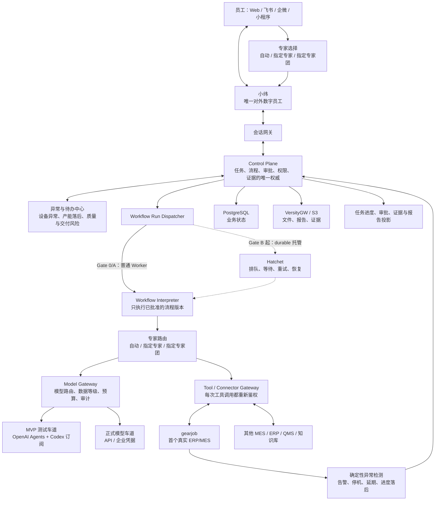
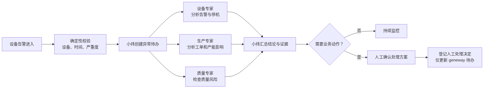

# geneway 制造业数字员工平台实施方案

版本：v19.1 快速可用顺序版

日期：2026-07-23

文档角色：**非执行路线图**。本文件说明长期产品与阶段关系，不授予任何 Gate 的实施权限，也不能覆盖当前合同。

详细技术约束见[技术实施附录](2026-07-18-geneway-v19-technical-appendix.md)，当前快速可用切片见 [Gate A0 Fast Chat 最终实施合同](atlas-workflow/20260723-002-geneway-fast-chat/implementation-contract.final.md)，延期的异常投影范围见 [Gate 0.2B 最终实施合同](atlas-workflow/20260722-009-geneway-gate-0-2b-task-exception-projection/implementation-contract.final.md)，界面细节见[界面设计 ADR](atlas-workflow/20260720-010-geneway-gate-0-1/ui-design.md)，v19 后确认的长期决定见[架构决策索引](../adr/README.md)。后续 Gate 必须由用户另行授权并建立新的 authority slice；accepted ADR 不等于已实现或已开放。

## 1. 一句话目标

`geneway` 是一个面向制造业企业的数字员工平台。员工通过 Web、飞书、企业微信或小程序与唯一的通用数字员工“**小纬**”交流；小纬在后台按需调用生产、设备、质量、供应链和方案等多 Agent 专家团，所有数据访问、审批、证据和结果都可追踪。

客户始终只与小纬对话，但可以让小纬自动安排，也可以明确指定“生产专家”“设备专家”或“生产 + 质量专家团”。专家 Agent 不以独立聊天成员出现，只向小纬返回结构化结论和证据。用户点名专家只改变执行路由，不会扩大用户的数据或工具权限。先做好内部小纬和专家团，再考虑 AgentTeams 专家房间、A2A 和外部 Agent。

## 2. 项目名称与代码仓库

项目名、仓库名、包名和新目录全部使用小写：

```text
项目名：geneway
GitHub：taotaosihao/geneway
本地目录：/home/gewu/work/geneway
代码前缀：geneway
环境变量前缀：GENEWAY_
```

Gate R 已于 2026-07-19 关闭。旧 Paperclip 项目已归档为 `/home/gewu/work/geneway-paperclip-archive-20260719` 和 `taotaosihao/geneway-paperclip-archive-20260719`；当前唯一产品基地是 `/home/gewu/work/geneway` 与 `taotaosihao/geneway`。详情见 [`../migrations/gate-r-verification.md`](../migrations/gate-r-verification.md)。

## 3. 产品先做什么

为了先形成可用产品，MVP 顺序调整为先交付一个不创建业务任务的基础交互闭环：

1. `xiaowei.chat.v1`：用户无需上传材料即可与小纬进行真实模型、多轮、流式、可取消的基础聊天。首版不调用工具，不访问企业知识或联网搜索，只面向可信本机内部使用。

随后交付两个受治理业务闭环：

2. `solution.analysis.v1`：读取客户需求、会议纪要和现有方案，输出需求清单、差距、实施建议、风险和引用证据。
3. `production.work-order-status.v1`：用户输入或选择一个 GearJob 生产工单，小纬返回工单状态、计划数量、已产数量、进度、数据更新时间和原始证据。这是首个真实 ERP/MES 任务，不先做复杂异常诊断或日报。

MVP 通过 `~/work/gearjob` 现有 Frappe 权限和只读 API 查询一个 Work Order，不直连数据库。设备异常、产能进度落后和生产日报仍保留在产品界面与路线图中，但放到 MVP 之后：

4. `operations.exception-assist.v1`：主动发现设备告警、停机、工单或产能进度落后，形成异常待办；小纬调用设备、生产、质量等专家分析影响、原因和处理建议。
5. `production.daily-report.v1`：只读查询 ERP/MES/QMS 数据，生成生产日报，并明确标记数据缺失和无法判断的内容。

第一版不做生产写入，不修改排产，不控制设备，不自动创建正式工单。

## 4. 总体架构



### 各层说人话

| 模块 | 负责什么 | 不负责什么 |
| --- | --- | --- |
| 会话网关 | 把不同渠道的消息变成同一种请求 | 不保存正式任务状态 |
| 小纬 | 统一理解问题、接受用户指定专家、组织专家并解释结果 | 不以多个 Agent 身份轰炸用户 |
| Control Plane | 保存任务、流程版本、审批、权限、证据 | 不直接调用模型或 MES |
| 异常与待办中心 | 汇总设备、产能、质量和交付异常，推动处理闭环 | 不依靠 LLM 猜测是否真的发生异常 |
| Harness | 为任务选择 Agent、工具、记忆、验证方法和预算 | 不绕过权限，不自行提权 |
| Workflow Interpreter | 读取已批准的流程数据并逐步执行 | 不运行 LLM 生成的代码 |
| Agent Runtime | 完成模型推理、工具选择和 Agent 协作 | 不成为业务状态和审批权威 |
| Model Gateway | 统一模型路由、脱敏、预算、限流和出网审计 | 不决定制造业业务权限 |
| Tool / Connector Gateway | 安全访问 MES、ERP、QMS 和知识库 | 不把系统凭证交给 Agent |
| Evidence | 记录“结论来自哪里、如何计算、用的哪个版本” | 不允许无证据的关键结论直接发布 |

确定性规则发现紧急异常后，小纬可主动提醒相关员工；同一异常只生成一个待办和一次首发提醒，后续进展更新原待办，避免消息轰炸。

文中的几个固定名词：

| 名词 | 简单解释 |
| --- | --- |
| Capability | 对用户承诺的一项业务能力，例如“生成生产日报” |
| Agent Runtime | 让模型执行任务的 SDK 和运行环境 |
| Harness | 一次任务使用哪些 Agent、工具、记忆、检查和预算的组合 |
| Workflow | 任务要按什么步骤和条件执行 |
| Evidence | 支撑结论的数据、文档片段或查询结果 |
| Artifact | 报告、附件、数据快照等可下载文件 |
| Connector | 访问 MES、ERP、QMS 等系统的受控适配器 |

知识能力采用“外部权威源 + geneway 受控快照、索引、查询快照与 Evidence”的长期架构；内部 `Business Capability Matrix` 只投影精确版本的 Capability、Expert/Agent、Harness、Tool/Connector、Workflow、Knowledge、Model/Policy 和 Eval，不成为第二份执行或权限权威。完整不变量见 [ADR-020](../adr/adr-020-hybrid-knowledge-and-business-capability-matrix.md)。该决定不把知识库或矩阵加入当前 Gate 0.1，也不授予后续 Gate 实施范围。

### 动态 Harness 和动态 Workflow

- 动态 Harness：根据任务选择不同的 Agent、工具、模型、记忆、检查方式和成本上限。
- Planner、专业 Agent、Verifier 等角色长期保留，不因单一模型能力提升而合并；不同角色可以绑定不同模型，利用各模型不同的擅长方向。
- 不同模型优先与其厂商原生 Agent Runtime/Harness 成套绑定，以保留该模型在 Agent 执行上的原生效果；平台不要求把所有模型压平到同一个通用 Runtime/Harness 实现。
- 客户只允许使用私有模型时，各角色绑定客户允许的私有模型及其对应 Agent Runtime/Harness，不要求公有模型作为兜底。
- 专家路由：默认由小纬选择；用户也可指定一个专家或一个已登记专家团。系统只在当前 Capability、权限和可用性范围内满足该选择。
- 动态 Workflow：Agent 可以生成结构化流程草稿，但必须通过校验并由人确认后才能执行。
- 批准后形成不可修改的 `WorkflowVersion`。运行中如需增加步骤或改变参数，必须生成新版本并重新审批。
- Agent 只能生成受限 DSL 数据，不能生成并部署 TypeScript、Python 或 Hatchet 代码。

固定流程可以用 TypeScript 对象模板或轻量 Builder 编写，但 TypeScript 只是开发者编写层，不是审批和执行权威。统一链路是：

```text
TS 对象模板 / Agent 结构化输出 / 管理端表单
→ 同一种 WorkflowDraft JSON
→ Zod 4 结构校验
→ Workflow Compiler 语义校验和版本解析
→ canonical WorkflowVersion JSON + SHA-256 hash
→ 审批 / React Flow / Interpreter / Diff
```

MVP 不使用 tagged template string，不同时维护 TypeBox/Ajv 与 Zod 两套 schema，也不使用全图高级泛型或大量 branded ID。TypeScript 只检查节点 discriminated union、必填字段、已登记 handler 的局部输入输出和 Interpreter exhaustive switch；跨节点依赖、拓扑、权限、预算和版本解析全部由 Compiler 在运行前完成。

Workflow 在界面中必须显示为节点图，不只显示一段文字。以设备异常为例：



确认页面展示节点、连线、分支、参与专家、数据范围、风险、预算和审批点；运行后同一张图直接显示每个节点的状态、耗时、输出和证据。

## 5. 会使用哪些开源项目

### 正式采用

| 项目 | 首次引入 Gate | 用途 | 采用方式 |
| --- | --- | --- | --- |
| PostgreSQL + Drizzle | Gate 0.1 | 业务状态、版本、审批、事件索引 | Control Plane 的唯一业务数据库 |
| React + Vite + Fastify + Zod 4 | Gate 0.1 | Web、API、合同校验 | 自研主工程基础栈 |
| [assistant-ui](https://www.assistant-ui.com/docs) | Gate 0.1 | 小纬 Thread、Composer、流式消息、工具状态和 HITL | 不使用 Assistant Cloud；Gate 0.1 不开放附件上传 |
| [Base UI](https://base-ui.com/react/overview/about) | Gate 0.1 | 无样式、可访问的基础组件 | 通过 `@base-ui/react` 与 Tailwind CSS 4 建立自有组件和 token |
| [React Flow](https://reactflow.dev/) | Gate 0.1 | 固定 Workflow 节点图与运行状态 | 使用 MIT 核心；Gate C 才增加动态 Diff 编辑能力 |
| [Casbin](https://casbin.org/) | Gate 0.1 | tenant、角色和资源范围授权 | 封装在自有 Authorization Service 后面 |
| [AG-UI](https://docs.ag-ui.com/) | Gate 0.1 | Web 前端事件投影 | 采用兼容事件模型，不保存业务权威 |
| [TanStack Table](https://tanstack.com/table/latest/docs/installation) | Gate 0.2 | 异常、任务、Evidence 和工单表格逻辑 | 稳定版 headless table；服务端受控查询 |
| [VersityGW](https://github.com/versity/versitygw) | Gate 0.2 | S3 兼容 Artifact 存储 | 复用 Hive/Sharp Cell POSIX backend，不使用 MinIO |
| [OpenAI Agents SDK for TypeScript](https://openai.github.io/openai-agents-js/) | Gate A0 | 首个真实基础聊天 Runtime；Gate A 复用到业务任务 | npm 依赖，封装在 Runtime Adapter 后面 |
| [`@openai/agents-extensions`](https://openai.github.io/openai-agents-js/extensions/ai-sdk/) | Gate A0 | AI SDK model bridge | 复用经审查的固定版本测试车道 |
| [Hatchet](https://github.com/hatchet-dev/hatchet) | Gate B | 长任务排队、等待、重试和恢复 | 独立服务，不 fork；只托管同一 Interpreter |
| [OpenTelemetry](https://opentelemetry.io/) | Gate G 前逐步引入 | 日志、指标和调用链 | Gate 0.1 先保留内部观测接口，正式 exporter 后置 |

MVP 的真实模型测试复用旧分支的共享 Codex 订阅车道，但仍必须满足唯一 Model Gateway 出口：`@openai/agents` Runtime → model facade/RPC → 本机 Model Gateway provider plugin → 官方 `aisdk()` bridge → 已固定版本的第三方 `@openai-oauth/ai-sdk` / `@openai-oauth/local` → 一个具名开发者的 Codex 订阅。auth-file 只挂载在该本机 Gateway plugin，Runtime 和 Worker 不读取它。若旧 bridge 无法放到这一边界后，关闭 live dev lane，不设置旁路。它不是生产车道，且必须满足以下限制：

- 只在受信任的本机或隔离测试主机运行，单账号、单刷新责任人、默认串行执行；
- 凭据文件在仓库之外，目录 `0700`、文件 `0600`；平台只保存不透明路径，不读取、复制或记录 token；
- 订阅用量记录为 `subscription_included/unpriced`，配额不足时暂停，不轮换账号、不伪装成零成本；
- 先原样复现旧分支的固定依赖和 conformance；刷新、崩溃恢复或依赖审查失败就关闭真实车道，只运行 fake tests；
- 不调用 Codex CLI/app-server/ACP，不在 `geneway` 中自研 OAuth、PKCE、token refresh 或协议转换；
- 正式环境和客户 VPC 使用 Model Gateway 管理的 API/企业凭据，不能挂载个人订阅凭据。

### 后续按计划接入

| 项目或 SDK | 计划阶段 | 用途与边界 |
| --- | --- | --- |
| Claude Agent SDK | 阶段 5 | 第二 Runtime；同样走 Runtime、Model 和 Tool Gateway |
| Keycloak | 阶段 6 | 客户 VPC 的 OIDC/SSO；等首个客户身份体系明确后接入 |

### 只在有真实需求后考虑

| 项目 | 可能用途 | 为什么不现在引入 |
| --- | --- | --- |
| AgentTeams | 内部专家群聊和联合处置 | 不是客户 UI，也不是任务权威 |
| DeerFlow | 研究、报告、长任务 Worker 或 Harness 设计参考 | 不替换平台 Control Plane 和主 Runtime |
| AgentScope | Python Agent 托管和沙箱 | 当前 TypeScript Runtime 已够完成首批闭环 |
| A2A | 对接外部 Agent、对外开放已毕业能力 | 内部能力和权限合同未稳定前不开放 |
| LangBot | 快速扩展更多 IM 渠道 | 飞书首通优先使用官方 SDK，避免过早增加中间层 |

核心原则是：只深度开发 `geneway` 自己的制造业内核；开源项目通过 API、协议或 SDK 接入，不把多个项目源码拼成一个巨型 fork。

### 旧分支复用顺序

先迁移已验证的底层合同，再写新代码；禁止整分支 cherry-pick：

| 旧分支资产 | 处理方式 |
| --- | --- |
| `packages/adapters/openai-agents` 的 SDK worker、结构化输出、取消、预算、provider conformance 和订阅测试车道 | 优先提取；改成 `geneway` 合同并删除 Paperclip Issue/Builder 语义 |
| Tool policy、Evidence bridge、fault/contract tests | 复用算法和测试向量；工具名改成制造业 Capability/Connector 合同 |
| `plugin-channel-gateway` 的飞书/企微签名、去重、重试和 redaction | 阶段 5 再提取，不提前重写 |
| outbox/inbox、SSE cursor、idempotency 测试 | 直接作为 Control Plane 基础合同测试来源 |
| Paperclip Issue/Pipeline/Company、Builder 角色和旧 UI | 不迁移；它们不是新产品权威 |

每个迁移项必须记录旧 commit/path、目标 path、保留行为、删除的领域耦合和新合同测试。能通过适配复用的，不重新发明。

### 本地真实业务参考

| 项目 | 用途 | 边界 |
| --- | --- | --- |
| `/home/gewu/work/gearjob` | 首个真实 ERP/MES 业务模型、只读 Connector 和异常场景联调来源 | 通过受控 API 接入，不复制 GearJob 数据库或 UI，不绕过其用户/DocType 权限 |
| `/home/gewu/work/hive` | VersityGW 对象存储实现和设备数据来源参考 | UI 尚未正式对外定稿，只作弱参考 |
| `/home/gewu/work/sharp-cell` | TypeScript S3 适配和制造现场交互参考 | UI 尚未正式对外定稿，只作弱参考 |

## 6. 分阶段实施

### Gate R：安全归档并新建小写项目（已关闭）

已完成旧仓库 bundle、bare mirror、分支、worktree、未跟踪文件和 GitHub 元数据归档，并完成实际恢复验证。当前产品基地为：

```text
taotaosihao/geneway
/home/gewu/work/geneway
```

Gate R 不再执行；验收和用户确认见 [`../migrations/gate-r-verification.md`](../migrations/gate-r-verification.md)。

### Gate 0.1/0.2：先做安全纵切，再补完整产品骨架

Gate 0.1 只使用预置、已批准的只读脱敏输入引用和服务端 fake Runtime，完成真实 Control Plane/Postgres 驱动的 served UI。用户可选择 auto、单专家或专家团，确认固定 Workflow 图，查看模拟进度、结果和最小内联来源；页面、事件和 Evidence 都必须显著标记模拟。Gate 0.1 不提供任意上传、Artifact 下载、报告文件、异常中心、TanStack Table、VersityGW 或真实模型。

Gate 0.2 再加入受鉴权上传、Artifact/VersityGW、报告下载、完整 Claim–Evidence–Lineage、inbox/恢复、异常 fixture、TanStack Table、四个完整路由、JSON Schema parity/property tests 与 UI 状态矩阵。

当前已关闭基线为 Gate 0.2B.1；Gate 0.2B.2–0.2B.3 延期且保持未关闭。当前唯一执行范围由 Gate A0 authority 与最终合同定义，本路线图本身不授权产品代码。

### Gate A0：先完成无材料真实基础聊天

在不创建 BusinessTask、WorkflowRun、Evidence 或 Artifact 的前提下，新增 `xiaowei.chat.v1`，把默认 Composer 与材料分析入口分离。普通聊天通过最小 Model Gateway 和真实 Runtime 完成多轮、流式与取消；首版 `tool_choice=none`，不访问企业知识、联网、GearJob 或任何 Connector。

Gate A0 只面向可信本机内部测试，复用 `pnpm dev-up` 和现有 192/10 网段 Web 入口。`codex_subscription_dev` 的 auth-file 只挂载到本机 Model Gateway provider plugin；Web、Control Plane、Runtime 和 Worker 不读取凭据，不允许 FakeRuntime 冒充真实聊天。

### Gate A：用共享 Codex 订阅完成真实业务 MVP

复用 Gate A0 已通过的 Model Gateway、`codex_subscription_dev` 与 OpenAI Agents Runtime，实现文档分析、方案生成、用户指定专家、人工复核、证据引用、预算、取消和失败恢复。

结果中的事实、推断、建议和不确定项必须分开显示。

同时接 GearJob 的一个只读查询：用户输入或选择一个生产工单，小纬调用生产专家或确定性查询器，返回 `production.work-order-status.v1` 卡片。`solution.analysis.v1` 和单工单六节点流程均用 TS 对象模板生成 `WorkflowDraft`，经同一 Compiler 固化为 `WorkflowVersion`，再由普通 Worker 中的 Interpreter 执行；此阶段不等待 Hatchet，也不开放 Agent 动态生成 Workflow。

### 阶段 3：先完成可靠长任务，再开放动态 Workflow

Gate B 先把 Gate A 已经使用的同一个 Workflow Interpreter 托管到 Hatchet，验证排队、等待、重试、恢复、lease/fencing 和多 Agent 子任务；不改变 WorkflowVersion、事件、审批或 UI 合同。

Gate C 再允许 Agent 生成结构化 `HarnessDraft` / `HarnessPatch` 和 `WorkflowDraft` / `WorkflowPatch` JSON。Harness 只能从 Registry 选择 Agent/ExpertTarget、Tool、Model、Memory/Context、Verifier 与 Budget policy；Workflow 可开放条件、并行和等待。Compiler 校验版本、工具、引用、拓扑、权限、数据等级、动作等级、预算和截止时间；人确认 canonical 版本与图形 Diff 后重新审批。Agent 永远不能生成或执行 TypeScript，也不能借 Harness 选择扩大权限。

验证 worker 重启、断线重连、重复消息、审批回放和超时恢复都不会重复产生业务结果。

### 阶段 4：扩展制造业异常与日报

在简单工单查询通过后，再扩展 Connector Gateway、Context Graph 和 GearJob 只读 Connector，实现 `operations.exception-assist.v1` 与 `production.daily-report.v1`。这一阶段只依赖 Gate A，可与 Gate B/C 并行；固定制造业流程不能被动态 Workflow 阻塞。

设备告警、停机、工单进度、计划延期和关键指标由确定性规则或代码识别和计算；小纬调用专家团解释影响、分析原因并提出建议。数据不足时必须明确说“不足以判断”。

### 阶段 5：多渠道和第二 Runtime

先接飞书，再复用统一 Channel Contract 接企业微信和小程序；接入 Claude 模型及其原生 Agent Runtime/Harness，证明不同角色可以绑定不同的模型原生执行组合，而不改变 Capability、权限和证据合同。客户只允许使用私有模型时，同一绑定机制只解析到客户允许的私有模型及其对应 Agent Runtime/Harness。

### 阶段 6：内部试点和能力毕业

选择真实内部用户运行试点，完成回归集、安全攻击、提示注入、备份恢复、成本、SLA、操作手册和审计验收。Capability 按以下状态逐步升级：

```text
draft → shadow → internal → graduated
```

只有达到 `graduated` 的能力才可以稳定推广；内部平台完成还必须通过至少一个受控动态 Harness + Workflow 场景，不能永久停留在固定模板。

### 阶段 7：可选扩展

内部平台稳定后，按真实需求增加：

- AgentTeams 平台内部专家房间（仅运维/实施协作，不进入客户界面）；
- DeerFlow/AgentScope 等可插拔 Worker；
- A2A 外部 Agent 接入与对外能力开放；
- 受严格审批保护的 D1 业务草稿动作。

生产写入、排产修改和设备控制仍需单独项目立项与安全认证。

## 7. 验收门禁

每项能力必须通过自己的门禁才能启用；Gate D 可在 Gate A 后与 Gate B/C 并行，不把动态 Workflow 变成制造业价值的前置。门禁不是“写完代码”，而是“证明结果安全、可恢复、可使用”。

| 门禁 | 必须证明 | 不通过怎么办 |
| --- | --- | --- |
| R：仓库门 | 旧仓库可恢复；新仓库全小写、无 Paperclip 运行依赖；未丢分支和未跟踪文件 | 停止改名和新建，不覆盖旧目录 |
| 0：产品骨架门 | Gate 0.1 先完成 tenant isolation、服务端身份、最小 Authorization/delegated capability、Zod/Compiler/hash、固定 HarnessVersion/ApprovalVersion、BusinessTaskEvent、最小 Evidence publish guard 和真实 API + served UI，并由同一 `verify:gate0.1` run 同时关闭产品/安全门；Gate 0.2 再完成迁移清单、Schema parity/property tests、完整 Lineage/outbox、VersityGW、React Flow 四路由和异常 fixture | 不接真实模型 |
| A0：基础聊天门 | 默认小纬会话无需材料即可通过唯一 Model Gateway 完成真实模型流式首问、追问和取消；普通聊天不创建 BusinessTask，跨 Conversation/tenant 隔离、凭据隔离、错误映射和材料分析回归通过 | 保持 `xiaowei.chat.v1` 为 `NOT_OPEN`，继续使用已关闭模拟基线，不用 FakeRuntime 冒充真实聊天 |
| A：MVP 真实 Agent 门 | 共享 Codex 订阅车道在可信本机通过依赖、刷新、配额、崩溃和脱敏测试；两个固定 TS 对象模板均生成标准 WorkflowDraft，并由普通 Worker Interpreter 执行；文档分析有证据；用户指定专家有效；GearJob 单工单进度只读查询通过 | 关闭订阅车道，保留 fake Runtime 和固定模板，不接 Hatchet 或动态 Workflow |
| B：长任务门 | 同一个 Interpreter 托管到 Hatchet 后，lease/fencing、双 Worker、服务重启、重复事件和断线续传均不重复完成；WorkflowVersion、事件和 UI 合同不变 | 保留 Gate A 短任务；不启用需要 durable wait/recovery 的流程 |
| C：动态 Harness、流程与审批门 | Agent 只能生成 HarnessDraft/Patch 与 WorkflowDraft/Patch JSON；Agent/Tool/Model/Memory/Verifier/Budget 选择、条件、并行、等待、引用和版本解析由 Compiler 校验；未批准版本绝不执行；变化显示 Diff 并使旧审批失效；Agent 不能生成 TS 或新增权限 | 不开放动态 Harness/流程，只保留已注册固定版本；不得宣称内部平台完成 |
| D：制造业扩展门 | 在单工单查询已经通过的基础上，设备异常和产能落后可进入待办；日报、租户隔离、数据字典、确定性指标、缺失提示和审计全部通过 | 保留简单工单查询，不进入高级场景试点 |
| E：渠道门 | Web 与飞书共享同一任务；消息去重；群聊受众过滤有效 | 不接企微和小程序 |
| F：多模型原生 Runtime/Harness 门 | Planner、专业 Agent、Verifier 等角色可分别绑定不同模型及其原生 Agent Runtime/Harness；客户仅允许私有模型时只使用获准的私有组合；Capability、权限和证据合同不变 | 保持已经通过验证的模型原生执行组合，不强行增加未通过验证的组合 |
| G：毕业门 | 回归、安全、提示注入、成本、SLA、Postgres + S3 联合恢复全部通过 | 保持 shadow/internal，不对外开放 |

平台级硬门禁：

- 同一个请求重复发送，只能创建一个业务任务。
- 每次工具调用都重新检查员工、Agent、流程、数据和动作范围。
- 模型不能直接连接 MES/ERP，也不能拿到真实系统凭证。
- 群聊结果按所有可见成员的安全范围过滤，不能取权限并集。
- 审批必须绑定准确参数、版本、范围和有效期。
- 关键结论没有 Evidence 和 Lineage 时不能作为已验证结果发布。
- Postgres 恢复后如果对应 S3 文件丢失或 hash 不一致，恢复验收失败。

## 8. 界面参考与设计

已有信息架构、线框和交互设计。`ADR-UI-001` 锁定 UI 实现底座：**Codex 式任务工作台结构 + assistant-ui + Base UI + TanStack Table + React Flow**。客户界面由 `geneway` 定义独立 design token 和页面语法，不使用 AgentTeams/Element，也不把 Hive/Sharp Cell 当前 UI 当成正式对外基线。

### UI 底座选型

| 层 | 采用 | 用途 |
| --- | --- | --- |
| 工程与样式 | React + Vite + Tailwind CSS 4 | 应用壳、路由、CSS variables、响应式和视觉 token |
| 基础组件 | `@base-ui/react` | Dialog、Drawer、Menu、Popover、Combobox、Tabs、Tooltip 等无样式可访问组件 |
| 小纬对话 | `@assistant-ui/react` + `@assistant-ui/react-ag-ui` | Thread、Composer、附件、流式消息、工具状态、HITL 和 AG-UI 事件解析 |
| 业务表格 | 稳定版 `@tanstack/react-table` | 排序、筛选、分页、选择、展开和服务端受控状态；渲染使用 Base UI 与自有组件 |
| Workflow | `@xyflow/react` | 节点图、运行态、审批和版本 Diff；节点外观使用 geneway token |
| Agent 事件 | AG-UI compatible contract | 通过 assistant-ui AG-UI adapter 将消息、任务、工具、中断和状态投影到 UI，不改变 Control Plane 权威 |

不采用：

- 不使用 Ant Design、Ant Design X、ProComponents、MUI 或其他完整视觉体系；表格也不例外。
- 不使用 Assistant Cloud；Conversation、BusinessTask、Approval 和 Workflow 仍以 Control Plane 为唯一权威。
- 不显示原始 reasoning/思维链；assistant-ui 的 `showThinking` 必须关闭，只展示正式步骤、工具摘要、Evidence 和结论。
- 不把 Codex 的代码、终端和 Diff 语义照搬给工厂用户；只复用其左侧工作入口、中间执行时间线、右侧检查器和底部 Composer 结构。

### 客户看到什么

- 默认只看到一个“小纬”通用数字员工，界面像简洁的 ChatGPT/Claude 对话。
- 默认基础聊天只显示普通文本输入与发送/停止；进入受治理业务能力后，输入框旁再提供“自动安排 / 指定专家 / 指定专家团”。小纬仍是唯一发言人，所选专家只显示在任务卡、流程节点和结论来源中。
- 小纬可以调用设备、生产、质量、供应链和方案专家团；专家只显示为任务进度和结构化结论，不各自占用聊天消息流。
- 复杂任务显示可视 Workflow、等待原因、审批卡片和报告，不展示模型内部思维。
- 右侧抽屉展示任务、证据、数据范围、费用和下载文件。

桌面工作区采用 Codex 式布局：左侧是小纬、异常与待办、任务、Workflow 和历史会话；中间承载当前对话或业务页面；右侧按选中对象展示任务、节点、Evidence、权限和 Artifact。底部 Composer 默认提供基础文本聊天与发送/停止，只有显式进入材料分析或其他业务 Capability 时才显示附件、专家/专家团和范围控件。右侧未选中对象时隐藏，窄屏改为 Drawer，不把三栏强行压缩。

### 主要页面

1. 小纬对话页：会话列表、消息区、专家/专家团选择、任务/证据抽屉。
2. 异常与待办中心：设备异常、停机、产能进度落后、质量和交付风险；支持筛选、认领、让小纬分析、查看影响和持续监控。
3. Workflow 图：节点、连线、分支、审批点、专家、工具、运行状态和版本 Diff，不以纯文本代替。
4. 工单进度卡：工单号、状态、计划数量、已产数量、进度条、更新时间和“查看证据”。
5. 任务详情页：步骤时间线、审批、Claim–Evidence、Artifact 和错误恢复。
6. 内部管理页：Capability、Agent、专家团、Connector、模型路由、权限和 Eval；不暴露给普通客户员工。

### 设计参考

- ChatGPT/Claude：简洁对话、附件和流式回答；只参考交互，不复制品牌。
- Codex：参考内容优先、内联执行事件、左中右工作区、右侧检查器和底部 Composer，不复制代码开发术语或私有视觉。
- assistant-ui / Base UI：正式对话行为和基础组件；所有样式、业务卡片和 design token 归 `geneway`。
- TanStack Table：正式轻量表格逻辑，不提供第二套视觉或业务状态。
- AG-UI：任务事件、共享状态、人工介入和可恢复交互的协议参考；CopilotKit 不进入 MVP 依赖。
- OpenHands/DeerFlow：只参考内部任务轨迹、工具结果和 Artifact 查看方式。
- GearJob：参考制造业 ERP 的对象、表格密度和工作上下文，不复制 Frappe 页面。
- Hive/Sharp Cell：UI 尚未正式对外定稿，只参考个别设备和现场交互，不作为 `geneway` 视觉标准。

详细线框和页面状态见[界面设计 ADR](atlas-workflow/20260720-010-geneway-gate-0-1/ui-design.md)。

## 9. 推荐仓库结构

```text
geneway/
├── apps/
│   ├── api/                  # Control Plane API
│   ├── web/                  # WebChat 与管理界面
│   ├── workflow-worker/      # 固定 Workflow Interpreter
│   └── channel-gateway/      # 飞书、企微、小程序
├── services/
│   ├── model-gateway/        # 模型路由与审计
│   └── connector-gateway/    # MES、ERP、QMS 等连接器
├── packages/
│   ├── contracts/            # API、事件和 DSL
│   ├── db/                   # Drizzle schema/migrations
│   ├── capabilities/         # 版本化制造业能力
│   ├── exception-rules/      # 设备、产能、质量和交付异常规则
│   ├── workflow-visuals/     # DSL 到 React Flow 节点图和版本 Diff
│   ├── design-system/        # Base UI wrappers、Tailwind token 和业务组件 recipe
│   ├── agent-ui/             # assistant-ui、AG-UI adapter 和小纬交互组件
│   ├── enterprise-table/     # TanStack Table + Base UI 的统一轻量表格
│   ├── gearjob-connector/    # 首个真实只读 ERP/MES Connector
│   ├── runtime-adapters/     # OpenAI、Claude 等适配器
│   ├── authorization/        # 授权、delegated capability
│   ├── evidence/             # Claim–Evidence–Lineage
│   ├── object-storage/       # S3/VersityGW 统一接口
│   └── observability/        # OpenTelemetry
├── deploy/
│   ├── compose/
│   └── kubernetes/
└── docs/
```

## 10. 最终取舍

这次重建不是把 DeerFlow、AgentTeams、Paperclip、Hatchet 和多个 Agent SDK 拼在一起，而是：

```text
geneway 自研并掌握：
制造业 Capability、任务、Workflow 合同、权限、审批、证据、Connector 和客户体验

开源项目承担：
长任务执行、对象存储、Agent SDK、前端事件、授权基础和可观测性

后置能力：
专家群聊、外部 Agent、更多 Runtime 和生产写动作
```

实施顺序调整为：保留 Gate 0.2B.1 已关闭基线，先用 Gate A0 打通无材料真实基础聊天，再恢复 Gate 0.2B.2–0.2B.3；Gate A 复用同一 Model Gateway 完成真实材料分析和 GearJob 单工单查询，随后再做长任务、动态 Workflow、异常和日报；先完成能力毕业，再连接外部 Agent。

## 11. 资料引用

- [OpenAI Agents SDK：TypeScript](https://openai.github.io/openai-agents-js/)
- [OpenAI 官方文档：Agents SDK 适用场景](https://developers.openai.com/api/docs/libraries#use-the-agents-sdk)
- [OpenAI Codex 认证：ChatGPT 订阅与 API key 边界](https://learn.chatgpt.com/docs/auth)
- [OpenAI Codex 自动化认证：账号凭据只用于可信执行环境](https://learn.chatgpt.com/docs/auth/ci-cd-auth)
- [Hatchet GitHub](https://github.com/hatchet-dev/hatchet)
- [VersityGW GitHub](https://github.com/versity/versitygw)
- [AG-UI 官方文档](https://docs.ag-ui.com/)
- [assistant-ui 官方文档](https://www.assistant-ui.com/docs)
- [assistant-ui AG-UI Runtime](https://www.assistant-ui.com/docs/runtimes/ag-ui/overview)
- [Base UI 官方介绍](https://base-ui.com/react/overview/about)
- [TanStack Table 官方文档](https://tanstack.com/table/latest/docs/installation)
- [React Flow 官方文档](https://reactflow.dev/)
- [Casbin 官方文档](https://casbin.org/)
- [OpenTelemetry 官方网站](https://opentelemetry.io/)

本地实现与业务参考：

- Hive：`/home/gewu/work/hive/docker-compose.yml`、`/home/gewu/work/hive/backend/app/services/object_storage.py`
- Sharp Cell：`/home/gewu/work/sharp-cell/docker-compose.yml`、`/home/gewu/work/sharp-cell/apps/fms-api/src/modules/object-storage/s3-object-storage.service.ts`
- GearJob：`/home/gewu/work/gearjob/PRODUCT.md`、`/home/gewu/work/gearjob/gearjob/mes/bigscreen_api.py`、`/home/gewu/work/gearjob/gearjob/mes/schedule_api.py`
