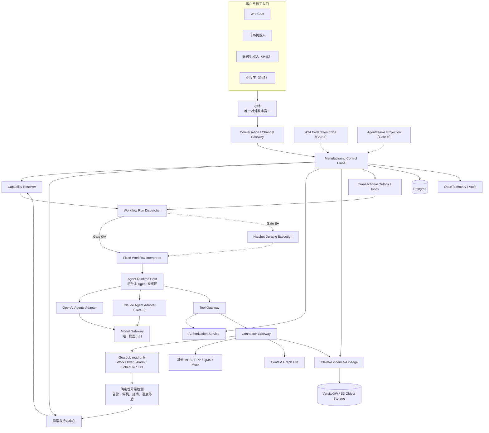
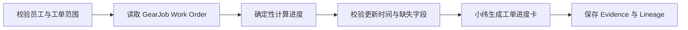
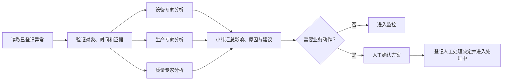
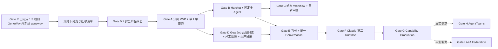

# geneway 制造业数字员工平台 v19 技术实施附录

状态：`supporting-implementation-reference`

日期：2026-07-18

文档角色：支持性技术参考。本文件保留数据模型、接口、故障恢复、安全和迁移细节，但不授予实施范围；任何内容与当前合同冲突时，以 [`atlas-workflow/20260720-010-geneway-gate-0-1/implementation-contract.final.md`](atlas-workflow/20260720-010-geneway-gate-0-1/implementation-contract.final.md) 为准。长期阶段见[非执行路线图](2026-07-18-geneway-v19-reimplementation.md)。

当前 Atlas authority：`20260720-010-geneway-gate-0-1`；旧任务 `20260715-044-paperclip-agent-mvp` 仅作历史来源。

产品设计来源：[`doc/reference/制造业数字员工平台_内部能力内核细节终审与兼容实施方案_v19.md`](../reference/制造业数字员工平台_内部能力内核细节终审与兼容实施方案_v19.md)

v19 后已接受的长期决定见 [`doc/adr/`](../adr/README.md)。其中 ADR-017～019 是后续 Gate 的 durable decision 输入；Gate 0.1 仅实现 ADR-019 所述固定线性基线，其余未来能力均不因接受 ADR 而获得实施授权。

本计划取代此前“基于 Paperclip 的多 Agent 长任务 MVP”作为后续实施路线。旧分支不删除、不重写，保留为历史 Spike 和选择性迁移来源。

---

## 1. 执行结论

不再继续改造 `codex/longtask-agent-mvp-implementation`，也不在 Paperclip 内部增加第二套制造业 Control Plane。

新的实施基地使用正式产品身份 `geneway`，并采用与当前大写 `GeneWay` Paperclip fork 完全隔离的 greenfield Git 历史。新产品、仓库和本地目录全部使用小写：

```text
产品显示名：geneway
代码/包 slug：geneway
GitHub 仓库：taotaosihao/geneway
本地目录：/home/gewu/work/geneway
```

Gate R 已于 2026-07-19 关闭。旧仓库已做可验证归档，新小写 `geneway` 已成为唯一产品基地；归档过程和恢复证据见 [`../migrations/gate-r-verification.md`](../migrations/gate-r-verification.md)。旧仓库不再是运行依赖，只保留历史 Spike、分支、Issue/PR 和迁移证据。

正式架构：

```text
Capability-first Manufacturing Control Plane
  + Restricted Workflow DSL
  + Fixed Workflow Interpreter（Gate 0/A 普通 Worker，Gate B 起 Hatchet 托管）
  + Versioned Approval
  + Runtime-neutral Agent Host
  + Mandatory Model Gateway
  + Tool / Connector Gateway
  + Context Graph Lite
  + Claim–Evidence–Lineage
  + Canonical Conversation / Channel Contract
```

产品前台只暴露一个通用数字员工“小纬”。设备、生产、质量、供应链和方案等专家 Agent 是小纬按任务调用的后台实现，不创建独立客户聊天身份，也不改变 Capability 合同。用户既可以让小纬自动安排，也可以指定一个专家或一个已登记专家团；该选择只约束路由，不产生任何额外权限。

旧成果的处置是：

```text
冻结旧分支
→ 建立迁移清单
→ 先实现新合同
→ 只移植不依赖 Paperclip 领域模型的机制
→ 重新通过新合同与安全测试
```

首个业务纵切是 `solution.analysis.v1`；首个真实 GearJob 任务收敛为 `production.work-order-status.v1`，只查询一个生产工单的状态和进度。设备/产能异常助理与生产日报在该简单任务通过后再实施。MVP 复用旧实现分支的 OpenAI Agents SDK + Codex 订阅测试车道，正式环境仍使用 Model Gateway 管理的 API/企业凭据。第一阶段动作上限为 A1，只允许查询、分析和建议，不允许正式业务写入或设备控制。

---

## 2. 为什么不能继续旧分支

### 2.1 权威对象已经改变

旧实现：

```text
Paperclip Company / Goal / Agent
  → Issue
  → Pipeline Case
  → Builder Planner / Implementer / Verifier / Reviewer
  → Interaction Approval
  → Work Product / Channel Projection
```

v19：

```text
Tenant / User / Conversation
  → BusinessTask
  → CapabilityVersion
  → WorkflowVersion / WorkflowRun
  → ApprovalVersion
  → AgentTask / ToolExecution
  → Claim / Evidence / Lineage / Artifact
```

这两个模型的差异涉及：

- 谁是产品合同；
- 谁保存任务和阶段的权威状态；
- 谁决定审批有效性；
- 如何按工厂/车间/产线/设备授权；
- 群聊受众能看到什么；
- 模型与 Connector 是否可以出网；
- 结论如何追溯到源记录；
- Capability 如何晋级并对外开放。

### 2.2 旧分支不是可局部修补的早期 v19

`codex/longtask-agent-mvp-implementation` 相对 master 已经：

```text
255 files changed
26,274 insertions
244 deletions
```

其 Runtime、Channel、Pipeline、角色、输出 schema 和 Evidence 全部围绕 Paperclip Builder 设计。继续原地改造需要先拆除大部分上层合同，仍难证明不存在旧权威旁路。

### 2.3 但旧分支不是废弃物

旧分支中：

- OpenAI Agents Adapter：18 个测试文件、107 个测试通过；
- Channel Gateway：9 个测试文件、41 个测试通过。

它们证明了一些底层机制已经可用：provider conformance、structured output、取消与预算、worker IPC、路径与命令限制、飞书/企微 SDK、事件去重、消息幂等和不确定投递恢复。新计划保留这些成果，但不保留其 Paperclip/Builder 上层语义。

---

## 3. 目标与非目标

### 3.1 目标

1. 建立内部制造业数字员工平台的单一业务权威内核。
2. 以版本化 Capability 而不是 Agent 身份作为产品合同。
3. 支持固定 Workflow 和经人工批准的 Agent 生成 Workflow。
4. 长任务可以暂停、恢复、重放、取消和故障恢复。
5. 所有模型、工具和制造业系统调用均受统一权限、数据等级和动作等级约束。
6. 所有关键结论均可追溯到 Evidence 和完整 Lineage。
7. 先完成文档/方案分析和 GearJob 单工单进度查询，再扩展异常待办和生产日报。
8. 同一内核支持 WebChat、飞书、企微和未来小程序投影。
9. Runtime 可替换：OpenAI first，Claude second，未来可接 AgentScope、DeerFlow、外部 A2A。
10. 只有已毕业 Capability 才能进入外部 Agent 联邦。

### 3.2 当前非目标

- 不做 Agent 市场或未知 Agent 自动注册。
- 不做任意 Workflow 代码生成和动态部署。
- 不允许运行中提高数据等级、动作等级或新增未批准工具。
- 不开放 D1/W1/W2/W3 写动作。
- 不直接控制 PLC、SCADA、设备或产线。
- 不让外部 Agent 直接访问 MES/ERP/QMS/SCADA。
- 不把 AgentTeams/Matrix 作为客户正式 UI。
- 不在第一阶段部署全部可选项目。
- 不开发完整 Agent 运维管理后台；先用 YAML + Git + API + CLI + 极简状态页。
- 不要求将旧 longtask 分支的所有功能和测试迁入新平台。
- 不把 ChatGPT/Codex 订阅 OAuth 作为生产 Model Gateway 默认方案。
- 不调用 Codex CLI/app-server/ACP；共享订阅测试沿用旧分支已验证的 SDK provider 路线。
- 不让用户点名专家成为权限提升、未登记 Agent 直连或第二个客户聊天身份。

---

## 4. 锁定的架构原则

### 4.1 Capability-first

平台稳定合同是：

```text
CapabilityDefinition
  → immutable CapabilityVersion
  → CapabilityImplementationBinding
```

实现可以是：

```text
agent
workflow
deterministic
external（后置）
```

业务代码不按 `openai-agent`、`claude-agent`、`deerflow-agent` 写分支，只按 capability id/version 和 implementation binding 解析。

### 4.2 Control Plane 单一权威

权威分配如下：

| 对象 | 唯一权威 |
| --- | --- |
| Conversation / Message | Control Plane Postgres |
| BusinessTask | Control Plane Postgres |
| Capability Definition / Version / Binding | Control Plane Postgres |
| Workflow Draft / Version / Run / Step | Control Plane Postgres |
| ApprovalVersion | Control Plane Postgres |
| Policy Decision / Delegated Capability | Control Plane Postgres |
| Agent Runtime session | Runtime 自身；Control Plane 只保存引用 |
| Hatchet run/cursor | Workflow binding；不是业务权威 |
| Connector execution | Connector Gateway；Control Plane 保存业务映射 |
| Claim / Evidence / Lineage | Evidence Store + Control Plane 索引 |
| Artifact binary | VersityGW-backed S3 Object Storage（开发/客户 VPC）或经验证的云 S3 服务 |
| Channel card/message delivery | Channel projection + outbox |

### 4.3 动态数据、静态代码

```text
TS 对象模板 / Agent 结构化输出 / 管理端表单
→ 同一种 WorkflowDraft JSON
→ Zod 4 结构校验
→ Workflow Compiler：graph / refs / registry / capability / policy / cost
→ canonical WorkflowVersion JSON + hash
→ 人工批准精确 payloadHash
→ 固定 Workflow Interpreter
→ Gate 0/A 普通 Worker；Gate B 起由 Hatchet durable 托管
```

禁止：

- 动态生成 Hatchet/TypeScript/Python 代码；
- tagged template string 或把 TS 源码保存为 Workflow payload；
- 任意 URL；
- `eval`、脚本表达式或宿主代码注入；
- 无界循环；
- 未登记 capability、handler 或 tool；
- 运行中提升 data/action ceiling。

### 4.4 网关是强制边界

```text
Agent Runtime
  → Model Gateway
  → approved model provider

Agent Runtime
  → Tool Gateway
  → Authorization + Approval + Evidence
  → Connector Gateway
  → MES / ERP / QMS / WMS / EAM / SCADA
```

Runtime 不能直接持有员工长期令牌、模型长期密钥或工业系统凭据。

### 4.5 业务效果 exactly-once，而不是幻想网络 exactly-once

跨服务投递采用 at-least-once：

```text
Control Plane transaction
  → state change + outbox event
  → worker delivery
  → consumer inbox claim
  → idempotent business effect
```

唯一约束和幂等记录保证业务效果不重复；不能仅依赖消息队列或 Channel event ID。

---

## 5. 目标架构



### 5.1 请求主链路

```text
ChannelEnvelope
→ Identity / Tenant / Audience mapping
→ Conversation + Message
→ BusinessTask for CapabilityVersion
→ ExpertTarget normalize / validate（auto、expert、team）
→ Authorization Decision
→ WorkflowVersion selection or Draft generation
→ ApprovalVersion if needed
→ Workflow Interpreter
→ AgentTask / ToolExecution
→ Claim / Evidence / Lineage
→ Artifact
→ channel-safe projection
```

对于设备异常、产能落后等主动场景，主链路从 GearJob 只读快照和确定性规则开始：先创建有证据的 `BusinessException`，再由小纬调用专家团分析。LLM 不能单独决定“异常是否发生”。

---

## 6. 技术基线

### 6.1 产品、仓库和语言

选择：TypeScript-first pnpm monorepo。

产品代码统一使用 `geneway`。这里的“新仓库”是指创建干净的 `taotaosihao/geneway` Git 历史和 `/home/gewu/work/geneway` 工作目录，不再创建任何临时命名的第二产品。新仓库不得配置 Paperclip upstream，也不得继承 Paperclip package、schema、migration 或产品文档作为运行基线。

原因：

- 已有可迁移成果为 TypeScript；
- OpenAI Agents SDK、Claude Agent SDK、飞书/企微官方 SDK和 Web 前端均可在同一类型系统下工作；
- 核心合同可生成 JSON Schema/OpenAPI，方便 Python/Java/.NET 外部实现；
- Python Runtime 通过内部 HTTP/SSE 或后续 A2A 接入，不进入 Control Plane 进程。

基线：

```text
Node.js：项目固定并锁定一个受支持版本
Package manager：pnpm
API：Fastify + OpenAPI
Schema：Zod + versioned JSON Schema artifacts
DB：Postgres + Drizzle migrations
UI：React + Vite + Tailwind CSS 4；基础组件使用 Base UI；对话使用 assistant-ui + AG-UI adapter；表格使用稳定版 TanStack Table；Workflow 图使用 `@xyflow/react` 的 MIT 开源核心
Durable execution：Hatchet TypeScript SDK
Object storage：VersityGW + S3 API；TypeScript 使用 `@aws-sdk/client-s3`
Observability：OpenTelemetry，自有 exporter/filter
Authorization MVP：Postgres resource scopes + Casbin domain RBAC
Container：Docker/Compose；客户 VPC 后增加 Helm
```

项目创建时锁定实际版本并提交 lockfile；本计划不使用浮动 `latest`。

### 6.2 UI 实现基线（ADR-UI-001）

#### 决策

`geneway` 不 fork任何完整客户 UI 项目，也不采用带固定品牌视觉的整套 UI。桌面信息结构参考 Codex 的任务工作台，但实现使用开源、可替换组件：

```text
React + Vite + Tailwind CSS 4
  ├── Base UI：无样式、可访问的 Dialog / Drawer / Menu / Popover / Combobox / Tabs
  ├── assistant-ui：Thread / Composer / Attachment / Tool / HITL
  │     └── @assistant-ui/react-ag-ui：AG-UI events → UI projection
  └── TanStack Table：异常 / 任务 / Evidence / GearJob 工单的 headless 表格逻辑

@xyflow/react
  └── 从 immutable WorkflowVersion 生成只读节点图、运行态和 Diff
```

MVP 使用 `@assistant-ui/react` 和 `@assistant-ui/react-ag-ui`，不使用 Assistant Cloud。assistant-ui 只拥有当前浏览器的交互投影；Conversation、BusinessTask、Approval、Workflow 和历史消息仍由 Control Plane Postgres 保存。页面刷新先读取服务端快照，再按 event cursor 续传，不能用前端 Thread 状态覆盖业务权威。

assistant-ui 采用 Base UI 风格的可复制 wrapper，生成源码归入 `packages/agent-ui` 并按 `genewayTheme` 维护；不把上游默认模板当成正式视觉稿。

`showThinking` 固定为 `false`。界面只展示正式计划、执行步骤、工具摘要、Evidence、不确定项和最终结论，不渲染原始 reasoning/思维链。Ant Design、Ant Design X、ProComponents、CopilotKit、MUI 和其他完整视觉体系不进入 MVP lockfile。

#### Codex 式工作台结构

Codex 只作为信息架构参考，不作为 UI 技术来源：

```text
┌───────────────┬──────────────────────────────────┬──────────────────────┐
│ 左侧工作入口   │ 中间主工作区                      │ 右侧上下文检查器      │
│ 小纬           │ 对话 / 异常 / 任务 / Workflow     │ 当前任务 / 节点       │
│ 异常与待办     │ 内联执行事件、任务卡和审批卡       │ Evidence / 权限       │
│ 我的任务       │                                  │ Artifact / 数据范围   │
│ Workflow       │ 固定 Composer：附件、专家、范围   │                      │
│ 历史会话       │                                  │                      │
└───────────────┴──────────────────────────────────┴──────────────────────┘
```

- 左侧异常入口显示未处理数量和最高严重度，设备异常和产能落后不能只藏在聊天或表格中。
- 中间区域按 `/conversations/new?capability=...`、`/conversations/:id`、`/exceptions`、`/tasks/:id`、`/workflows/:id` 切换，每个页面只有一个主任务；`/xiaowei` 仅作为导航别名，重定向到 canonical 新会话入口，Playwright 和审计统一记录 canonical route。
- 右侧只展示当前选中对象；无选中时隐藏，窄屏改为 Drawer。
- 底部 Composer 提供 `ExpertTarget`、工厂/车间范围和发送；用户可自动安排、指定专家或指定专家团。附件入口从 Gate 0.2 起开放，Gate 0.1 只选择服务端预置脱敏输入。
- Codex 的 File Diff、Terminal、Repository 分别映射为 Workflow/报告版本 Diff、Connector 调用摘要和制造业工作上下文，不向普通员工展示开发工具术语。

#### geneway design token 起始值

`packages/design-system` 通过 CSS variables 与 Tailwind theme 导出单一 `genewayTheme`，Base UI wrappers、assistant-ui、TanStack Table DOM 和 React Flow 节点共同消费：

| 语义 | 起始值 | 用途 |
| --- | --- | --- |
| `colorPrimary` | `#155EEF` | 主操作、选中态和小纬标识 |
| `colorText` | `#172033` | 主文字 |
| `colorBgLayout` | `#F4F6F8` | 应用底色 |
| `colorBgContainer` | `#FFFFFF` | 内容面 |
| `colorSuccess` | `#168A5B` | 已完成、数据正常 |
| `colorWarning` | `#C77700` | 产能落后、待处理 |
| `colorError` | `#C9362B` | 设备紧急异常 |
| `borderRadius` | `8` | 统一卡片、输入和抽屉几何 |

默认浅色、扁平内容面、1px 边框、弱阴影、无玻璃拟态和无大面积渐变。字体顺序为 Inter、`PingFang SC`、`Microsoft YaHei`、`Noto Sans CJK SC`、sans-serif。运营表格可在局部使用 compact density，对话和审批不全局开启 compact algorithm。

#### 组件所有权

| 页面/能力 | 基础组件 | geneway 必须自建 |
| --- | --- | --- |
| 小纬对话 | assistant-ui `Thread/Composer/Attachment/Tool` + Base UI | `ExpertTargetPicker`、`TaskCard`、`ApprovalCard`、`ExceptionCard`、AG-UI history adapter |
| 异常与待办 | TanStack Table + Base UI | `ExceptionSeverity`、FilterBar、影响范围、规则与 Evidence 卡片 |
| Workflow | React Flow | 业务节点、状态、节点详情、hash 和版本 Diff |
| 任务/证据 | Base UI + TanStack Table | Timeline、Claim–Evidence–Lineage、恢复操作和 Artifact 授权下载 |
| GearJob 工单 | Base UI + TanStack Table | 单工单语义、Progress、数据新鲜度和证据引用 |

assistant-ui 的 Markdown 渲染必须通过允许列表和链接策略；用户输入、GearJob 自由文本和外部 Agent 内容不允许以原始 HTML 直接渲染。

TanStack Table 使用当前稳定版并由 lockfile 固定，不采用 beta。它只提供排序、筛选、分页、选择和展开等 headless 状态。服务端查询参数、租户范围、字段权限和导出授权由 `geneway` 控制；不得一次取回宽表后在浏览器过滤。所有业务页面只能使用 `packages/enterprise-table`，不得各自拼一套表格样式。

#### Gate 0.1 UI 门禁

1. 在真实 Vite HTTP 应用中交付 Codex 式应用壳和一个小纬方案分析产品纵切；固定 Workflow 审批、运行进度、结果与 Evidence 在同一任务上下文中展开。
2. 同一 `genewayTheme` 同时作用于 Base UI wrappers、assistant-ui 和 React Flow 自定义节点。
3. Playwright 在 1440×900、1280×800 和 768×1024 完成关键页截图回归、键盘导航和非颜色单一状态识别。
4. 1440px 宽度显示左中右三栏；1280px 下右侧检查器可收起；768px 使用 Drawer，并验证 focus trap/关闭后焦点恢复、Composer 和 Workflow 平移缩放。
5. 所有对话只显示小纬；专家只出现在选择器、Workflow 和任务进度中。
6. assistant-ui 刷新、SSE 断线和乱序事件后从 Control Plane 快照/游标恢复；不得形成第二会话权威。
7. dependency scan 必须证明 Ant Design、Ant Design X、ProComponents、MUI、CopilotKit 和 Assistant Cloud 不在运行依赖。
8. 成功路径的主 HTML、JS/CSS bundle 与 Control Plane API 不允许由浏览器拦截伪造；页面 task id 必须与 API、Postgres 事件、WorkflowVersion/hash、ApprovalVersion 和 SSE cursor 关联。

四个核心路由、`EnterpriseTable`、异常中心、上传/Artifact 和完整页面状态矩阵属于 Gate 0.2，不能成为 Gate 0.1 的退出条件。

### 6.3 对象存储标准：复用 Hive / Sharp Cell 的 VersityGW 路线

`geneway` 不使用 MinIO。开发、内部试点和默认客户 VPC 安装统一采用 Hive/Sharp Cell 已验证的对象存储模式：

```text
geneway ObjectStorageService
  → @aws-sdk/client-s3
  → S3 API（forcePathStyle=true）
  → VersityGW
  → POSIX backend + versioning directory + IAM directory
```

实施基线：

- Compose/Helm 使用固定版本的 `ghcr.io/versity/versitygw` 镜像，禁止 `latest`；初始候选版本与 Sharp Cell 当前验证线一致，正式落库前重新跑兼容测试并锁定 digest。
- 本地端口沿用 `7070`；容器内 endpoint 使用 `http://versitygw:7070`，宿主开发使用 `http://localhost:7070`。
- 配置字段沿用 Hive/Sharp Cell 已验证集合，统一使用 `GENEWAY_` 前缀：`GENEWAY_S3_ENDPOINT`、`GENEWAY_S3_REGION`、`GENEWAY_S3_BUCKET`、`GENEWAY_S3_ACCESS_KEY`、`GENEWAY_S3_SECRET_KEY`、`GENEWAY_S3_FORCE_PATH_STYLE`、`GENEWAY_S3_USE_SSL`、`GENEWAY_S3_BASE_PREFIX`。
- 默认 bucket 为 `geneway-artifacts`；对象 key 必须包含不可伪造的 tenant/task/artifact 分区，例如 `tenants/{tenantId}/tasks/{taskId}/artifacts/{artifactId}/{filename}`，禁止直接信任用户提供的 key。
- 核心接口只暴露 `ensureBucket`、`putObject`、`getObject`、`headObject`、`deleteObject`、`uriForKey`/`keyFromUri` 和受权短期下载，不把 VersityGW 特有实现泄漏到 Capability、Evidence 或 Runtime 合同。
- Artifact 元数据、hash、tenant、data class、retention 和 lineage 存在 Postgres；binary 存在对象存储。对象 key/prefix 不是安全边界，每次 get/head/delete 都按 Postgres metadata 重新鉴权；C2 优先走 `/api/artifacts/{id}/download` 鉴权代理，使用签名 URL 时必须短 TTL、受控 `Content-Disposition`/`Cache-Control`、记录一次审计且日志不得保存 URL。
- Postgres 与 VersityGW 的 data/versioning/IAM volumes 纳入同一恢复协议：暂停新 Artifact publish → 记录 Control Plane checkpoint/DB LSN → 生成对象 inventory manifest/hash → 备份 DB 与对象数据 → 恢复后逐项核对 metadata、object version 和 sha256 → 通过后恢复 publish；禁止只备份数据库而丢失 Evidence/Artifact binary。
- 公有云可以把同一 adapter 指向经兼容测试的云 S3 服务；更换 backend 不改变 `s3://bucket/key` 权威引用和上层合同。
- 不部署 MinIO，不引入 MinIO 专用 SDK，也不以 MinIO 行为作为测试 oracle。

Gate 0.2 必须完成 bucket 创建/探测、put/get/head/delete、tenant key 隔离、hash 校验、服务重启持久化和对象缺失错误标准化；Gate G 前必须完成 Postgres + VersityGW 联合 backup/restore 演练。Gate 0.1 不启动 VersityGW，也不开放上传或 Artifact 下载。

本标准的本地依据是 Hive 的 `versitygw` POSIX backend + boto3 实现，以及 Sharp Cell 的 `versitygw:v1.5.0` + `@aws-sdk/client-s3` 实现。`geneway` 为 TypeScript-first，因此优先复用 Sharp Cell 的接口形状和 AWS SDK 客户端模式，同时吸收 Hive 的 tenant prefix、hash 与联合备份约束。

### 6.4 推荐仓库结构

```text
geneway/
├── apps/
│   ├── control-plane/
│   ├── conversation-gateway/
│   ├── web-chat/
│   ├── channel-gateway/
│   ├── workflow-interpreter/
│   ├── agent-runtime-host/
│   ├── model-gateway/
│   ├── tool-gateway/
│   ├── connector-gateway/
│   └── federation-edge/               # Gate I 后置
│
├── packages/
│   ├── capability-contracts/
│   ├── workflow-contracts/
│   ├── agent-runtime-contracts/
│   ├── model-routing-contracts/
│   ├── tool-contracts/
│   ├── connector-contracts/
│   ├── channel-contracts/
│   ├── authorization-contracts/
│   ├── context-graph/
│   ├── evidence-contracts/
│   ├── exception-rules/
│   ├── workflow-visuals/               # DSL → React Flow + version Diff
│   ├── design-system/                  # Base UI wrappers、Tailwind tokens、component recipes
│   ├── agent-ui/                       # assistant-ui + AG-UI projections
│   ├── enterprise-table/               # TanStack Table + Base UI unified tables
│   ├── outbox/
│   ├── testkit/
│   └── a2a-mapping/                    # Gate I 后置
│
├── runtime-adapters/
│   ├── fake/
│   ├── openai-agents/                   # 含 dev-only Codex 订阅 profile
│   ├── claude-agent/                   # Gate F
│   ├── agentscope/                     # 可选
│   ├── deerflow/                       # 可选
│   └── a2a/                            # Gate I
│
├── channel-adapters/
│   ├── web/
│   ├── feishu/
│   ├── wecom/                          # 飞书验收后
│   └── langbot/                        # 可选
│
├── connectors/
│   ├── document/
│   ├── mock-manufacturing/
│   ├── gearjob/                        # 首个真实只读 ERP/MES
│   ├── mes/
│   ├── erp/
│   ├── qms/
│   ├── wms/
│   ├── eam/
│   └── scada/                          # 后置，只读起步
│
├── capabilities/
│   ├── solution.analysis.v1/
│   ├── production.work-order-status.v1/
│   ├── operations.exception-assist.v1/
│   └── production.daily-report.v1/
│
├── infra/
│   ├── compose/
│   ├── postgres/
│   ├── hatchet/
│   ├── object-storage/
│   │   └── versitygw/
│   ├── oidc/
│   ├── egress-proxy/
│   └── helm/                           # 客户 VPC
│
└── docs/
    ├── adr/
    ├── capabilities/
    ├── contracts/
    ├── runbooks/
    └── security/
```

### 6.5 单体优先，边界先行

第一部署单元不强行拆十个微服务：

```text
control-plane process
  ├─ Control Plane API
  ├─ Conversation Gateway
  ├─ Capability Resolver
  ├─ Authorization Service
  └─ Evidence index

worker process
  ├─ Workflow Interpreter
  ├─ Agent Runtime Host
  ├─ Tool Gateway
  └─ Connector Gateway

model-gateway process
web-chat process / static assets
```

代码包和进程合同从第一天分离；只有安全、资源、部署或团队边界出现时再独立拆服务。

---

## 7. 核心合同与不变量

### 7.1 Capability

必须实现：

```text
CapabilityDefinition
CapabilityVersion
CapabilityImplementationBinding
CapabilityReleasePolicy
```

不变量：

- `CapabilityVersion` 创建后不可更新，只能 deprecated 或新建版本；
- input/output schema digest 固定；
- binding 修改产生新 revision；
- Resolver 只能选择 deployment mode、data class、model policy、health 和 graduation 状态均满足的实现；
- 未毕业版本不能映射到外部联邦；
- traffic split 只在 shadow/eval 中允许，业务结果必须记录实际 binding/version。

#### 7.1.1 ExpertTarget

每个用户请求都归一化为一个可审计的专家目标：

```ts
type ExpertTarget =
  | { mode: "auto" }
  | { mode: "expert"; expertId: string; expertVersion?: string }
  | { mode: "team"; teamId: string; teamVersion?: string };
```

来源可以是输入框旁的选择器，也可以是“小纬，请让设备专家分析”这类自然语言；自然语言解析结果必须在任务卡中回显。规则如下：

- `auto` 由 Capability binding 和 Harness 选择最小可用专家集合；
- `expert` / `team` 只能引用已登记、健康且被当前 Capability 允许的版本；
- 用户选择不改变员工授权、Agent ceiling、Workflow scope、数据等级或工具 allowlist；
- 精确 ExpertTarget 写入 `BusinessTask` 和 Workflow payload/hash，运行后不可静默替换；
- 指定专家不可用时，返回原因和可选替代项。只有用户预先允许 fallback 时才可自动改路由；
- 专家名称、进度和结论可以出现在任务卡与 Workflow 节点中，但渠道消息的发言身份始终是小纬。

### 7.1.2 HarnessVersion

Harness 是一次任务采用的执行组合，不是新的业务权威。`HarnessVersion` 不可变，至少固定：

```text
AgentVersion / ResolvedExpertTarget
ToolVersion set
ModelPolicyVersion
MemoryPolicyVersion / ContextPolicyVersion
VerifierPolicyVersion
BudgetPolicyVersion
termination / retry policy
```

Capability Resolver 根据 Capability、调用者、资源范围、数据等级和部署环境，从 Registry 中选择允许的 HarnessVersion；实际选择写入 BusinessTask、WorkflowVersion canonical payload/hash、Audit 和回放记录。子 Agent 或替代 Agent 的有效权限只能取父任务 capability、目标 Agent 上限与 Tool policy 的交集。

Gate 0/A 只允许选择已登记版本，Agent 不能现场修改 Harness。Gate C 才增加结构化 `HarnessDraft` / `HarnessPatch`；Compiler 必须解析所有版本引用、检查工具/模型/数据出域/预算/Verifier 与权限，并把 Diff 和新 hash 交由人工重新审批。Harness 不包含任意代码、任意 URL 或明文 secret。

### 7.2 Workflow DSL v1

#### 7.2.1 ADR-WF-001：TS 只负责开发体验，JSON 才是权威

决议：

> 用 TypeScript 提高固定模板的开发效率，用 Zod 4 守住输入结构，用 Workflow Compiler 守住流程语义，用不可变 canonical JSON 守住审批、显示和执行一致性。

具体边界：

- 固定流程使用普通 TypeScript 对象模板或轻量 `workflowTemplate(...)` Builder；不使用 tagged template string。
- TypeScript 源码、函数闭包和 Builder 对象都不进入数据库、审批 payload 或 Interpreter。
- Zod 4 是 MVP 唯一结构 schema 代码来源，TypeScript 类型统一由 `z.infer` 生成；不同时引入 TypeBox/Ajv 第二套 schema 体系。
- 使用 Zod 4 的 `z.toJSONSchema(...)` 生成版本化 wire artifact。CI 用固定正反例验证 Zod 接受/拒绝结果，并检查生成 artifact 的 discriminator、required、enum、ref 和 digest；这属于 export parity，不宣称任意 JSON Schema validator 与 Zod 完全等价。MVP 运行时不增加第二个 JSON Schema validator。外部消费者出现后，再为该消费者增加跨语言 validation parity suite。
- ID 使用带格式约束的普通 string schema；MVP 不建立大量 branded ID。
- TypeScript 只负责节点 discriminated union、字段必填、Registry helper 的局部输入输出约束和 Interpreter exhaustive switch。跨节点拓扑、引用兼容性、授权与版本解析不使用全图高级泛型，统一交给 Compiler。
- Agent 只能产生符合同一 Zod schema 的 `WorkflowDraft` 或 `WorkflowPatch` JSON，不能产生或执行 TypeScript。

#### 7.2.2 单一数据链路

```text
TS fixed template ─┐
Agent draft/patch ─┼→ WorkflowDraft JSON
Admin form ────────┘
        ↓
Zod 4 strict parse / defaults / unknown-field rejection
        ↓
Workflow Compiler
        ↓
immutable canonical WorkflowVersion JSON
        ├→ ApprovalVersion payloadHash
        ├→ React Flow projection
        ├→ Workflow Interpreter
        └→ WorkflowVersion / WorkflowPatch Diff
```

审批、React Flow、Interpreter 和 Diff 不得直接读取 TS 模板、Agent 原始输出或浏览器图状态。

#### 7.2.3 结构 schema 与 feature gate

核心 Step kinds：

```text
capability
deterministic
agent
tool
approval
verification
```

`start` / `end` 是 React Flow 的投影节点，不是可执行 Step kind。Compiler 要求固定流程只有一个入度为 0 的入口，并至少有一个出度为 0 的终点；投影层据此生成开始/结束节点。

Gate C 才开放动态图节点：

```text
condition
parallel
wait
```

Gate 0 不要求实现这些动态节点的结构；即使为了前端组件复用而提前描述，Compiler 也必须按 `WorkflowDslFeatureSet` 拒绝当前 Gate 尚未开放的 kind：

```text
fixed-v1    Gate 0/A：固定顺序、确定性/Agent/Tool/Approval/Verification
durable-v1  Gate B：语法不变；仅把相同 Interpreter 托管到 Hatchet
dynamic-v1  Gate C：允许 condition / parallel / wait / WorkflowPatch
```

Gate B 的审批或 Agent 输入等待由 Interpreter/Hatchet 的运行状态承载，不等于允许 Agent 在 Draft 中自由增加 `wait` 节点。

#### 7.2.4 Workflow Compiler 的权威职责

Compiler 必须完成：

1. Zod strict parse、默认值物化、未知字段拒绝。
2. node/edge ID 唯一性、边端点存在、开始/结束、可达性、DAG 和 feature set 校验。
3. step input/output ref 的来源、顺序和 Registry schema 兼容性校验。
4. CapabilityVersion、HarnessVersion、AgentVersion、ResolvedExpertTarget、ToolVersion、ConnectorActionVersion 和 deterministic handler version 解析。
5. data class、action level、resource scope、audience、egress、预算、deadline 和 approval policy 校验。
6. condition 的穷尽/默认路径、parallel fan-out/fan-in、timeout、retry 和 compensation 约束校验；这些动态语义在 Gate C 前必须 fail closed。
7. 把所有可变引用解析成不可变版本 ID，物化默认参数和有效权限上限。
8. 输出 RFC 8785/JCS canonical JSON：记录 `schemaVersion`、`compilerVersion`、`canonicalizationVersion`；Zod 必须先物化默认值并拒绝 `undefined`、`NaN`、`Infinity`、BigInt、函数和循环引用。仅在业务 schema 明确声明集合无序时，Compiler 才能按稳定 ID 排序；其余数组保持语义顺序。
9. 对 canonical UTF-8 JSON 计算 SHA-256；使用跨进程 golden vectors 验证 Unicode、数值、对象键和数组顺序一致。该 hash 同时绑定审批、图形投影、Interpreter 和版本 Diff。

Compiler 不执行 Workflow，不调用模型或 Connector，也不能修改已经创建的 WorkflowVersion。

#### 7.2.5 表达式和执行限制

表达式使用自有 JSON AST 白名单：

```text
and / or / not
eq / neq / gt / gte / lt / lte
exists
in
```

表达式只能引用已声明的 workflow input 或先前 step output；不得访问环境变量、文件、网络或当前时间。当前时间由 Interpreter 作为显式输入提供。

DSL v1 不提供通用循环。需要集合处理时使用注册的 deterministic handler；未来引入 `map` 时必须声明 `maxItems`、并发上限和总成本上限。

#### 7.2.6 分阶段实现

| Gate | Workflow 交付 |
| --- | --- |
| Gate 0.1 | Zod 4 fixed-v1 schema、Compiler 基线、canonical JSON/hash、固定 Workflow/Harness API、最小只读 React Flow 投影、普通 Worker Interpreter + Fake Runtime |
| Gate 0.2 | JSON Schema wire artifact、fixture export parity/property tests、完整只读 React Flow 投影和四路由状态矩阵 |
| Gate A | 保持 Gate 0.1 的 `solution.analysis.v1` 固定模板与 wire contract，切换到真实 OpenAI Runtime；新增 `production.work-order-status.v1` 六节点模板、Model Gateway 与 GearJob 只读闭环 |
| Gate B | 不改 DSL、WorkflowVersion、审批或 UI；仅把同一个 Interpreter 托管到 Hatchet，增加 durable wait/retry/recovery 和多 Agent child task |
| Gate C | Agent 结构化 HarnessDraft/Patch 与 WorkflowDraft/Patch、condition/parallel/wait、图形 Diff、重新审批；仍由同一 Compiler 和 Interpreter 处理 |

### 7.3 ApprovalVersion

不变量：

- 请求包含准确 payload snapshot、payload hash、workflow/step/version、required roles、resource scopes 和过期时间；
- 同时绑定 `approval_kind`、`subject_type/id/version`、tenant、requester 和 approver policy version，渠道回调必须匹配同一 kind/subject/tenant；
- 决策只对该版本有效；
- payload、工具参数、数据范围、成本上限或受众变化后旧版本自动 superseded；
- 同一 approval 只能 terminal 一次；重复渠道回调返回原决定；
- 发起人不能成为需要职责分离动作的唯一审批人；
- 决策事务内重新检查审批人当前角色、资源范围、tenant、职责分离、expiry、payload hash 和 subject version；角色撤销或版本 superseded 后不得批准；
- terminal CAS、BusinessTaskEvent 和 outbox 必须在同一 Control Plane 事务写入；
- SDK/Hatchet/channel 不保存第二份审批权威。

### 7.4 AgentRuntimeAdapter

每个 Adapter 必须通过同一 conformance suite：

所有请求与事件先携带 `contractVersion`、`inputSchemaDigest`、`eventSchemaVersion`、runtime implementation metadata，并以 `ArtifactRef[]` 和 typed interruption 表达文件与人工中断；这是内部兼容边界，不提前引入 A2A 运行依赖。

```text
describe
createTask(idempotencyKey)
getTask
streamEvents(afterCursor)
submitHumanInput(idempotencyKey)
resolveInterruption
pauseTask
resumeTask
cancelTask
getCheckpoint
getHealth
```

必须验证：

- 重复 create 返回同一 RuntimeTaskRef；
- sequence/cursor 单调，断线后可重放；
- terminal event 只出现一次；
- budget/deadline/cancel 能中止 tool/model 循环；
- checkpoint 按 tenant/task 作用域鉴权并加密，记录 checkpoint schema/runtime version 和恢复兼容策略；不包含明文 secret 或未脱敏 C2/C3；
- Runtime 不可直接修改 Workflow/Approval/BusinessTask。

### 7.5 Model Gateway

MVP 逻辑 model policy 例：

```text
document.analysis.standard
document.analysis.high
verification.strict
manufacturing.readonly.analysis
```

Gateway 决策输入：

```text
tenant
deployment mode
data class
model policy
required capabilities
budget/deadline
provider health
egress policy
```

Gateway 必须记录 model route、provider/model revision、capability conformance、token/cost、retry/fallback、数据等级和脱敏策略。Runtime 只拿逻辑 policy，不持久化 provider secret。

Gate A 只允许 C0/C1 或经过批准脱敏的 C2 fixture 进入公有模型。真实 C2 只有在客户 VPC/私有 route 和数据规则验收后才能使用。

MVP 增加一个明确的非生产 profile：

```text
codex_subscription_dev
  runtime: openai-agents
  transport: runtime model facade → local Model Gateway provider plugin → official aisdk() bridge + pinned third-party OAuth provider
  credential: auth-file mounted only in local Model Gateway plugin; Runtime receives no path or token
  deployment: trusted-local-only
  concurrency: 1 active model task
  cost: subscription_included / unpriced
  data: C0/C1 or approved redacted fixture only
```

该 profile 从 `codex/longtask-agent-mvp-implementation` 的 `packages/adapters/openai-agents` 选择性迁移，先以旧 lockfile 精确复现，再决定是否升级依赖。OAuth provider 和 auth-file 只能存在于本机 Model Gateway provider plugin；Runtime/Worker 只调用 model facade/RPC，不能直连 provider。若旧 `aisdk()` bridge 无法置于该边界后，真实 dev lane fail closed。它必须保留旧分支已经具备的 provider conformance、结构化输出、tool call、stream、cancel、usage、预算和故障映射测试，并新增：

旧分支回放基线必须保持精确版本，不先混入升级：

```text
@openai/agents              0.13.4
@openai/agents-extensions   0.13.4
@openai-oauth/ai-sdk        2.0.0
@openai-oauth/local         2.0.0
@ai-sdk/openai              3.0.41
ai                          6.0.185
zod                         4.4.3
```

以上是迁移复现基线，不是对第三方 OAuth 包的长期背书；只有依赖来源、许可证、完整性和 live conformance 都通过后才启用真实 dev lane。升级另开依赖变更，不与合同迁移混在同一个提交里。

- 具名订阅 owner 与重新登录责任人；
- auth 目录 `0700`、文件 `0600`、非 symlink、同一 OS owner；
- 单 active run / 单 refresh owner；
- concurrent refresh、kill-during-refresh、malformed/rotated token、worker restart 和 quota exhaustion 负面测试；
- token 永不进入 Postgres、S3、日志、trace、截图、Issue 或 Artifact；
- quota 映射为 `provider_quota + retryNotBefore`，不忙重试、不切换账号；
- 不允许静默 fallback 到 API key、其他账号、其他模型或 Codex CLI；
- 第三方 OAuth package 许可、provenance、integrity 或 live conformance 任一失败时，真实车道 fail closed，fake Runtime 继续可用。

OpenAI 官方文档只把 ChatGPT 登录描述为 Codex 的订阅认证，并把账号凭据自动化限定在可信执行环境。这里复用的是旧分支的非官方 provider bridge，因此只能作为成本受控的 MVP 测试手段，不能用其结果冒充正式 OpenAI Platform API conformance，也不能进入客户部署。

### 7.6 Tool / Connector

每次执行必须绑定：

```text
ToolVersion / ConnectorActionVersion
DelegatedCapability token
tenant / requester / acting agent
BusinessTask / WorkflowRun / Step
resource scopes
data/action ceiling
audience scope
idempotency key
evidence policy
```

结果必须返回：

```text
typed data
dataClass
trustLabels
evidenceRefs
lineageRef
warnings
missingFields
```

### 7.7 Claim–Evidence–Lineage

发布前验证：

- `fact` 必须有可访问 Evidence；
- `inference` 必须标识推断来源和置信度/限制；
- `recommendation` 必须与事实分开；
- `uncertainty` 不得被汇总器删除；
- Evidence snapshot 记录源系统、记录 ID、查询条件、schema、转换和脱敏版本、hash、data class、resource scope、retention policy；
- 最终 Artifact 能从报告段落回溯到 Claim，再回溯到源记录/查询。

### 7.8 Context Graph Lite

Canonical object：

```text
tenant
factory
workshop
line
equipment
production_order
work_order
operation
batch
quality_lot
```

映射记录外部系统、external id、canonical id、置信度、验证人和有效期。低置信度映射不得静默用于关键统计；必须转人工确认或显示无法判定。

### 7.9 Conversation / Channel

Canonical Conversation 与外部渠道解耦。`ChannelEnvelope` 进入后必须：

```text
签名验证
tenant/user mapping
event dedup
Conversation mapping
attachment ingestion
audience classification
message persistence
task dispatch
```

输出必须先做 audience filter，再写 channel outbox。群聊结果按所有受众可见范围处理；无权看到明细时只投影安全摘要或创建受限私聊/会话。

---

## 8. 核心数据设计与分阶段迁移

### 8.1 Gate 0.1 最小表集

只建立首个安全纵切直接使用的表；不以预建未来表制造完成度。

```text
tenants
users
roles
resource_scopes

conversations
messages

business_tasks
business_task_events
business_task_steps

capability_versions
expert_catalog_versions
harness_versions
workflow_versions
approval_versions

delegated_capabilities
policy_decisions
result_claims
minimal_evidence_refs

outbox_events
idempotency_records
```

### 8.2 Gate 0.2 增加

```text
conversation_members
claims
evidence_items
evidence_links
lineage_records
artifacts
artifact_manifests
inbox_events
audit_events
```

### 8.3 Gate A 增加

```text
capability_implementation_bindings
agent_definitions
agent_versions
expert_definitions
expert_teams
expert_team_members
agent_tasks
agent_task_events
runtime_checkpoints

connector_definitions
connector_actions
connector_executions
domain_objects
external_object_mappings

model_routes
model_capabilities
model_invocations
```

### 8.4 Gate C 增加

```text
workflow_drafts
workflow_draft_validations
workflow_version_approvals
```

### 8.5 Gate D 增加

```text
domain_relations
object_aliases
data_quality_reports

business_exceptions
business_exception_events
exception_rule_versions
exception_task_bindings
```

### 8.6 Gate E 增加

```text
external_identities
channel_installations
channel_events
channel_outbox
channel_projection_state
```

### 8.7 Gate G/I 增加

```text
capability_release_policies
eval_cases
eval_runs
eval_scores

external_agents
agent_trust_records
federation_calls
```

### 8.8 数据库不变量

- 每个业务表含 `tenant_id`，外键同时验证 tenant 一致性；
- immutable version 表禁止 update mutable columns；
- `(tenant_id, idempotency_key, operation)` 唯一；
- 幂等记录同时保存规范化请求摘要和原响应：同 operation/key/摘要返回原结果，同 key 不同摘要返回冲突；
- `(agent_task_id, sequence)` 和 `(agent_task_id, cursor)` 唯一；
- `(tenant_id, business_task_id, sequence)` 唯一；BusinessTaskEvent 是 append-only 权威事件账本，包含 event/schema/aggregate version、correlation/causation、payload ref 和 occurred_at；
- BusinessTask/Workflow/Approval/result Claim 状态变化、对应 BusinessTaskEvent 和 outbox 必须在同一事务写入；SSE cursor 指向该事件账本，不指向 Runtime 私有游标或 outbox；
- 快照 API 在同一只读事务返回 aggregate version 与 event watermark；续传读取 `(watermark, ...]`，按稳定 event id 去重并逐次校验 tenant/task；
- `(consumer, event_id)` inbox 唯一；
- active workflow binding 使用 partial unique constraint；
- Approval terminal transition 使用决策时重新授权和 compare-and-set；
- Workflow Step claim 记录 `attempt_id`、`lease_until` 和单调 `fencing_token`；过期 attempt 的 completion/checkpoint/result 被拒绝，Connector effect 使用稳定 `effect_id`；
- Gate 0.1 的 `BusinessTask.expert_target` 必须引用同 tenant 的 immutable `expert_catalog_versions` 条目并属于 Capability allowlist；Gate A 的真实 Agent binding 仍引用不可变 Agent/Expert version；
- `result_claims` 是 Gate 0.1 最小发布权威：只有同 tenant、来源 hash 有效且当前 principal 可访问的 EvidenceRef 才能与 Claim 原子绑定并发布；Runtime/SSE/UI 只提交候选或读取投影；
- Artifact/Evidence metadata 与 object storage key 同 tenant；
- `business_exceptions` 以 `(tenant_id, source_system, exception_type, source_object_ref, detection_window)` 或等价 dedup key 防止轮询重复建单；
- 删除使用 retention workflow，不允许业务 API 直接级联删除证据链。

---

## 9. MVP 与后续 Capability 设计

### 9.1 `solution.analysis.v1`

#### 输入

```text
需求文档
会议纪要
产品资料
现状系统清单
用户补充约束
```

#### 固定 WorkflowVersion

```text
document_ingest
→ requirement_extract
→ contradiction_check
→ solution_design
→ evidence_verify
→ result_quality_check
→ report_publish
```

#### 角色/实现

Gate A 单 Runtime 可先由一个 agent implementation 完成多个结构化步骤；Gate B 再拆为：

```text
Document Analyst
Requirement Analyst
Solution Architect
Verifier
```

角色拆分不改变 Capability 输入输出合同。

#### 输出

```text
confirmed_requirements[]
assumptions[]
contradictions[]
unknowns[]
solution_scope
integration_boundaries[]
risks[]
claims[]
artifact_ref
```

#### 验收

- 每个关键结论有引用；
- 需求、假设、推断和未知项分离；
- 文档内冲突明确列出；
- 缺少来源的事实不能发布；
- 上传文本始终标记 `untrusted_text`；
- 输出符合版本化 schema；
- 人工 review 可批准、拒绝或要求修订，且绑定精确 payload hash。

### 9.2 `production.work-order-status.v1`

这是 MVP 的第一个真实 GearJob 任务，目标是证明 Connector、权限、Evidence 和小纬解释链路，不证明复杂多 Agent 或长任务。

#### 输入

```text
work_order_id（必填或由用户从最近可见工单中选择）
expert_target（默认 auto，可指定 production-expert）
```

#### 固定 WorkflowVersion



MVP 不要求 Hatchet，也不启动复杂专家团。`auto` 可直接使用确定性 handler + 小纬；用户指定生产专家时，仅增加一个受控解释步骤，不能增加查询字段或权限。

#### GearJob 读取边界

优先使用 GearJob/Frappe 现有、会执行 DocType read permission 的单对象只读 API，字段仅允许：

```text
name
status
production_item
item_name
qty
produced_qty
modified
```

如果现有 API 不能按单个工单和资源范围强制授权，则先在 GearJob 增加最小只读 facade；不得通过 `get_work_order_progress` 拉取无关工单后在 Agent 内过滤，也不得直连 MariaDB。

#### 输出

```text
work_order_id
status
production_item / item_name
planned_qty
produced_qty
progress_pct（deterministic）
data_freshness
missing_fields[]
claims[]
evidence_ref
```

#### 验收

- 查询准确命中一个用户有权查看的 Work Order；
- `progress_pct` 由版本化确定性函数计算，Agent 不能覆盖；
- 页面显示状态、数量、进度条、GearJob 更新时间和“查看证据”；
- 找不到、无权限、数量为零或字段缺失时明确返回对应状态，不臆测；
- 同一请求重放不重复创建业务任务或 Evidence snapshot；
- Connector 无写方法、通用 SQL、越权字段和数据库凭据；
- 只显示小纬；用户指定的生产专家仅作为任务来源标签和可审计 Step 出现。

### 9.3 `operations.exception-assist.v1`

该 Capability 分析已经由确定性规则登记的异常，不让 LLM 自行扫描自由文本后直接宣布设备或产能异常。

#### 输入

```text
BusinessException
工厂/车间/产线/设备范围
关联 Work Order / Job Card / MES Schedule
告警、停机、KPI、质量和时间窗口快照
用户补充说明
```

#### 首批确定性触发

| 异常类型 | GearJob 只读来源 | 规则示例 |
| --- | --- | --- |
| 设备严重告警 | `MES Alarm Log` | 严重度达到阈值，或关键告警在窗口内未确认 |
| 持续停机/离线 | 设备状态、`MES Downtime Summary` | 连续停机超过配置阈值 |
| 工单进度落后 | `Work Order`、`Job Card` | 实际完成进度低于计划进度，超过允许偏差 |
| 排程延期 | `MES Schedule` / `MES Schedule Item` | `has_delays` / `is_delayed` 为真，或预计结束超过交付窗口 |
| 质量风险 | `Quality Inspection`、`MES Daily KPI` | 合格率低于阈值或出现已登记的关键不合格模式 |

阈值、窗口、严重度映射和去重键均保存为 `exception_rule_versions`。每次命中保存源对象版本、查询条件、时间范围和 Evidence；规则变化不修改历史异常。

#### WorkflowVersion



#### 输出

```text
exception_summary
affected_objects[]
impact_assessment
root_cause_hypotheses[]
confirmed_facts[]
unknowns[]
recommended_actions[]
monitoring_plan
claims[]
artifact_ref
```

#### 状态与强约束

```text
新发现 → 已确认 → 分析中 → 已给出方案 → 处理中 → 监控中 → 已解决
                                          └────────────→ 已忽略（必填原因）
```

- 状态只保存在 `geneway`；第一版不向 GearJob 写回认领、工单或排程。
- 小纬是唯一对外发言者；专家输出只作为 StepResult、Claim 和 Evidence 展示。
- 数据不足时输出 `unknowns`，不能用模型常识补全生产事实。
- 相同源对象和检测窗口重复轮询不得创建第二条活动异常。
- 任何建议的最高动作等级为 A1；D1 及以上必须另立合同。

### 9.4 `production.daily-report.v1`

#### 输入

```text
工厂/车间/日期范围
GearJob Work Order / Job Card 汇总
GearJob MES Schedule / Alarm / Downtime / Daily KPI 摘要
GearJob Quality Inspection 汇总
人工说明
```

#### WorkflowVersion

```text
context_resolve
→ deterministic_summary
→ anomaly_analysis
→ report_draft
→ claim_evidence_check
→ verifier
→ human_signoff
→ publish
```

#### 强约束

- 产量、达成率、停机时长、合格率等关键数值由 deterministic handler 计算；
- Agent 不重新计算或覆盖关键指标；
- Context mapping 低置信度时显示未映射对象；
- 数据缺失和时间范围不一致显式显示；
- 异常、事实、建议和人工说明分离；
- 首个真实系统只读；
- 首个真实实现通过 GearJob 受控 API/权限层读取，不直连 MariaDB，也不复用 Frappe 页面作为 geneway UI；
- 输出动作上限 A1。

---

## 10. 实施阶段与能力门

实施按能力门推进，不按日历日期承诺。任何能力不得绕过自己的前置门禁；Gate D 只依赖 Gate A，可与 Gate B/C 并行，避免动态 Workflow 阻塞制造业核心价值。

### Gate R：旧 GeneWay 安全归档与小写 geneway 新建（已关闭）

#### 历史目标

在不丢失 Paperclip fork、longtask 分支、worktree 和 GitHub 元数据的前提下，把正式产品身份切换为小写 `geneway` 和全新 Git 历史。该目标已经完成，不再属于当前执行范围。

#### 已完成交付物

1. `legacy-repository-inventory.md`：remotes、refs、worktrees、LFS/submodule、dirty/untracked、GitHub Issue/PR/Release/Actions/branch-protection 清单；未跟踪文件另做逐文件 hash 和归档，因为 Git bundle 不包含它们。
2. `git bundle --all`、bare mirror、sha256、未跟踪文件归档和从 bundle 产生的临时恢复 clone。
3. 日期化 GitHub 归档仓库与本地归档目录；两个 longtask branch HEAD 均可读取。
4. 新的私有 `taotaosihao/geneway` 和 `/home/gewu/work/geneway` clone，初始分支保护、访问控制、secret inventory（不复制 secret 值）和 Paperclip dependency/remote negative scan。
5. 新仓库中的 v19、主实施计划、最终实施合同、ADR 和迁移清单。

#### 已通过退出条件

- `git bundle verify` 通过；临时 clone 能 checkout master 和两个 longtask 分支，HEAD 与 inventory 一致；
- 旧 GitHub Issues/PR/Releases 和权限配置有可审计归档/导出；
- 旧本地归档仓库的 `origin` 已改为日期化 GitHub 归档 URL，并能 fetch 对应旧 refs；不得继续指向迁移前的 `taotaosihao/GeneWay` URL；
- 新 `geneway` origin 正确且没有 Paperclip upstream；
- 旧 linked worktree 已对归档仓库执行 `git worktree repair`，每个 worktree 的 `git status`、HEAD、dirty/untracked 清单与切换前一致；
- `/home/gewu/.codex/worktrees/3442/GeneWay/workflow/` 等未跟踪内容仍在原 worktree 且归档 hash 可核对；
- 新旧仓库、目录和对象名称无歧义，旧目录未被删除；
- 用户确认新仓库为后续唯一产品代码基地。

完整结果、受阻的 GitHub 私有分支保护条件及用户确认见 [`../migrations/gate-r-verification.md`](../migrations/gate-r-verification.md)。本节只作历史验收说明，不得触发重新归档、改名或移动目录。

### Gate 0：合同、模拟器与第一个可操作切片

#### 目标

在 Gate R 已交付的干净 `geneway` 仓库中完成最小可运行纵切，证明核心对象和边界能工作。

#### 交付物

Gate 0 分为两个可审计切片：

- **Gate 0.1 安全产品纵切**：Postgres migration、仅 loopback 可用的服务端 trusted-local principal、tenant isolation、最小 Authorization/delegated capability、Zod fixed-v1/Workflow Compiler/canonical hash、固定 ExpertCatalogVersion/HarnessVersion/WorkflowVersion、完整执行语义的 ApprovalSubject/ApprovalVersion、最小 result Claim/EvidenceRef publish guard、Conversation/BusinessTask/BusinessTaskEvent API、最小 outbox、普通 Worker Interpreter和真实 served WebChat。用户必须在页面完成一次任务提交、审批、执行、正向 Claim/Evidence 与无证据拒绝查看；该切片结束仍无安全闭环的真实 API + UI 即停止。
- **Gate 0.2 完整产品骨架**：上传、Artifact/VersityGW、完整 Claim–Evidence–Lineage、outbox/inbox 扩展、异常 fixture、恢复、TanStack Table 和四路由状态矩阵。Gate 0.2 不属于当前实施合同。

Gate 0.1 的代码顺序是“基础合同 → 单一纵切”，但它们共同属于一个 Gate，不能把基础合同交付冒充产品验收。

1. pnpm monorepo、CI、版本锁、许可证/NOTICE、基础 Compose。
2. `legacy-migration-manifest` 与复用 conformance harness：先把旧分支 Runtime/Provider、SSE cursor、outbox/inbox、Evidence、storage 和 channel 可靠性资产分类为“直接提取 / 改合同提取 / 不迁移”。
3. Gate 0.1 只建立 Capability、ExpertCatalog、Harness、Workflow、Runtime、Authorization、Evidence 和 Outbox 的当前纵切合同；不预建 Tool、Connector、Channel 或 Model Gateway 产品接口。`AuthorizationService` 实现 Postgres resource scopes + Casbin domain RBAC 和 delegated capability，不延后到 Gate D。
4. Gate 0.1 完成 Zod 4 fixed-v1 WorkflowDraft/WorkflowVersion schema、`z.infer` 类型、Workflow Compiler、canonical JSON/hash、固定 HarnessVersion 和普通 Worker Interpreter；Gate 0.2 再完成版本化 JSON Schema wire artifact 与 fixture export-parity/property suite。HarnessPatch/WorkflowPatch schema 后置 Gate C，不引入 TypeBox/Ajv 或全图类型推导。
5. 最小 Postgres schema 和 migrations，包括 append-only `business_task_events` 事件账本、固定 Workflow 的 `approval_versions` 和 step attempt/lease/fencing 字段。
6. Gate 0.1 只实现服务端 Fake Runtime 和版本固定、脱敏、只读的方案分析 fixture；fixture 必须包含“生产工单跟踪和质量追溯”正向 Claim/Evidence oracle，以及“直接控制设备”无 Evidence 不发布 oracle。Fake Model Gateway、制造业异常 fixture、Fake Channel、上传和 VersityGW ObjectStorage adapter 后置。
7. Control Plane API：Conversation、BusinessTask、Capability 查询、expert/team 查询、event stream、Evidence 查询。
8. 真实 WebChat route：

```text
http://localhost:3200/conversations/new?capability=solution.analysis.v1
```

9. 第一个代码纵切：在真实 HTTP WebChat 向小纬提交任务 → 选择自动/专家/专家团 → 服务端身份/tenant/权限校验 → 从 ExpertCatalogVersion 解析固定 HarnessVersion → 创建 BusinessTask/BusinessTaskEvent → Compiler 固化 `solution.analysis.v1` 七节点 WorkflowVersion/hash → ApprovalVersion 绑定完整 ApprovalSubject digest → 普通 Worker Interpreter 调用 fake Runtime → Control Plane 原子发布 result Claim/Evidence → UI 显示投影。完整 Lineage、Artifact/下载和报告在 Gate 0.2 补齐。
10. Gate 0.1 完成 BusinessTask/Event/outbox 同事务的最小实现；Gate 0.2 补齐 inbox、跨服务投递和重放矩阵。
11. ADR 与 migration manifest 模板；ADR-WF-001 必须落库。
12. Gate 0.1 只交付小纬对话、专家选择、Workflow 审批图、运行进度和结果/Evidence 视图；Hive/Sharp Cell UI 不作为验收替代。
13. Gate 0.1 的 React Flow 只读图和审批预览必须来自同一份 WorkflowVersion；异常与待办、设备停机、产能落后和任务表格后置 Gate 0.2。
14. OIDC 接入前仅允许 loopback trusted-local dev session；principal 由服务端配置/session 派生，客户端提交的 tenant/user 无效，非 loopback 启动或受保护请求 fail closed。
15. GearJob preflight 属于 Gate A 的进入准备，不属于 Gate 0.1 交付或验收。

#### Gate 0.1 必须先写的 Contract tests

```text
Capability version immutability
tenant isolation
Workflow DSL reject list
Compiler graph/ref/registry/policy validation
canonical JSON/hash determinism
TS template and structured Draft fixture produce identical WorkflowDraft wire shape
Approval payload hash
Runtime idempotency/cursor
Evidence publish guard
outbox duplicate delivery
delegated capability expiry
expert target capability/policy validation
客户端 tenant/user 伪造与非 loopback fail-closed
成功路径禁止浏览器拦截主 HTML/bundle/Control Plane API
```

JSON Schema export parity/property tests、inbox、channel dedup、真实 Model/Tool/Connector Gateway bypass 和 Object Storage conformance 在对应后续 Gate 才成为必需检查。Gate 0.1 只验证没有这些路由、凭证和开放出网执行面，未开放 kind 结构化拒绝。

#### 退出条件

- 首个真实 HTTP UI 流可操作；
- 客户界面只显示小纬；用户可指定一个专家或专家团，专家 Agent 仅显示为后台步骤和结构化结论；
- 指定不可用或不允许的专家时 fail closed 并给出可选项，不静默替换、不提权；
- Workflow 节点图由同一 DSL 生成，点击节点可查看输入输出、权限和 Evidence；
- 重复提交同一 idempotency key 不创建第二个 BusinessTask；
- fake Runtime 断线后按 cursor 重放；
- Claim 无 Evidence 时发布失败；
- 页面、任务、审批、WorkflowVersion/hash、数据库事件和 SSE cursor 可按同一 task id 关联；
- 所有 fake 结果、fixture 和模拟步骤均有醒目标识，不得伪装成真实模型或真实 ERP/MES 输出；
- production packages 不依赖 `@paperclipai/*`；
- 新 `geneway` 仓库没有 Paperclip upstream remote、历史 commit 或运行依赖；
- 新产品代码扫描不到 `companyId`、`issueId`、`pipelineCaseId`、`builder.*`，迁移文档/fixture allowlist 除外；
- `pnpm verify:gate0.1` 在同一 run 覆盖产品流与安全负向检查并通过。

Gate 0.2 另行验收上传、Artifact/VersityGW、异常中心、TanStack Table、完整 Lineage、inbox/跨服务恢复和四路由状态矩阵，不得反向扩大 Gate 0.1。

#### 停止条件

Gate 0.1 结束仍只有文档、schema、fixture、scanner 或 headless API，没有真实 served UI 产品行为时停止并缩小范围。若成功路径通过浏览器 `route.fulfill` 等方式伪造主页面、bundle 或 Control Plane API，也视为未通过。

---

### Gate A：共享 Codex 订阅 MVP + GearJob 单工单查询

#### 目标

复用旧分支的 OpenAI Agents SDK 订阅测试车道，用一个真实 Runtime 完成方案分析，并通过 GearJob 只读 API 完成一个生产工单进度查询。此 Gate 只面向可信本机内部测试。

#### 进入条件

- Gate A 开始前另行完成并验收 GearJob preflight，锁定单 Work Order endpoint、认证方式、对象权限判断点、字段 allowlist 和审计字段；该 preflight 不是 Gate 0.1 交付或退出条件；
- 推荐模式是专用 read-only service identity 调用最小 facade，并携带 Control Plane 签名的 server-derived user/resource context，由 facade 执行单对象权限和字段白名单；
- 若现有 GearJob API 无法满足且需要新增 facade，必须取得独立跨仓修改授权，在 GearJob 仓库单独测试和提交；未获授权时 Gate A 停留在 contract/fake 验证，不得扩大 service credential 或改用数据库直连。

#### 交付物

1. 从旧分支提取 OpenAI Agents SDK worker、provider conformance、结构化输出、budget/cancel、fault 和 Evidence 测试，删除 Paperclip/Builder 合同。
2. `codex_subscription_dev` model profile：固定依赖、隔离 auth-file、单账号、串行队列、quota/retryNotBefore 和 secret redaction。
3. Model Gateway 合同与 OpenAI Agents Runtime Adapter；订阅 dev profile 和未来正式 API profile 使用相同上层 Runtime 合同，但证据分开。
4. 将 Gate 0.1 的 ExpertCatalog 条目绑定到真实 immutable Agent/Expert versions，保持既有 ExpertTarget resolver、wire contract 和 UI 选择器。
5. Document ingestion：MIME/扩展名双重 allowlist、大小与压缩/递归嵌套限制、恶意文件扫描、PDF/Office 隔离解析、hash、data class、retention；解析文本保持 `untrusted_text`，禁止原始 HTML/script 渲染。
6. `solution.analysis.v1` 保持 Gate 0.1 的 Zod schema、TS 对象模板和固定 WorkflowVersion，只切换真实 Runtime并增加 release policy。
7. GearJob 最小只读 ConnectorAction、Work Order resource mapping、`production.work-order-status.v1` 六节点 TS 对象模板、固定 WorkflowVersion 和 UI 卡片。
8. Gate 0 的同一 Workflow Compiler 与普通 Worker Interpreter 接入真实 Runtime；不引入 Hatchet，也不允许 Agent 生成 WorkflowDraft。
9. Claim/Evidence/Lineage publish guard。
10. 人工 review 复用 Gate 0 已建立的 ApprovalVersion、决策时重新授权和重放保护，不另建审批状态。
11. 脱敏真实案例回归集、单工单 fixture 和评分 rubric。
12. WebChat 任务进度、专家来源、Evidence drawer、人工 review 和 Artifact download。

#### 退出条件

- Gate A 使用 Atlas Team SDD 现有 `business-intent`、两张 `business-scenario-card`、`business-evidence-map`、`business-acceptance-report` 与 `business-verdict` JSON schema/helper/validator；不另造验收 schema；
- `business-intent` 为 dual-goal，技术目标与业务目标分别引用同一真实 integration path 的不同 Evidence；两个场景均 `passed` 且 overall `accepted`；
- 两名 Gate A 人类验收 owner ref 在执行前可解析且已登记；缺 owner、真实集成或 served-UI 证据时保持 `blocked`；
- 至少一组脱敏真实案例完整通过；
- 订阅车道在受信任本机完成真实 structured output、tool call、stream/cancel、quota、refresh/crash conformance，且凭据从未进入平台状态或证据；
- 专家自动路由、指定一个专家和指定专家团三种请求均可审计；用户权限与结果字段完全一致；
- GearJob 一个真实或脱敏 Work Order 能按权限返回状态、计划/已产数量、确定性进度、更新时间和 Evidence；
- 关键 Claim Evidence coverage 达到 Capability policy 要求；
- 事实/假设/未知项分类通过专家抽检；
- Runtime 取消、超时、预算和 provider error 能正确映射；
- OpenAI tracing 和未登记 telemetry 无外发；
- 无 Model Gateway 旁路；
- Capability 状态可从 draft 进入 shadow，再进入 internal。
- 该 Gate 不宣称 OpenAI Platform API、客户 VPC、并发共享订阅或生产 SLA 已通过。

#### 不进入 Gate A 的内容

- Hatchet 多 Agent；
- 动态 Workflow；
- GearJob 的异常、日报、排程、设备、质量和多对象分析；
- 飞书；
- Claude Runtime。

---

### Gate B：固定多 Agent Workflow 与 durable recovery

#### 目标

在不改变 Capability 合同的前提下，把 `solution.analysis.v1` 的固定流程交给 Hatchet Interpreter，并验证多 Agent、恢复和重放。

#### 交付物

1. 将 Gate 0/A 已通过的 `execute_workflow_version` 解释器核心和 Step command 合同托管到 Hatchet；只增加 durable 调度、lease/fencing 适配，不得另写第二套业务 Interpreter。
2. Hatchet binding、child task、wait/event 和 retry；不改变 WorkflowVersion wire schema、hash、事件和 UI 投影。
3. Document Analyst、Requirement Analyst、Solution Architect、Verifier 的独立 AgentVersion。
4. StepResult、checkpoint、AgentTask event replay。
5. Runtime/Interpreter crash test harness。
6. duplicate delivery、out-of-order、stale approval 和 retry exhaustion 测试。
7. Control Plane CAS step claim：`attempt_id`、`lease_until`、单调 `fencing_token` 和稳定 Connector `effect_id`；Hatchet 只调度 command，不直接写业务完成状态。

#### 退出条件

- 停止 Runtime worker 后重启，Workflow 从安全 checkpoint 继续；
- 停止 Interpreter/Hatchet client 后恢复，不重复已完成业务效果；
- 双 Worker、lease 过期和旧 completion 晚到时，只有最新 fencing token 能提交，旧结果不能覆盖状态或重复 Connector effect；
- 等待人审时不占用 worker；
- 相同错误指纹达到阈值后进入 blocked/human review，不无限循环；
- Verifier 失败时只能回到已允许的修订路径；
- Control Plane 与 Hatchet 状态可对账且 Control Plane 仍为业务权威。

---

### Gate C：Agent 生成动态 Harness / Workflow + 人工批准

#### 目标

允许复杂任务生成受限 HarnessDraft 与 WorkflowDraft，但未经批准不能运行。

#### 交付物

1. 新增 `harness_drafts` / `harness_patches` 与结构 schema/API；只能引用 Registry 内已登记 Agent/ExpertTarget、Tool、Model、Memory/Context、Verifier、Budget 和 termination/retry policy。
2. 在既有 WorkflowDraft schema 上增加动态 Draft API，并新增 WorkflowPatch schema/API。
3. Agent 只能输出结构化 HarnessDraft/Patch 与 WorkflowDraft/Patch JSON；禁止输出或执行 TS 源码。
4. 开放 `dynamic-v1` feature set：condition、parallel、wait；保留无通用循环约束。
5. Compiler 同时校验 Harness 的版本/健康/权限/出域/预算，以及 Workflow 的 cycle、dependency、output refs、handler/tool/capability/version resolution、condition 默认路径和 parallel fan-in。
6. Policy preview：data class、action level、resource scopes、audience、egress、预算、deadline。
7. Cost preview 和最大成本。
8. 动态 Harness/Workflow approval card/UI，复用 Gate 0 的 ApprovalVersion。
9. immutable canonical HarnessVersion / WorkflowVersion materialization，并将两者绑定进同一批准快照。
10. HarnessPatch/WorkflowPatch 对旧 ApprovalVersion 的 supersede 和重新审批流程。
11. React Flow graph projection、Harness 选择详情、节点详情和版本 Diff；图形只读自权威 JSON，不形成第二份状态。

#### 退出条件

- 任意代码/URL/未知 tool/无界循环/提权 Draft 均被拒绝；
- Harness 不能选择超出 Capability、调用者、资源或数据出域范围的 Agent、Tool 或 Model；
- 用户批准的是准确版本和 payload hash；
- 修改任意 Step 参数后旧批准失效；
- 图形节点、边、参数与 DSL 一一对应；图与 DSL hash 不一致时不能批准；
- WorkflowPatch 在界面中显示新增、删除、连线和参数变化，而不是仅显示文字摘要；
- 未批准 Workflow 无法被 Interpreter/Hatchet 启动；
- 运行中 Patch 不能绕过重新校验；
- 预批准模板和 Agent 生成 Workflow 采用同一 Interpreter。
- TS 模板、Agent Draft 和管理端表单产生相同的 WorkflowDraft wire shape，并由同一 Compiler 处理；TypeScript 源码不进入审批和执行链。
- 至少一个真实受控场景由 Agent 生成 HarnessDraft + WorkflowDraft，经人工确认后完成执行；没有该证据不得宣称内部平台完成。

---

### Gate D：GearJob 高级只读数据、异常助理与生产日报

#### 目标

在 Gate A 的单工单查询已经稳定后，扩展 `/home/gewu/work/gearjob` 只读范围，验证多对象 Context、主动异常、数据质量、确定性计算、权限和证据。

#### 进入条件

- GearJob owner 签署只读 endpoint/DocType/字段动作清单；
- 数据字典、时间语义、主键、资源范围和样例数据已确认；
- C0–C3、retention、脱敏、模型出域规则已批准；
- 连接器使用独立 service credential，Agent 不持有。

#### 交付物

1. Context Graph Lite 与对象 mapping CLI/API。
2. 扩展 Connector Gateway 和 GearJob read-only Connector；复用 Gate A 单工单 action，新增能力仍优先走受控 API，不直连 MariaDB。
3. ConnectorAction versions、idempotency、query snapshot 和 lineage。
4. GearJob 权限与 API 审计：禁止宽泛查询旁路，service credential 仅含 allowlist 所需读权限。
5. deterministic summary handlers 与版本化异常检测规则。
6. `BusinessException` 去重、状态、负责人、任务绑定和 Evidence。
7. data quality report：缺失、重复、延迟、时间范围、映射置信度。
8. `operations.exception-assist.v1` Capability/Workflow/异常中心 UI。
9. `production.daily-report.v1` Capability/Workflow/UI。
10. 在 Gate 0 AuthorizationService 上扩展工厂、车间、产线、设备和高级 ConnectorAction 资源关系，不首次引入授权框架。
11. 群聊/受众过滤的负面测试，即使正式 IM 尚未接入。

首批 ConnectorAction allowlist：

| geneway action | GearJob 候选 API | 用途 |
| --- | --- | --- |
| `gearjob.dashboard.read` | `get_dashboard_overview` | 总览、逾期工单、设备和质量摘要 |
| `gearjob.work-order.read` | Gate A 已验证的单 Work Order 只读 API/facade | 单工单状态与进度 |
| `gearjob.work-orders.progress.read` | `get_work_order_progress` | 多工单计划/实际进度；只在资源过滤完善后启用 |
| `gearjob.alarms.read` | `get_alarm_overview` | 告警数量、严重度和未确认状态 |
| `gearjob.workstations.timeline.read` | `get_workstation_gantt_data` | 工作中心、Job Card 和时间占用 |
| `gearjob.schedules.read` | `get_schedule_for_work_order`、`get_schedules_by_date_range` | 排程、延期和原因 |
| `gearjob.kpi.read` | `get_kpi_overview`、`get_production_trend` | KPI 与生产趋势 |
| `gearjob.quality.read` | `get_quality_overview` | 质量汇总与异常线索 |

现有 API 如果不能按工厂、车间、产线或设备强制过滤，不能直接进入生产 Connector；应先在 GearJob 增加专用只读 facade 和角色权限。`generate_mes_schedule`、`regenerate_mes_schedule`、`save_process_flow` 等写操作不在 allowlist 中。

#### 退出条件

- 关键指标与人工 SQL/报表基准一致；
- `MES Alarm Log`、设备/停机、Work Order/Job Card 进度和 MES Schedule 延期至少各有一个受控 fixture 或真实脱敏样例；
- 设备异常和产能进度落后能由确定性规则创建唯一待办，小纬可组织专家分析并回写 `geneway` 状态；
- 重复轮询不会重复建异常；规则版本、阈值、源记录和时间窗口可追溯；
- Agent 无法覆盖 deterministic 指标；
- 未映射、低置信度、缺失和延迟数据显式呈现；
- 资源范围越权查询被 Connector Gateway 拒绝；
- 每个异常有 Evidence 和完整 Lineage；
- 只读证明成立，Connector 没有隐藏写 API、通用 SQL endpoint 或绕过 GearJob 权限的数据库连接；
- 真实数据不进入未批准的模型 route 或 trace。

---

### Gate E：多渠道与统一 Conversation

#### 目标

保持 WebChat 权威体验，增加飞书正式渠道；企微随后复用相同合同。

#### 交付物

1. 飞书官方 SDK Adapter。
2. external identity/tenant/user mapping。
3. ChannelEnvelope、attachment ingestion、message dedup。
4. Channel outbox、投递 claim、retry、uncertain-send reconciliation。
5. 任务状态卡、ApprovalVersion 卡片和回调。
6. Conversation 在 WebChat/飞书之间的安全映射。
7. audience/data class output filter。

#### 迁移来源

旧 `plugin-channel-gateway` 的飞书/企微 SDK、message UUID、claim/reconcile 测试可移植；`issueId`、Paperclip API client、插件 state store 必须重写。

#### 退出条件

- 重复飞书事件不重复创建 Message/Task；
- 重复审批回调不重复推进 Workflow；
- 不确定投递可对账并恢复；
- 群聊含无权限成员时不输出敏感明细；
- WebChat 与飞书看到同一 BusinessTask，但各自按 audience filter 投影；
- 真实租户证据与 fake/negative tests 均通过。

---

### Gate F：第二 Runtime 与可替换性

#### 目标

接入 Claude Agent Adapter，证明 Capability 不绑定 OpenAI Runtime。

#### 交付物

1. Claude Adapter 与 conformance suite。
2. 受限容器：任务 Workspace、默认无宿主写、默认无公网、显式 egress allowlist。
3. Claude permission/session/checkpoint 到平台 contract 的映射。
4. 同一 `solution.analysis.v1` 的 OpenAI/Claude shadow eval。
5. Runtime selection policy 和 rollback。

#### 退出条件

- 两个 Adapter 通过相同 Runtime contract；
- Capability API/UI/Workflow 无 Runtime 特判；
- Claude SDK permission 不能代替 ApprovalVersion；
- Runtime 切换只影响新 task/binding revision，不修改历史 run；
- 质量、成本、延迟、Evidence coverage 和故障恢复形成对照报告。

---

### Gate G：Capability Graduation 与内部试点

#### 目标

把至少一个 Capability 从 internal 晋级 graduated，形成持续回归和内部运营闭环。

#### 交付物

1. Eval case/version/run/score 模型和 CLI。
2. 三层 Eval：unit、capability、workflow。
3. 权限攻击、提示注入、模型切换、故障恢复和成本上限测试。
4. 专家评分与评分者一致性。
5. release policy 和 rollback policy。
6. 内部试点部署：OIDC、Postgres + VersityGW 联合备份、restore drill、审计导出、runbooks。

#### 退出条件

- `solution.analysis.v1`、`production.work-order-status.v1`、`operations.exception-assist.v1` 或 `production.daily-report.v1` 至少一个达到 graduated；
- 每个 Capability 有版本化回归集和持续抽检机制；
- 模型、prompt、toolset、schema、Runtime 任一变化产生新 Agent/Capability implementation revision 并触发回归；
- 备份/恢复后任务、审批、Evidence、Artifact 引用及 binary hash 一致；
- internal pilot 运维与安全验收通过。

---

### Gate H：可选专家协作

只在平台运维、实施或重大异常研讨出现真实多人/多 Agent 专家房间需求后接入 AgentTeams；客户仍只看到小纬。

边界：

- 只投影已存在的 BusinessTask、AgentTask、进度和 Artifact；
- Matrix message 不成为业务任务、审批或 Connector 权威；
- 客户 WebChat/飞书不依赖 AgentTeams；
- 可移除而不影响 Capability 运行。

---

### Gate I：外部 A2A 联邦

只对 `external-preview` 或 `external` CapabilityVersion 开放。

先做：

```text
只读 outbound external Agent
只读 inbound 调用内部 Capability
```

必须具备：

- Agent Card/版本/签名和 trust record；
- tenant、audience、data egress 和 delegated capability；
- ContextPacket 脱敏；
- external output 默认 `untrusted_text`；
- timeout/cancel/artifact/event mapping；
- 外部 Agent 永远不能直连工业 Connector；
- federation call 有完整审计和限流。

---

## 11. 旧 GeneWay 仓库安全归档、小写 geneway 新建与迁移计划

### 11.1 已完成的安全重建顺序（历史记录）

以下步骤已在 Gate R 完成，仅用于解释当前仓库来源，不再构成可执行指令：

1. 记录当前 `/home/gewu/work/GeneWay` 的 remotes、全部 refs、worktrees、submodules、LFS、dirty/untracked 文件、GitHub Issue/PR/Release/Actions/branch protection 和旧测试结果；为每个 dirty/untracked 文件生成 hash，并单独复制到归档区。
2. 记录旧分支 HEAD：

```text
codex/longtask-agent-mvp
codex/longtask-agent-mvp-implementation
```

3. 在当前仓库之外创建包含 `--all` refs 的 Git bundle 和 bare mirror；分别执行 `git bundle verify`、从 bundle 临时 clone、检查两个 longtask branch HEAD，并记录 sha256。
4. 将当前 GitHub `taotaosihao/GeneWay` **重命名**为日期化归档仓库，例如 `geneway-paperclip-archive-20260718`，而不是直接删除；保留 Issues/PR/Releases 和权限快照。立即把当前本地仓库 `origin` 更新为新的归档 URL 并 fetch/核对 refs，不依赖 GitHub 旧 URL redirect。
5. 结束占用当前仓库的 Agent/开发进程，从 `/home/gewu/work` 等中立目录将 `/home/gewu/work/GeneWay` 移动为日期化归档目录，例如 `/home/gewu/work/geneway-paperclip-archive-20260718`；不删除 `/home/gewu/.codex/worktrees/3442/GeneWay/workflow/`。
6. 立即从归档仓库对每个 linked worktree 执行 `git worktree repair <worktree-path>`，逐个验证 `git status`、HEAD 和 dirty/untracked hash；禁止在 repair 验收前运行 `git worktree prune` 或在原路径创建新仓库。
7. 创建新的私有 GitHub 仓库 `taotaosihao/geneway`，在新路径 `/home/gewu/work/geneway` clone，全新初始化 TypeScript-first 产品；新仓库不添加 Paperclip upstream。
8. 将 v19 来源、当前主计划、实施合同、迁移清单和必要 ADR 作为新仓库首批文档落库；旧源码只按迁移矩阵选择性移植。
9. 生成 `legacy-spike-manifest.md`，列出旧 commit、包、许可证、测试、归档位置和迁移分类。旧分支不 rebase、不 squash、不 merge/cherry-pick 整体进入新产品。

实际结果和未满足的外部托管限制以 [`../migrations/gate-r-verification.md`](../migrations/gate-r-verification.md) 为准。任何后续人员不得根据本节再次移动、归档或重建仓库。

### 11.2 文件级迁移矩阵

| 旧路径 | 新目标 | 处置 | 必须改写 |
| --- | --- | --- | --- |
| `packages/adapters/openai-agents/src/server/model-provider/contracts/**` | `packages/model-routing-contracts` | 迁移思想和测试向量 | 去 Builder/OpenAI-only 术语；接 Model Gateway |
| `.../model-provider/conformance-runner.ts` | `apps/model-gateway` + testkit | 迁移 | 新 provider/model policy 与审计 |
| `.../session/sdk-runtime.ts` | `runtime-adapters/openai-agents` | 优先提取 Runtime、官方 `aisdk()` bridge 和订阅 dev provider 接缝 | 去 Builder tools/output；实现新 AgentTaskInput、ExpertTarget、cursor、checkpoint、delegated token |
| `.../session/runtime-worker.ts` | `apps/agent-runtime-host` | 选择性迁移 | tenant/task workspace、egress、secret policy |
| `.../environment-test.ts`、`.../model-provider/**`、`doc/examples/longtask-builder/model-profile-registry.json` | `runtime-adapters/openai-agents` + `packages/model-routing-contracts` | 优先迁移 conformance、profile digest、auth metadata 和故障测试 | `PAPERCLIP_*` 改为 `GENEWAY_*`；订阅 profile 标记 trusted-local-only |
| 旧 lockfile 中 `@openai/agents`、`@openai/agents-extensions`、`ai`、`@openai-oauth/*` 精确依赖 | `dependency-acceptance.md` + 新 lockfile | 先精确复现，再评估升级 | 第三方 OAuth provenance/许可/refresh 失败即关闭 dev lane，不复制包源码 |
| `.../session/protocol.ts` | `packages/agent-runtime-contracts` | 不直接复制 | 完全按 v19 重写 |
| `.../session/tool-ipc.ts` | `apps/tool-gateway` / runtime host | 迁移机制 | ToolVersion、auth、evidence、lineage |
| `.../tools/contracts/**` | `packages/tool-contracts` | 迁移模式 | 去 company/issue/run authority |
| `.../tools/policies.ts` | Authorization/Tool policy | 迁移测试思想 | 接 delegated capability 与 resource scope |
| `.../tools/workspace-operations.ts` | Runtime sandbox | 迁移 | data class、artifact、tenant isolation |
| `.../evidence-bridge/**` | `packages/evidence-contracts` | 只迁移 redaction/idempotency 测试思想 | 不保留 Paperclip ref；实现 Claim–Evidence–Lineage |
| `.../output-schemas.ts` | Capability schemas | 不迁移 | builder.* schema 全部废弃 |
| `packages/plugins/plugin-channel-gateway/src/feishu/adapter.ts` | `channel-adapters/feishu` | 选择性迁移 | ChannelEnvelope、Conversation、ApprovalVersion |
| `.../wecom/adapter.ts` | `channel-adapters/wecom` | Gate E 后迁移 | 同上 |
| `.../core/store.ts` | Postgres channel outbox/inbox | 不直接复制 | 插件数组/CAS 改为事务表 |
| `.../core/gateway.ts` | `apps/channel-gateway` | 只迁移算法 | 去 Paperclip task/comment API |
| `.../core/faults.ts` | resilience testkit | 迁移测试向量 | 对齐新状态机 |
| Paperclip pipeline/issue/interaction services | 无 | 不迁移 | 新 CP 自建业务模型 |
| Builder teams/catalog/content plugins | 无 | 不迁移 | 不属于首批 Capability |

### 11.3 每个迁移项的证明

每个迁移 PR 必须包含：

```text
source_repo
source_branch
source_commit
source_paths
target_paths
behavior_reused
domain_coupling_removed
license/NOTICE result
new_contract_tests
negative tests
```

禁止：

- 整包 cherry-pick；
- 在新代码中建立 `@paperclipai/*` 运行依赖；
- 先复制再长期保留兼容 shim；
- 让 `companyId`/`issueId` 伪装成 tenant/task；
- 用旧测试数量代替新合同验收。
- 把旧订阅车道的测试结果冒充 OpenAI Platform API、生产 SLA 或客户 VPC 验收。

---

## 12. API 与事件最小面

### 12.1 外部产品 API

```text
POST /api/conversations
POST /api/conversations/{id}/messages
GET  /api/conversations/{id}

GET  /api/capabilities
GET  /api/capabilities/{id}
GET  /api/experts?capabilityId=...
GET  /api/expert-teams?capabilityId=...

POST /api/business-tasks
GET  /api/business-tasks/{id}
POST /api/business-tasks/{id}/cancel
GET  /api/business-tasks/{id}/events?afterCursor=...

GET  /api/workflow-runs/{id}
POST /api/workflow-drafts/{id}/validate
POST /api/workflow-drafts/{id}/request-approval

GET  /api/business-exceptions
GET  /api/business-exceptions/{id}
POST /api/business-exceptions/{id}/analyze
POST /api/business-exceptions/{id}/transitions

GET  /api/approvals/{id}
POST /api/approvals/{id}/decisions

GET  /api/claims/{id}
GET  /api/evidence/{id}
GET  /api/artifacts/{id}/download
```

### 12.2 内部接口

```text
Control Plane → Workflow Interpreter
Control Plane → Agent Runtime Host
Runtime Host → Model Gateway
Runtime Host → Tool Gateway
Tool Gateway → Connector Gateway
Channel Gateway → Control Plane
```

内部调用必须使用 service identity、tenant/task binding 和幂等键，不接受用户从客户端直接构造 delegated capability。

### 12.3 平台事件

基础事件：

```text
conversation.message.received
business_task.created
business_task.state_changed
business_task.expert_target_resolved
business_exception.detected
business_exception.state_changed
workflow.version_approved
workflow.run_started
workflow.step_started
workflow.step_completed
agent_task.started
agent_task.event
approval.requested
approval.decided
tool.execution_requested
tool.execution_completed
claim.created
evidence.captured
artifact.created
business_task.completed
business_task.failed
```

Event envelope 含 event id、tenant、aggregate type/id、aggregate version、correlation/causation id、occurred at、schema version 和 payload ref。大 payload 放 Artifact/Evidence，不塞入 outbox 行。

---

## 13. 权限、安全与数据治理

### 13.1 有效权限公式

```text
员工授权
∩ Agent capability ceiling
∩ 用户选择的 ExpertTarget 与 Capability allowlist
∩ resolved HarnessVersion approved scope / tool-model-context-budget ceiling
∩ Workflow approved scope
∩ Conversation audience scope
∩ Connector policy
= 本次有效权限
```

### 13.2 MVP 数据/动作分级

```text
C0：公开
C1：一般内部
C2：受限业务数据
C3：高敏/控制/凭证/高频原始数据

R0：查询
R1：汇总分析
A1：建议
D1：草稿
W1：一般写入
W2：关键生产配置/排产
W3：设备/产线控制
```

Gate 0–G 最大动作等级 A1。D1 及以上必须另立产品和安全合同。

### 13.3 Delegated Capability

短期 token 绑定：

```text
tenant
requester
acting agent
BusinessTask
WorkflowRun
allowed capability/tool
resource scopes
max data/action level
audience
expiry
nonce/version
```

Connector 每次调用重新验证，长任务跨天/换班/成员变化时必须重新签发或 fail closed。

### 13.4 提示注入与污点

以下默认 `untrusted_text`：

```text
上传文档
工单备注
报警描述
网页/邮件内容
外部 Agent 输出
用户粘贴的命令或配置
```

规则：

- untrusted 内容可以被分析，不能改变平台策略；
- 不能自行添加 tool、URL、recipient 或 action level；
- D1+ 参数未来必须有结构化 Evidence 或人工确认；
- 汇总/转换后仍保留来源 trust label，不因模型改写而洗白。

### 13.5 Egress、tracing 和 secrets

- Agent worker 默认 egress deny，只允许 Model/Tool Gateway；
- Model Gateway 按 data class 和 deployment route 放行；
- OpenAI/Claude SDK 自带 tracing 默认关闭或接自有脱敏 processor；
- prompt、tool result、Evidence snapshot 不发送到未登记 telemetry；
- provider、MES/ERP 凭据只存在 Gateway secret store；
- `codex_subscription_dev` 例外只保存仓库外 auth-file 的不透明路径和元数据指纹；只有 trusted-local Model Gateway provider plugin 可读取 token 内容，token 不进入 Control Plane、Runtime、UI、数据库、S3、日志或 trace；
- 订阅 auth 仅可由具名 owner 在可信本机交互创建/更新，平台不能代登录、复制或上传；
- 生产、共享 CI、远程 sandbox、多租户 worker 和客户 VPC 禁止启用 `codex_subscription_dev`；
- Artifact 使用短期签名 URL，按 tenant/resource scope 鉴权；
- 依赖锁定、SBOM、镜像签名和密钥轮换进入 Gate G。

---

## 14. 验证体系

### 14.1 标准命令

新仓库必须提供：

```bash
pnpm lint
pnpm typecheck
pnpm test
pnpm test:contracts
pnpm test:integration
pnpm test:security
pnpm test:eval
pnpm test:e2e
pnpm build
```

Gate 聚合命令从 `pnpm verify:gate0.1` 开始；该命令必须在同一 run 同时覆盖真实 served UI 和 Gate 0.1 的 tenant/principal/delegated capability/ApprovalSubject/事件幂等/Evidence publish guard/fake Runtime isolation/未开放 kind/无 provider 或 connector route、credential、开放出网执行面负向检查，不能把安全门推迟到其他命令。真实 Gateway bypass conformance 在首次引入对应 Gateway 的 Gate 执行。

### 14.2 测试金字塔

1. Contract/unit：schema、状态机、policy、mapping、deterministic calculation。
2. Integration：Gate 0.1 为 Postgres、Control Plane API、普通 Worker Interpreter 和 Runtime fake；Hatchet、Object Storage、Model Gateway 在各自开放 Gate 加入。
3. Conformance：每个 Model、Runtime、Channel、Connector Adapter 同一套套件。
4. Fault：kill/restart、duplicate、out-of-order、timeout、stale approval、partial delivery。
5. Security：tenant escape、resource scope、audience leak、prompt injection、egress、secret scan。
6. Eval：真实案例、Evidence coverage、事实正确、拒答/缺失、成本/延迟、模型切换。
7. Browser：真实 served UI 的完整用户流。

### 14.3 浏览器验收

入口：

```text
http://localhost:3200/conversations/new?capability=solution.analysis.v1
```

#### Gate 0.1：方案分析安全产品纵切

1. 打开真实 HTTP server 提供的页面。
2. 确认聊天区只有小纬一个数字员工身份，再从服务端提供的清单选择一个预置、脱敏、只读 fixture；当前 Gate 不上传任意文件。
3. 依次验证“小纬自动安排”、指定方案专家、指定方案专家团；选择结果在任务卡回显，但聊天发言人仍只有小纬。
4. 提交 `solution.analysis.v1`。
5. 打开由 DSL 生成的 React Flow 节点图，点选节点查看权限、输入输出和 Evidence。
6. 批准精确 WorkflowVersion/hash，看到 BusinessTask、“小纬的专家团进度”和流式 Step 状态。
7. 打开 Evidence drawer，检查至少一个 Claim 与预置来源 hash。
8. 确认结果、进度和 Evidence 均醒目标记为 simulation/fake，不能误认为真实模型或 ERP/MES 输出。
9. 刷新页面，图、状态和证据仍可恢复。
10. 断开 SSE 后用 cursor 续传，不重复消息。
11. 使用页面 task id 对照 Control Plane API、Postgres 事件、WorkflowVersion/hash、ApprovalVersion 和 SSE cursor，确认属于同一任务。

成功路径不得用 `page.setContent`，也不得用 Playwright/browser route interception `fulfill` 主 HTML、JS/CSS bundle 或 Control Plane API。仅允许拦截明确列入故障注入用例的外部依赖，并在证据中列出。

#### Gate 0.2：上传、Artifact 与异常中心

1. 上传脱敏文档并形成受控 Artifact。
2. 下载报告 Artifact，校验 tenant key 和内容 hash。
3. 打开 `/exceptions`，看到一条设备停机和一条产能进度落后 fixture。
4. 重放同一检测事件，确认不生成第二条活动异常。
5. 低权限用户访问不属于其资源范围的异常详情时返回拒绝，不泄露摘要或 Artifact。

#### Gate A：GearJob 简单任务

GearJob 简单任务操作：

1. 打开 `production.work-order-status.v1`，从当前员工可见列表选择一个 Work Order，或输入准确工单号。
2. 选择“自动安排”或“生产专家”，提交“这个工单做到哪一步了”。
3. 看到工单状态、计划数量、已产数量、确定性进度条、GearJob 更新时间和 Evidence。
4. 用无权限工单、未知工单、`qty=0` 和字段缺失 fixture 验证拒绝/缺失状态，不出现模型猜测。
5. 重复请求相同 idempotency key，不重复创建 Task 或查询快照。

#### Gate C：动态 Draft/Patch

1. Agent 生成结构化 WorkflowDraft/WorkflowPatch，不生成或执行 TypeScript。
2. 修改一个执行相关参数后，Compiler 生成新 WorkflowVersion/hash。
3. UI 显示图形和语义 Diff，旧审批失效；重新批准后才能执行。

### 14.4 证据保存

原始日志、HAR、视频、截图集、trace、API dump、Playwright JSON、故障注入输出写入：

```text
/tmp/geneway-runs/<run-id>/
```

Git 每阶段只保留：

```text
evidence-index.md
gate-checklist.md
phase-review-report.md
必要的脱敏小型 fixture/result
```

目标为每阶段不超过 10 个证据文件、单文件不超过 1 MB；例外必须在 phase review 中解释。

---

## 15. 逻辑工作流与依赖顺序



可以并行但受门约束的工作：

| 工作流 | 最早开始 | 不能越过的门 |
| --- | --- | --- |
| WebChat | Gate 0.1 | 必须与首个纵切同时交付 |
| OpenAI Runtime + Codex 订阅 dev profile 迁移 | Gate 0.1 关闭后 | Gate A 前完成；必须串行、可信本机、fail closed |
| Model Gateway | Gate 0.1 关闭后 | Gate A 前完成 |
| Hatchet spike | Gate 0.1 后 | 不得阻塞 Gate A 单 Runtime闭环；Gate B 才成为必需 |
| 飞书 Adapter 迁移 | Channel contract 冻结后 | Gate E 前不得进入主链路 |
| GearJob 单 Work Order mapping | Gate 0.1 关闭后 | Gate A 只开放一个受控只读 action |
| Context Graph / GearJob 高级 mapping | Gate A 后可并行 | Gate D 才开放多对象、异常和日报 |
| Claude Adapter | Runtime conformance 冻结后 | Gate F 才影响产品路由 |
| AgentTeams/A2A | Gate G 后 | 不能提前成为运行依赖 |

---

## 16. 责任边界

以下是逻辑责任，不假定团队人数；同一人可承担多个角色，但审批准入和安全验收需要独立人类责任人。

| 责任 | 主要交付 |
| --- | --- |
| Product / Manufacturing Owner | Capability 输入输出、业务规则、真实案例、毕业决定 |
| Platform Core | Control Plane、DB、outbox/inbox、Workflow/Approval、API |
| Runtime / Model | Runtime adapters、Model Gateway、conformance、budget/trace |
| Tool / Connector | Tool/Connector Gateway、Context Graph、真实系统 mapping |
| Evidence / Eval | Claim/Evidence/Lineage、rubric、regression、graduation |
| Web / Channel | WebChat、Channel Contract、飞书/企微、安全投影 |
| Security / Operations | Auth、egress、secrets、sandbox、backup/restore、VPC |

必须由人类明确批准：

- Capability 业务合同；
- C0–C3/R0–W3 企业定义；
- 真实数据接入范围；
- Model egress；
- Capability graduation；
- D1+ 或外部联邦范围扩展。

---

## 17. 风险、替代方案与停止条件

### 17.1 主要风险

| 风险 | 后果 | 防护 |
| --- | --- | --- |
| 旧模型渗入新内核 | 双权威、难迁移 | dependency/domain scanner + migration manifest |
| 过度基础设施化 | 长期没有用户价值 | First-code/UI guard，Gate 0 首个纵切 |
| Model Gateway 被绕过 | 数据出域和成本失控 | 网络 egress deny + negative test |
| SDK 状态冒充业务状态 | 审批/恢复冲突 | Control Plane 单一权威 + mapping tests |
| Hatchet 动态代码化 | 供应链和权限风险 | 固定 Interpreter + restricted DSL |
| Evidence 只做引用 | 无法解释和审计 | publish guard + lineage completeness |
| 多 Agent 过早引入 | 质量难归因、成本增加 | Gate A 单 Runtime，Gate B 才拆角色 |
| 用户点名专家被误当成提权 | 越权读取或调用未批准工具 | ExpertTarget 只约束 Capability allowlist 内路由，权限继续取交集 |
| 共享 Codex 订阅并发刷新或凭据泄漏 | 测试中断、账号风险、审计失真 | 可信本机、单 active run、opaque auth path、权限模式检查、故障即关闭 dev lane |
| 把订阅测试当生产认证 | 客户交付与 SLA 失真 | 订阅与 Platform/API conformance 分证据；客户部署禁用 dev profile |
| GearJob/真实 ERP-MES 数据质量差 | 报告或异常判断错误 | Gate D data quality report + deterministic baseline |
| LLM 把噪声误报成运营异常 | 告警疲劳、错误处置 | 确定性规则先建 `BusinessException`，Agent 只分析已登记异常 |
| Workflow 图和执行 DSL 漂移 | 用户批准的不是实际流程 | 单向 DSL projection + hash 校验 + graph/DSL contract test |
| 直接复用 Hive/Sharp Cell 未定稿 UI | 产品体验失焦、后续返工 | 只作弱参考；Gate 0 交付 geneway 自有 token、高保真原型和浏览器验收 |
| GearJob 通用 API 或数据库旁路 | 越权读取、无法审计 | endpoint/field allowlist + service role + 无直连 DB negative test |
| 群聊泄露 | 非授权受众看到 C2 | audience intersection + safe projection |
| 迁移复制旧 bug | 新合同被兼容层污染 | 只迁移机制、重新写协议、negative tests |
| 同名仓库重建丢失历史或外部配置 | 分支、Issue/PR、secret 或保护规则不可恢复 | bundle + bare mirror + GitHub 归档重命名 + 临时恢复验证，验证前不覆盖 |
| 旧归档 origin 仍指向迁移前的 GeneWay URL | 旧仓库误 fetch/push 到错误地址 | GitHub 改名后立即更新 archive origin，fetch/refs 验证后才创建小写新仓库 |
| Postgres 与对象存储恢复点不一致 | Evidence 元数据存在但 Artifact binary 丢失 | 同一备份清单、hash 校验、联合 restore drill |
| VersityGW 行为与云 S3 漂移 | 客户 VPC/公有云交付不一致 | 统一 ObjectStorage conformance suite，锁镜像 digest，backend 切换前验收 |

### 17.2 已拒绝替代方案

1. **继续旧 implementation 分支**：拆除成本和双权威风险最高。
2. **在 Paperclip master 内加制造业模块**：违反 Paperclip 产品边界并阻碍上游同步。
3. **完全从零不看旧代码**：浪费已通过测试的可靠性机制。
4. **先上 DeerFlow/AgentScope/AgentTeams**：会在内部 Capability 合同稳定前引入第二套 Session/Task/Team 模型。
5. **先做 A2A 联邦**：内部能力未毕业，不具备可靠对外合同。
6. **让 LLM 生成 Hatchet 代码**：不可审计、不可安全验证。
7. **为赶进度自研 Codex OAuth/刷新或改用 Codex CLI**：违背既有已验证接缝和用户已锁定边界；优先提取旧 SDK provider，失败即停用真实 dev lane。

### 17.3 全局停止条件

实施必须停止并回到决策层，如果发生任一项：

- 新产品被要求继续使用 Paperclip Issue/Pipeline/Interaction 作为权威；
- 旧大写 `GeneWay` 的 bundle/bare mirror 无法验证，或任一已知 worktree/branch/Issue/PR 归档不可恢复；
- 未获得 GitHub 仓库重命名/新建和本地目录移动的明确实施授权；
- 无法以新的 `geneway` Git 历史完全隔离 Paperclip 产品边界；
- 任何 Runtime/渠道/Hatchet 必须持有第二份业务审批权威；
- Model/Tool/Connector Gateway 需要被旁路；
- 真实系统不提供只读范围或无法做资源级授权；
- 需要把 C2/C3 发送到未批准公有模型；
- Capability 无回归/Evidence/权限测试却被要求 graduation；
- 迁移要求删除/覆盖旧 worktree 或无关用户改动；
- 依赖许可、数据出境或凭据使用不清楚且不能 fail closed；
- 共享订阅要求进入生产、多租户、远程 sandbox 或客户 VPC，或要求复制/记录 auth token；
- Gate 0.1 结束仍没有真实 API + served UI 产品行为。

---

## 18. 部署演进

### 18.1 开发档

```text
Postgres
VersityGW（固定版本/digest，POSIX backend）
Control Plane
Fake/Local Model Gateway
Agent Runtime Host
codex_subscription_dev（仅具名开发者可信本机，单 active run）
Document + Manufacturing Mock Connector
GearJob 单 Work Order 只读 ConnectorAction（Gate A）
WebChat
Hatchet local/self-hosted dev
```

### 18.2 内部试点档

```text
Postgres backup
self-hosted Hatchet
VersityGW + Postgres 联合备份
Control Plane
Model Gateway
Agent Runtime Host
Tool/Connector Gateway
WebChat
飞书
OIDC
OpenTelemetry/Audit
```

### 18.3 客户 VPC 档

```text
HA/managed Postgres
self-hosted Hatchet
customer OIDC / Keycloak
Model Gateway + egress proxy
Secrets/KMS
VersityGW 或通过 geneway ObjectStorage conformance 的客户 S3 服务
signed images + SBOM
backup/restore
multi Runtime workers
formal readonly connectors
Helm/operator runbooks
```

AgentTeams、DeerFlow、AgentScope、LangBot 不进入默认安装清单。

---

## 19. 当前授权边界

Gate R 与 Gate 0.1 已完成，不得根据本文再次归档、移动或重建仓库，也不得把后续决定反向加入 Gate 0.1 的验收范围。Gate 0.1 的当前事实仍是：固定 `solution.analysis.v1`、预置只读脱敏输入、整体 `WorkflowVersion` 审批、普通 Interpreter 和服务端 fake Runtime；所有真实写 Connector、D1/W1/W2/W3、临时编码沙箱及工单确认表单均未开放，未开放能力保持 `NOT_OPEN`。

2026-07-21 接受的 [ADR-017](../adr/adr-017-controlled-ephemeral-orchestration-code.md)、[ADR-018](../adr/adr-018-human-confirmation-for-external-side-effects.md) 与 [ADR-019](../adr/adr-019-authoritative-three-layer-sop-state-machines.md) 只冻结长期边界与推荐顺序。Gate 0.1 仅具有 ADR-019 所列固定七节点线性状态机基线；临时编码、外部写确认链路、动态条件、真正并行、durable wait/人机恢复和 Agent 生成的动态 Workflow 均未因 ADR 被接受而变成当前能力或获得实施授权。

Gate 0.2、Gate A 及以后各 Gate 必须各自形成新的 authority slice、可审计合同并获得用户明确授权。提交、推送、建 PR、部署和跨仓修改仍分别遵循独立权限边界。

---

## 20. 完成定义

MVP 完成必须满足：

```text
小纬是唯一客户对话身份
且
用户可选择自动、单专家或专家团，路由可审计且不提权
且
共享 Codex 订阅测试车道在可信本机通过真实 conformance，凭据未进入平台状态
且
`solution.analysis.v1` 完成 Evidence 闭环
且
`production.work-order-status.v1` 用 GearJob 单工单只读数据完成状态/进度/Evidence 闭环
且
固定 Workflow 有可视节点图，不只是文字说明
```

MVP 不要求异常自动发现、生产日报、Hatchet 动态 Workflow、飞书、Claude 或生产 Model Gateway SLA 全部完成。

“重新实施完成”不是新仓库能聊天，也不是多个 Agent 能同时运行，而是：

```text
至少一个内部制造业 Capability 已 graduated
且
Gate C 至少一个受控动态 Harness + Workflow 场景完成 Compiler 校验、图形/版本 Diff、人工批准和执行；任何执行相关变化均使旧批准失效并重新审批
且
`operations.exception-assist.v1` 与 `production.daily-report.v1` 已用 GearJob 真实只读数据完成 internal 验收
且
Control Plane / Workflow / Approval / Authorization / Evidence 单一权威成立
且
长任务恢复、幂等、故障和权限攻击测试通过
且
WebChat + 一个正式 IM 渠道共享同一 Conversation/BusinessTask
且
两个 Runtime 可替换而不改变 Capability 合同
```

Gate H 专家协作和 Gate I 外部 Agent 联邦属于后续扩展，不阻塞内部平台完成定义。

核心顺序：

> **先复用已验证底层资产做出小纬 MVP，再用一个 GearJob 工单证明真实制造业闭环；之后扩展异常、日报、长任务、多渠道和多 Runtime，最后才做外部 Agent 联邦。**

---

## 21. 本轮修订依据

| 依据 | 用途 |
| --- | --- |
| `doc/reference/制造业数字员工平台_内部能力内核细节终审与兼容实施方案_v19.md` | 产品内核、Capability、Workflow、Approval、Evidence 与兼容路线权威来源 |
| Gate R 归档记录中的旧 origin `git@github.com:taotaosihao/GeneWay.git` 和旧本地 `/home/gewu/work/GeneWay` | 记录已归档 Paperclip fork 的历史身份；当前 canonical identity 为小写 `geneway` |
| `/home/gewu/work/hive/docker-compose.yml` | 确认 Hive 部署 VersityGW POSIX backend、独立 data/versioning/IAM 路径与 `:7070` S3 endpoint |
| `/home/gewu/work/hive/backend/app/services/object_storage.py` | 确认 Hive 使用 boto3 S3 contract、path-style、tenant prefix、sha256 与 bucket lifecycle |
| `/home/gewu/work/sharp-cell/docker-compose.yml` | 确认 Sharp Cell 使用固定 `ghcr.io/versity/versitygw:v1.5.0`、POSIX backend 和 `FMS_S3_*` 配置集合 |
| `/home/gewu/work/sharp-cell/apps/fms-api/src/modules/object-storage/` | 确认 TypeScript 侧使用 `@aws-sdk/client-s3`、ObjectStorageService、bucket ensure、put/get/head/delete 和 `s3://` URI |
| `/home/gewu/work/gearjob/PRODUCT.md`、`README.md`、`DESIGN.md` | 确认 GearJob 的 ERP/MES 产品对象和现有 UI 只作为业务语境参考，不作为 geneway 视觉基线 |
| `/home/gewu/work/gearjob/gearjob/mes/bigscreen_api.py` | 确认 Work Order 进度、告警、设备、停机和 KPI 的现有只读聚合逻辑 |
| `/home/gewu/work/gearjob/gearjob/mes/schedule_api.py` | 确认 MES Schedule 延期、工作中心负荷和排程时间窗口的现有逻辑 |
| `codex/longtask-agent-mvp-implementation:packages/adapters/openai-agents/**` | 复用 OpenAI Agents SDK worker、官方 `aisdk()` bridge、订阅 dev provider 接缝、结构化输出、取消、预算和 conformance；删除 Paperclip/Builder 语义 |
| [OpenAI Codex Authentication](https://learn.chatgpt.com/docs/auth) | 确认 ChatGPT 登录使用订阅访问、API key 使用 Platform 按量访问，以及本地凭据的密码级保护边界 |
| [Maintain Codex account auth in CI/CD](https://learn.chatgpt.com/docs/auth/ci-cd-auth) | 确认账号凭据自动化只适用于可信本地/私有 runner；本方案因此禁止进入生产、多租户和客户 VPC |
| [assistant-ui 官方文档](https://www.assistant-ui.com/docs) 与 [AG-UI Runtime](https://www.assistant-ui.com/docs/runtimes/ag-ui/overview) | 小纬 Thread、Composer、附件、流式消息、工具状态、HITL 和 AG-UI 事件解析；不使用 Assistant Cloud |
| [Base UI 官方介绍](https://base-ui.com/react/overview/about) 与 [Styling](https://base-ui.com/react/handbook/styling) | 无样式、可访问、可组合的 React 基础组件；由 Tailwind 与 geneway token 决定视觉 |
| [TanStack Table 官方文档](https://tanstack.com/table/latest/docs/installation) | 异常、任务、Evidence 和 GearJob 工单的轻量 headless 表格逻辑；不建立第二视觉体系 |
| [AG-UI 官方文档](https://docs.ag-ui.com/) | 消息、工具、状态、中断和恢复的前端事件契约；不承担业务状态权威 |
| [React Flow 官方文档](https://reactflow.dev/) 与 [xyflow GitHub](https://github.com/xyflow/xyflow) | Workflow 节点图、连线和交互的 MIT 开源基础；不采用 Pro 模板，不建立第二份流程权威 |

以上本地项目只作为已验证实现或业务参考。Hive/Sharp Cell UI 尚未正式对外定稿，GearJob UI 也不直接复用；`geneway` 仍需完成自己的设计门禁、conformance、安全、租户隔离和 backup/restore 验收。
