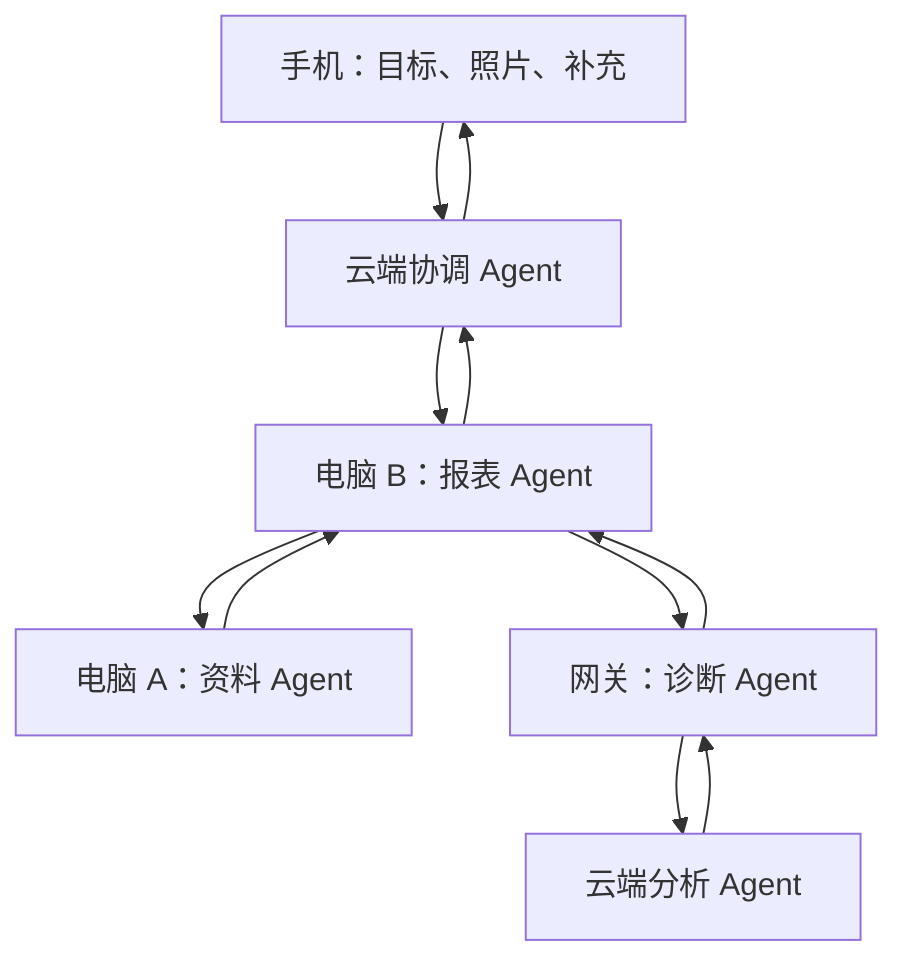
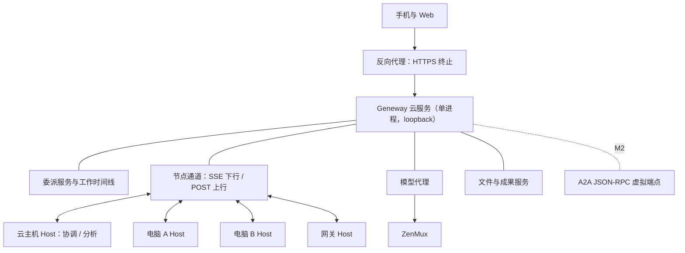

# Geneway 多地点 Agent 协作实施计划

> 版本：v4.0；更新日期：2026-10-30（Asia/Shanghai）。
> 状态：实施方案，尚未开工。本版依据 2026-10-29 对 v3.0 的审查及用户决定修订；协议与模型事实于 2026-10-30 联网复核。
> 首要目标：以最短路径跑通完整业务流程：手机发起工作，云端协调，两台电脑与一个网关上的 Agent 互相委派，手机拿到核验过的 XLSX。
> 协议决定：采用 A2A 1.0（JSON-RPC binding，`@a2a-js/sdk` 1.3.x）作为唯一标准协议，取消 ANP/A2A 同场对比。M1 现场节点走 Geneway 内部出站通道，内部对象按 A2A 语义建模；A2A 标准入口在 M2 接入。
> 文件名中的 2026-10-28 是初建日期；v3.0 原文保留在上传件中，可对照。

## 0. 相对 v3.0 的变更

| v3.0 | v4.0 | 依据 |
|---|---|---|
| ANP 与 A2A 同场验证，M0 后选一 | 直接选定 A2A；ANP 不进入本期 | §3 复核；用户决定取消对比 |
| M1 一次要求主链加 19 项验收 | 拆为 M1a 主链跑通、M1b 最低可靠性 | 上一轮 J10 三轮失败集中在验收前提而非产品缺陷（P7-plan.md:198） |
| DS-Bot 整体导入是 M0/M1 前置 | 推迟到桌面代操作样本；电脑、网关、云端 Agent 统一跑 headless Host | 本样本不涉及原生 GUI |
| 拆分 `collaboration-runner.mjs`，旧协作迁移为历史委派 | 旧协作不动；多地点委派是平行新路径 | 旧协作有硬上限（child ≤ 4、根超时 ≤ 6 分钟，`file-store.mjs:1674-1677`） |
| 新建 Agent 实体 | 复用 `employees`，增加节点放置字段 | 现有 Agent 概念即员工（`file-store.mjs:463`） |
| 未列：云端入口、远端模型代理、文件服务、XLSX 引擎 | 新增为独立工作包并估算 | 服务只允许 loopback（`server.mjs:42`）；模型直连 ZenMux（`model-route.mjs:6-7`）；无上传接口 |
| 照片如何理解未定义 | 使用 `deepseek-v4.1-flash` 图片输入，无需新增模型路由 | ZenMux 模型页标明原生图片理解；该模型已在白名单（`model-route.mjs:3`） |
| 桌面默认 Windows x64 | 用手边机器，Linux x64 优先 | 当前唯一验证平台是 Linux x64（`doc/operations.md`） |
| 节点 `last_seen`、群事件等写入 state.json | 连接状态只在内存；state.json 只记关键状态迁移 | P7 曾出现空轮询反复整库写入、20 身份空闲 CPU 超 1 核（P7-plan.md:144） |
| 节点通道为 WSS | 下行 SSE、上行 HTTPS POST | 不新增服务端依赖，企业代理兼容性更好，`Last-Event-ID` 天然支持续传 |

v3.0 的 M0–M4、T00–T17 编号由本版替代。

---

## 1. 目标与范围

### 1.1 产品目标

| 事项 | 本版约束 |
|---|---|
| 客户 | B2B 为主 |
| 场景 | 文档、表格自动化；跨电脑、网关和云端协作。桌面代操作后置 |
| 云部署 | 自有云托管，单实例；私有化后置 |
| 现场节点 | Agent 循环和工具在本地；模型请求和选定协作数据经自有云 |
| 多地点 | 不同电脑、现场网关、云端独立提供能力，可相互委派 |
| 手机 | 发起工作、上传照片、回答追问、修改要求、下载成果 |
| 协议 | A2A 1.0；M1 内部对象与之同构，M2 对外暴露标准入口 |
| 仓库 | 云端、Host、工具、测试都在 Geneway 仓库 |
| 优先级 | 先跑通真实业务链，再补可靠性、标准入口和分发 |

### 1.2 实施假设

- 一家企业、一个 workspace、多个 site。site 是资源归属字段，不建组织树。
- 手机使用现有响应式 Web（`web/index.html` 已有 760px 断点与移动底栏）。
- 现场节点用手边可用机器，Linux x64 优先。若必须用 Windows，T01 先验证 DSH 原生依赖（node-pty、koffi）在 Windows 上可安装。
- 网关只读：已有采集数据、日志、只读诊断。优先接现有 Hive/Beezer 或明确的本地文件导出；具体接口在 T00 固定。
- 生成新 XLSX，不覆盖原件，不向企业生产系统提交。
- "独立运行"指 Agent 进程、会话和工具在本地；断网时不会凭空获得模型，下一次推理等待连接恢复。
- M1 是受控内部验证，不等于多租户生产隔离。
- 网关若无法运行本地 Agent 循环，明确记为 `tool_node` 降级，不冒充 `agent_node` 通过。

### 1.3 本期不做

ANP 接入；DS-Bot 导入与原生 GUI 操作；Windows 安装包；多租户与数据库迁移；视频与实时通话；PLC 写点或设备控制；跨企业互通。

---

## 2. 第一条完整业务链

### 2.1 样本：现场异常资料整理与整改表

用户从手机上传现场照片并提出"结合设备情况、历史业务资料，生成可检查的异常核对表"。

| 角色 | 位置 | 必须实际完成的行为 |
|---|---|---|
| 手机用户 | 手机 Web | 提交照片和目标，回答口径问题，中途修订要求，下载结果 |
| cloud-coordinator | 云主机上的 Host | 理解目标与照片，选择授权能力，发起委派，核验和汇总 |
| desktop-data | 电脑 A 的 Host | 在授权目录读取历史记录或业务明细，返回结构化证据 |
| desktop-office | 电脑 B 的 Host | 使用本地模板，主动向其他 Agent 请求帮助，生成并回读核验 XLSX |
| gateway-diagnostics | 网关的 Host | 自主选择有限只读工具收集状态/日志，标明数据时间与质量，必要时请求云端分析 |
| cloud-analysis | 云主机上的独立 Host 会话 | 对照片和证据做归类分析，返回结构化结果和依据 |

委派路径：

1. 手机创建 Work 并上传照片。
2. 协调 Agent 读取照片和目标，按资源与权限选定电脑 B。
3. 电脑 B 的 Agent 自主向电脑 A 和网关发起两个子委派。
4. 电脑 A 读取授权历史资料；网关读取状态、报警、采集健康或日志片段。
5. 网关或电脑 B 向 cloud-analysis 请求分析，不重入正在等待的根会话。
6. 电脑 B 汇总证据；遇到样本中预置的歧义时向用户追问。
7. 用户在手机上回答；另一次验收中修改要求。
8. 电脑 B 按新的要求版本生成新 XLSX，回读验证后上传。
9. 协调 Agent 核验成果，手机下载到同一份文件。

"请求帮助"是目标委派：接收方自己选择允许的工具、返回结果或继续追问。云端控制面只转发、授权和记录，不代替节点推理。

### 2.2 拓扑



这是逻辑关系。实际通信全部经自有云控制面中转，节点之间不直连；每条委派保留真实发送者与接收者身份。

### 2.3 M1a：主链跑通的标准

- 电脑 A、电脑 B、网关各自运行真实 Host 进程，有独立运行绑定与委派记录；不能是一个进程模拟三方。
- 电脑 B 的 Agent 自主向电脑 A 和网关发起委派，网关自主请求云端分析。
- 网关的 `agent_node` 模式有实际本地循环；若只能 `tool_node`，单独标明。
- 主流程包含一次用户追问并恢复、一次要求修订，输出记录实际采用的要求版本。
- 生成真实 XLSX，关键值/公式通过断言；云端与手机拿到相同 sha256。
- 所有现场节点只出站访问自有云；没有人工开放入站端口，没有手工复制 ID、提示词或文件。
- 现场节点不持有长期 provider key，模型请求经云端代理。
- 成果未就绪或 hash 不符时，不显示交付成功。

对应验收项见 §17.1。先在同一开发机用多个进程跑通全链（里程碑 D1），这只算开发验证；M1a 最终要跨实际机器。

### 2.4 M1b：最低可靠性的标准

- 同一命令重发不重复执行；首个响应丢失后可查到原结果；同键不同参数被拒绝。
- 文件完成后断网，恢复时只补报回执，不重新生成。
- 指定节点离线时明确显示等待或不可用，不在别处重做本地资源任务。
- 取消需要停止确认；迟到的旧结果保留证据，但不覆盖新执行。
- Host 重启后受理与结果事实仍在；无法安全续跑时明确中断或 `outcome_unknown`。
- 群外、跨资源或伪造身份的请求，读写和下载都被拒绝。
- 网关数据过期或来源不明时，输出标明限制。
- 至少注入一次提交前持久化失败，证明不会成功 ACK 或派发。
- 三名以上 Agent 在同一工作时间线共享证据，并发生一次 Agent 之间的定向提问与回应。
- 至少两种网络出口下完成主链。

M1b 的去重键、持久结果和就绪门在 M1a 设计中就要具备，M1b 只是把故障注入与负例验收补齐。

---

## 3. 协议决定：A2A

### 3.1 复核结果（2026-10-30）

| 项 | A2A | ANP |
|---|---|---|
| 规范 | 1.0.0 于 2026-03-12 发布，首个稳定版；文档站当前 v1.0.1；线协议版本 `1.0` | v1.2 于 2026-09-24 发布，仅规范与文档变更；P6 群 E2EE 仍为 Candidate，ANP-06 为 Draft |
| 治理 | 2025-06 成为 Linux Foundation 项目，2026-08 加入 Agentic AI Foundation（与 MCP 同基金会），公告称 150+ 组织支持 | agent-network-protocol 社区维护 |
| TypeScript SDK | `@a2a-js/sdk` 1.3.0（2026-09-29），Apache-2.0，实现规范 1.0；JSON-RPC、REST、gRPC 三种传输；硬依赖仅 `jose`；Node ≥ 20；2026-07 至 09 发布 6 个版本 | `@awiki/anp-typescript-sdk` 0.9.5（2026-09-24），仍为 0.x；README 自述无实时订阅、无建群、无多设备 |
| 任务语义 | 原生 Task / Message / Artifact，`INPUT_REQUIRED`、取消、`tasks/list` | 无原生任务语义，需应用层定义 |
| 群组 | 无，需应用层实现 | P4 群语义；可自部署的 Host 参考实现为 awiki-open-server（Python 单节点，GitHub 3 star） |
| 社区量级 | 规范仓约 26.3k star；a2a-js 约 650 star | 规范仓约 1.5k star；SDK 仓约 360 star |
| NAT 后节点 | 无官方反向连接方案，需自建中继 | 同样需自建 |

### 3.2 选择 A2A 的理由

1. **语义匹配。** 这条链的核心是"委派 → 等待输入 → 取消 → 交付成果"，正是 A2A 的原生对象。ANP 的优势在 DID 身份、群成员与消息排序，在单企业、全部经自有云中转的拓扑里用不上；工作时间线 Geneway 无论选哪个都要自建。
2. **实现成熟度。** A2A 有 1.x 稳定 SDK 且持续发布；ANP 的 TS SDK 仍是 0.x，缺建群与实时订阅，要么补 Group Host，要么引入 Python sidecar。
3. **互通价值。** A2A 已在主流厂商与框架中落地，未来对接客户或第三方 Agent 的概率更高。
4. **接入成本低。** 解包 `@a2a-js/sdk` 1.3.0 核实：`JsonRpcTransportHandler.handle(requestBody, context)` 与 HTTP 解耦，返回响应或流式 AsyncGenerator；`TaskStore` 接口只有 `save` / `load`。可以挂在现有 `node:http` 服务上，TaskStore 从 Geneway 领域状态投影，不引入 Express，也不另建任务库。

ANP 不进入本期。出现跨企业 DID 身份或联邦需求时，作为对外 adapter 重新评估（T20）。

### 3.3 A2A 在架构中的位置

**M1（内部同构）：** 现场节点经 Geneway 内部通道接入，不在 M1 引入 SDK 运行时。内部对象与 A2A 1.0 同名同义：

- 一次 Attempt 对应一个 A2A Task。`taskId` 由云端控制面（代表接收方服务端）生成，等于 `attemptId`。
- 内部状态与 A2A 1.0 TaskState 一一对应（`TASK_STATE_SUBMITTED`、`TASK_STATE_WORKING`、`TASK_STATE_INPUT_REQUIRED`、`TASK_STATE_COMPLETED`、`TASK_STATE_FAILED`、`TASK_STATE_CANCELED`、`TASK_STATE_REJECTED`），映射固定并有契约测试（§6.2）。Geneway 特有细节（等待依赖、等待连接、停止中、结果未知）放在状态消息和 metadata 里，不扩展标准枚举。
- 消息与 A2A Message 同构（`messageId`、`contextId`、`taskId`、`role`、`parts`、`metadata`），`role` 取 `ROLE_USER` / `ROLE_AGENT`，Part 取 `text` / `url` / `data` 三种（不用 `raw`，文件一律走文件服务）；`messageId` 兼作去重键，结果对应 Artifact。精确字段以 `@a2a-js/sdk` 1.3 类型定义为准。
- `contextId` 只在本服务内有效，不当作跨服务器的全局群 ID。

**M2（标准入口，T13）：** 云端为每个已注册 Agent 暴露 A2A JSON-RPC 虚拟端点和 Agent Card；TaskStore 从 Delegation 投影；协调 Agent 可以作为 A2A Client 调用外部 Agent；用官方 client 做一次互通测试。内部通道不冒充 A2A 官方 binding。

**约束（两个阶段都适用）：**

- 终态 Task 不重新打开；同一委派需要再次执行时创建新 Attempt 与新 Task，旧 Task 的终态和证据保留。普通网络重试复用原命令。
- `artifactId` 只在 Task 内唯一，产品保留全局 artifact ID。
- 幂等、断线补齐和"取消已停止"不因协议存在就自动成立，由 Geneway 实现并验证。
- 只实现 JSON-RPC 一种 binding。
- TaskStore 写入不得以旧全量 Task 覆盖较新的领域状态：带投影 revision 校验，过期写拒绝，禁止终态回退。

---

## 4. 总体架构

### 4.1 部署结构



- **云服务保持单进程、绑定 loopback**，由反向代理（Caddy 或 nginx）对外终止 HTTPS。代码只需放开 https 的 trusted origin，并为 cookie 加 `Secure`；`server.mjs:42` 的 loopback 限制可以保留。
- **云服务是确定性控制面**：授权、路由、状态、记录。它不调用模型做决策。
- **所有 Agent 都运行在 Host 进程里**，包括云端协调与分析 Agent，它们部署在云主机上，经同一节点通道接入。这样五个 Agent 共用一套 Host 代码、一套委派语义和一条模型代理路径，不需要接入现有 collaboration-runner。
- 现场连接全部由 Host 主动建立；通道只转发已注册 Agent 的控制消息，不提供任意 TCP、本机 HTTP 或 Shell 转发。
- 照片、日志包、表格经文件服务传递；控制消息只带引用和必要的结构化片段。

### 4.2 对象与身份

| 对象 | 最小字段 | 存储 |
|---|---|---|
| Site | siteId、名称 | 配置 |
| Node | nodeId、siteId、platform、runtimeMode（`cloud` / `agent_node` / `tool_node`）、凭据 hash | state.json；连接状态与 last_seen 只在内存 |
| Agent | 复用 `employees`，新增 `placement: { nodeId, capabilities, resourceRefs }` | state.json |
| Resource | resourceId、siteId、kind、所属节点、允许的访问方式 | 配置 / state.json |
| Work | 沿用现有 Work，新增 `multisite` 类型、instructionRevision、参与者 | state.json |
| Delegation | delegationId、workId、parentDelegationId、from/to Agent、目标、约束、结果 schema、授权范围 | state.json |
| Attempt | attemptId（= A2A taskId）、delegationId、executionEpoch、运行绑定、状态 | state.json |
| WorkEvent | 有界的工作时间线事件 | state.json，每个 Work 有上限 |
| Artifact | artifactId、sha256、大小、类型、来源、instructionRevision、状态 | 元数据在 state.json，字节在数据目录 |

IP、进程号、协议会话 ID 都不作为稳定业务身份。M1 限制一个 Agent 同时只有一个活动 Host 绑定。

### 4.3 调度规则

按确定性规则过滤候选：

1. 发起用户、Agent 和目标属于同一 workspace。
2. 委派允许访问指定 site 与 resource。
3. 候选 Agent 已绑定的工具满足能力与版本要求。
4. 有资源归属的任务不迁往没有该资源的节点。
5. 节点在线，满足本地资源互斥与并发预算。
6. 剩余候选按静态优先级选择，并记录选择依据。

例：`office.xlsx.render.v1` 只派给有本地模板和 XLSX 工具的电脑；`site.evidence.inspect.v1` 只派给能访问对应现场数据源的 Agent；`analysis.classify.v1` 可派给云端分析 Agent。Agent 自报能力不能获得新的工具或连接权限。

---

## 5. 工作时间线

### 5.1 M1 的群协作形态

M1 不建独立群服务。每个 Work 有参与者列表和一条有界事件时间线，手机和各 Agent 按权限读取。这覆盖了"共享证据、定向提问、可辨认来源"的需要；独立的群成员治理留到确有需求时再做。

- 参与者包括协调者、实际参与的 Agent 和发起用户。
- 业务负责人、执行者是不同角色；参与时间线不自动获得文件或工具权限。
- 撤权后拒绝新执行、内容访问和下载；已下载内容不宣称可撤回。

### 5.2 事件类型

| 类型 | 用途 | 是否授权执行 |
|---|---|---|
| observation | 带来源和时间的证据与发现 | 否 |
| question / answer | 定向追问与回答 | 否，回答由等待它的执行消费 |
| delegation.requested | 请求明确 Agent 完成子目标 | 服务端受理并签发执行范围后才可开始 |
| delegation.status | 状态变化（A2A TaskState） | 否 |
| delegation.result | 返回指定委派的结果 | 否，需校验来源、版本和状态 |
| instruction.updated | 发起者修订要求 | 改变相关执行的输入依据 |
| cancellation.requested | 取消明确范围 | 记录意图，再取得停止证据 |
| artifact.ready | 已验证成果的引用 | 否，不代表 Work 完成 |

每条事件至少带 eventId、workId、sender、目标或 replyTo、instructionRevision 和证据引用。时间线里的文本按数据处理，任何发言都不能直接变成工具授权。

### 5.3 唤醒规则

- 收到、持久化、通知界面、唤醒模型是四个独立步骤。
- 只有被委派、被定向提问或在等待该结果的 Agent 会被唤醒；广播 observation 只进入上下文。
- 设工作级预算：最大委派深度 3、子委派总数 8、单 Agent 同时活动执行 1，以及模型调用次数、token 和截止时间。这些是样本初值，T01 按实测调整。
- 失败、状态通知和自身消息不触发回声。
- 手动暂停的 Agent 只累积待处理项，恢复后才继续。

### 5.4 要求版本

- `instructionRevision`：用户目标或约束的有效变更递增；普通聊天和进度不递增。
- 每次模型调用记录实际包含的要求版本和所用证据清单（ID、版本、hash、时间）。
- 关键提交前校验当前要求版本、有效执行者和必要批准；新要求在提交前到达时，旧动作不再获准。
- 成果记录所依据的要求版本；控制面拒绝把版本落后的成果作为 Work 的最终交付。
- "已进入上下文"不等于模型理解正确，最终成果仍需独立业务校验。

---

## 6. 多级委派与执行归属

### 6.1 新路径，旧协作不动

现有协作要求子工作直接挂在根工作下、handoff 只能交回根员工（`file-store.mjs:1653`、`:1719`），并有 child ≤ 4、根超时 ≤ 6 分钟等硬上限。它不适合跨机、带用户追问的多级委派。

- 新增 `multisite` Work 类型与独立的 Delegation 图；旧协作代码、校验和数据保持原样，不做历史映射。
- 每条委派边保存 from/to Agent、目标、结果 schema、要求版本和授权范围，可带 parentDelegationId。
- 不把每条消息或每个 Task 变成嵌套 Work。

### 6.2 委派生命周期

| 内部状态 | A2A 1.0 TaskState | 说明 |
|---|---|---|
| requested | `TASK_STATE_SUBMITTED` | 已持久受理，目标尚未接受 |
| running | `TASK_STATE_WORKING` | 当前 Attempt 已开始；等待依赖、等待连接作为 metadata 细节 |
| waiting_input | `TASK_STATE_INPUT_REQUIRED` | 等待用户或有权限的上游补充 |
| completed | `TASK_STATE_COMPLETED` | 结果校验通过，必需成果均已就绪 |
| failed | `TASK_STATE_FAILED` | 已知失败且原因明确 |
| rejected | `TASK_STATE_REJECTED` | 目标拒绝（无资源、无权限、超预算） |
| stopping | `TASK_STATE_WORKING` + metadata | 已记录取消，尚未取得停止确认 |
| cancelled | `TASK_STATE_CANCELED` | 已确认停止；外部动作事实独立保留 |
| interrupted / outcome_unknown | `TASK_STATE_FAILED` + metadata | 中断或副作用不确定，禁止自动重放 |

### 6.3 关键标识

- `delegationId`：逻辑委派的稳定身份。
- `attemptId`：一次实际执行，同时作为 A2A taskId。
- `executionEpoch`：服务端认可的执行代次，用于拒绝旧执行者的新写入。
- `commandId` / `messageId`：传输与业务去重。相同 ID、相同摘要返回原结果；相同 ID、不同参数报冲突。
- `actionId`：一次具体副作用的稳定身份。
- `launchId` / `sessionId`：运行时归属，避免迟到输出串入新执行。

M1 不做写操作的自动跨节点接管；只读、可验证、明确可重试的子任务才可重新派发。

### 6.4 防止等待环

- 记录祖先委派，拒绝委派回正在等待当前链结果的祖先。
- 请求云端分析使用独立会话，不占用根协调会话。
- 子委派的等待方式（工具调用阻塞等待，或结束回合、结果到达后续接会话）由 T01 实测 DSH 工具超时与续接能力后选定。
- 必须验证"根等 B、B 等网关、网关等云分析"在固定并发配置下能推进。
- 父工作取消后不再签发新子委派，已有后代收到取消请求。
- 超预算或过截止时间进入明确状态，不持续互相唤醒。

---

## 7. 存储与可靠交付

### 7.1 沿用单写者存储

- 云端一个写者、一个 Store 实例。启动保护禁止第二个进程写同一数据目录；远端节点只经 API。
- 新增 `applyCommand`：在同一次 `store.update` 里提交 Work、Delegation、Attempt、去重记录、结果元数据、待发事件和时间线。提交成功后才 ACK 和推送；mutator 内不调用模型、网络或文件工具。
- `STATE_VERSION` 12 → 13，只做增量：新增 `nodes`、`delegations`、`workEvents`、`artifacts`，以及 `employees[].placement`，旧状态迁移时补空集合。必须有迁移、默认值、引用校验和旧状态兼容测试。
- **不写入 state.json 的内容**：心跳、连接状态、last_seen、流式 token、进度百分比、原始遥测、截图与文件字节。
- 每个 Work 的时间线事件和待发事件设上限，初值由 T05 定；达到上限或存储不可靠时拒绝新执行，不静默丢关键事实。

### 7.2 唯一权威

云端 Store 是 Delegation 与 Task 状态的唯一权威。Host 本地记录只是跨节点可靠交付的缓存。M2 的 A2A TaskStore 从 Store 投影并走 `applyCommand`，不另建任务库。

### 7.3 Host 本地收发记录

- M1a：受理的委派和最终结果、成果回执写入本地追加日志，重连后补报；事件带稳定 eventId、nodeInstanceId、sequence。
- M1b：只有精确匹配的 ACK 才清理对应事件；补齐并发 ACK、重启、队列满、磁盘不足的明确状态。
- ACK 只表示接收层已可靠接纳；开始执行、模型已见和业务完成分别记录。
- 进度可以合并；accepted、started、result、cancel-confirmed 等关键事实不能丢。

### 7.4 断线与重启

| 事件 | 处理 | 阶段 |
|---|---|---|
| 通道断开 | 标记连接状态；不判失败，不重新启动执行 | M1a |
| 连接恢复 | 重验身份，取 Work/Delegation 快照，补报本地记录，再消费新输入 | M1a |
| 已提交、ACK 丢失 | 重试同一命令，返回原结果 | M1b |
| 文件已生成、回执未送达 | 回读核对成果，只补报回执，不重做生成 | M1b |
| Host 重启 | 恢复受理与结果记录；明确核对原执行能否续跑 | M1b |
| 外部动作结果不明 | `outcome_unknown`，停止自动重放 | M1b |
| 存储写入失败 | 不 ACK，不签发新执行，显示可诊断原因 | M1b |

重连先用快照校准；增量缺口补齐在 M2 完善。状态 revision、事件序号、要求版本、执行代次各有用途，不混成一个版本号。

### 7.5 成果提交

1. 上传到临时位置；
2. 校验大小、sha256、类型和必要的业务内容；
3. 提交 Artifact `ready` 元数据；
4. 委派完成只能引用已就绪的成果；
5. 清理没有被引用的临时上传。

文件已上传而工作提交失败，只会留下可清理的孤立对象，不会出现"显示完成却下载不到"。

---

## 8. 网络、身份与授权

### 8.1 云端入口

- 反向代理终止 HTTPS，转发到 loopback 上的云服务；`GENEWAY_TRUSTED_ORIGIN` 允许配置 https 公网 origin，cookie 在 https 下加 `Secure`。
- 节点通道：下行 `GET` SSE 推送控制事件，支持 `Last-Event-ID` 续传；上行 `POST` 提交命令，带 `commandId` 幂等。反向代理对 SSE 路径关闭缓冲。
- 服务关闭时主动结束 SSE 长连接，纳入现有关闭测试。

### 8.2 节点注册与通道约束

- 管理员在 Web 生成短期配对码，节点用它换取可撤销的节点凭据；state.json 只存凭据 hash。
- 连接绑定 nodeId，不信任消息内自报的 sender。
- 消息有大小上限、超时、重试退避和队列上限；大文件不进控制消息。
- 心跳只说明节点连接在线，不证明任务进度或采集数据新鲜。

### 8.3 委派授权

- 每次委派由服务端签发：目标 Agent、允许能力、resourceRefs、要求版本、截止时间、预算、可继续委派的范围。
- 子请求权限取父权限的交集，不能扩大。
- 节点凭据、Agent 身份、当前执行许可分别校验。
- 不把完整 execution-grant/policy 下发到节点；`execution-grant.mjs` 新增受限执行上下文的签发。
- 撤销节点后拒绝新任务与下载；本地取不到新许可时停止发起新副作用。
- secret、provider key、完整会话和本地配置不进入时间线。

---

## 9. Headless Host

### 9.1 一套代码，多种角色

电脑 A、电脑 B、网关和云端 Agent 运行同一个 Host 入口，用配置区分角色、工具和资源。Host 位于本仓库 `host/`，使用根依赖，节点机器 clone 仓库后 `pnpm install --frozen-lockfile` 即可运行；安装包在 M2 再做。

共享能力：注册与凭据、出站通道与重连、DSH 运行时（复用 `src/dsh-host.mjs` 的启动方式）、委派相关工具、本地收发记录、模型代理客户端、文件客户端、资源范围、取消令牌、按 work/delegation/attempt/agent/node 关联的日志。

Agent 可用的委派工具（拟建）：

| 工具 | 作用 |
|---|---|
| `geneway_delegate` | 向指定能力发起子委派并取得结果 |
| `geneway_ask` | 向用户或有权限的上游提问 |
| `geneway_observe` | 向工作时间线发布带来源的观察 |
| `geneway_submit_result` | 提交结构化结果和成果引用 |

### 9.2 RuntimeAdapter 最小契约

```typescript
interface RuntimeAdapter {
  capabilities(): {
    inputWhileBusy: "steer" | "queue" | "unsupported";
    resume: "verified-checkpoint" | "context-only" | "unsupported";
    cancel: "cooperative" | "process-stop";
  };
  start(binding, executionContext, input): Promise<StartReceipt>;
  send(binding, input, revision): Promise<InputReceipt>;
  stop(binding, reason): Promise<StopReceipt>;
  observe(binding): Promise<RuntimeObservation>;
}
```

这是 Geneway 内部边界的设计示意，不代表 DSH 已有同名方法。T01 用真实 DSH 验证启动、追加输入、忙时输入、停止和工具长时间等待。进程存在、正在推理、工具运行中、等待输入、等待云端、结果待回传分别表达；进程退出不能推出外部操作没有发生。

### 9.3 网关能力：`site.evidence.inspect.v1`

输入：现场资源、异常时间范围、问题、允许读取的证据类型。
行为：Agent 按问题选择工具和时间窗口，判断证据是否足够，必要时请求云端分析。
输出：结构化观察、来源与时间、质量标记、原始证据引用、尚未确定的问题。

| 工具 | 首个用途 | 约束 |
|---|---|---|
| read_collector_health | 采集连接、最后成功时间、队列情况 | 读现有接口，不改采集逻辑 |
| read_recent_events | 报警、状态变化、限定窗口日志 | 条数、时间、大小有上限 |
| describe_resource | 设备类型、数据源、允许的指标 | 只返回本工作有权查看的元数据 |
| collect_evidence_bundle | 生成可追溯诊断包 | 脱敏范围、hash、上传许可 |

这些是拟建能力名，不是对 Hive/Beezer 现有 API 的描述。真实数据没接通时标记 fixture，不混入生产结论。不让 LLM 执行 PLC 写点、启停设备或修改采集参数。

### 9.4 网关资源

P7 在云端实测：每多一个 DSH SDK 子进程，进程树 RSS 约增加 155 MiB（2/4/8 个子进程分别为 432204/749332/1398164 KiB，P7-plan.md:138）。这是参考值，不是 headless Host 的实测。T00 选网关时按"Host 加一个活动会话预留不少于 1 GB 空闲内存"筛机器；T01 在目标硬件实测：

- 冷启动时间，空闲与任务中的 RSS、CPU；
- 空闲时模型请求次数应为 0；
- 断线积压时的磁盘写入；
- 对现有采集进程延迟和错误率的影响；
- OS、CPU 架构、DSH 原生依赖能否安装。

两种模式在目录和界面中区分：`agent_node`（本地 Agent 循环，模型经云端代理）与 `tool_node`（只执行受控工具，由云端 Agent 推理）。只做到后者时，记为"网关工具接入完成，独立 Agent 未完成"。

### 9.5 本地资源互斥

- 文件操作按规范化的 resourceId 与输出目标加锁；解析符号链接与路径映射，禁止越出授权目录。
- 锁与 Attempt 绑定；进程崩溃后先核对动作效果再释放。
- 不同机器的不同资源可以并行。
- GUI 互斥（鼠标、键盘、剪贴板、焦点）随桌面代操作样本一起设计，本期不涉及。

### 9.6 DS-Bot 推迟

本样本只需要读文件和生成 XLSX，headless Host 足够。DS-Bot 导入、桌面壳、浏览器与 Office 原生操作、Windows 打包随桌面代操作样本（T18）进行。届时沿用 v3.0 §13.2 的规则：固定提交导入、保留相对结构、自有代码与上游分离、独立 app ID 与数据根、UPSTREAM.md 记录来源与补丁、保留许可证与 NOTICE。

---

## 10. 模型、证据与成果

### 10.1 模型代理

- 云端新增 OpenAI 兼容的模型代理端点（现有路由使用 `openai-completions` API）。Host 内 DSH 的 baseUrl 指向该端点，凭据是绑定 node、work、attempt 的短期令牌。
- 代理校验绑定关系与预算，用服务端 key 转发到 ZenMux，流式透传，并按工作记录用量。模型白名单与参数上限复用 `model-route.mjs`，不新增模型。
- 现场节点不持有长期 provider key，也不能用本地私人 provider 绕开代理。
- 断网时，已授权且不需要新推理的本地步骤可以运行到检查点；新推理、新委派和需要新许可的提交等待恢复。

### 10.2 照片理解

ZenMux 的 `deepseek/deepseek-v4.1-flash` 模型页标明原生支持图片理解，输入为文本加图片；该模型已在现有白名单中。照片经文件服务上传，协调 Agent 和云端分析 Agent 以图片输入读取。T01 验证图片能经 DSH 附件、`openai-completions` 请求和模型代理完整传到模型，并确认格式与大小限制。

### 10.3 Artifact 与 Evidence

```json
{
  "artifactId": "art_example",
  "workId": "work_example",
  "kind": "spreadsheet",
  "version": 1,
  "sourceNodeId": "node_pc_b",
  "sourceDelegationId": "dlg_report",
  "instructionRevision": 2,
  "sha256": "<sha256>",
  "sizeBytes": 12345,
  "mediaType": "application/vnd.openxmlformats-officedocument.spreadsheetml.sheet",
  "state": "ready",
  "accessScope": "work_participants",
  "evidenceRefs": ["ev_gateway", "ev_pc_a"]
}
```

- 消息中只传引用和必要元数据；下载时按当前身份取短期访问许可。
- 电脑 A 的本地路径不能交给电脑 B；先授权上传所需字节或提取结构化数据。
- 参与工作不等于能下载全部附件，文件逐项授权。
- 云端"完成"需要可验证的字节与元数据，不能只有本地路径或失效链接。

### 10.4 现场证据新鲜度

网关观察至少记录 siteId、resourceId、sourceId、sourceTimestamp、observedAt、receivedAt、质量与新鲜度、查询时间窗口和原始证据引用。无法确认源时间时保留不确定性；陈旧证据只能作为历史材料，不能作为当前状态结论。原始高频遥测留在现有数据平台。

### 10.5 XLSX

- 默认引擎 `exceljs`（MIT）：读取本地模板、写入数据与公式、保留样式。T01 验证模板保真度与公式处理；若需要重算公式结果，再评估 LibreOffice headless。
- 至少包含一项真实业务数据处理与公式/数值校验，不只是写固定字符串。
- 产物重新加载后检查工作表、关键单元格和公式结果；云端下载后再做结构核验；手机拿到同一版本。

---

## 11. 内部契约

### 11.1 委派消息示例

以下是 Geneway 内部通道的应用消息，`message` 与 A2A 1.0 Message 同构；精确的 Part 字段以 SDK 类型为准。

```json
{
  "schema": "geneway.delegation.v1",
  "type": "delegation.dispatch",
  "commandId": "cmd_example",
  "workId": "work_example",
  "delegationId": "dlg_collect",
  "parentDelegationId": "dlg_report",
  "attemptId": "att_example",
  "contextId": "ctx_work_example",
  "fromAgentId": "desktop-office",
  "toAgentId": "gateway-diagnostics",
  "instructionRevision": 2,
  "requiredCapability": "site.evidence.inspect.v1",
  "resourceRefs": ["site_a/resource_machine_01"],
  "constraints": {
    "readOnly": true,
    "maxChildDelegations": 1,
    "allowedPeerCapabilities": ["analysis.classify.v1"]
  },
  "message": {
    "messageId": "msg_example",
    "role": "ROLE_USER",
    "parts": ["<text：文本目标>", "<data：结构化输入>", "<url：照片的短期下载地址，附 artifactId>"]
  },
  "expectedOutputSchema": "geneway.site-evidence.v1"
}
```

有效期、执行许可和身份从认证上下文与服务端记录取得，不信任 payload 中自报的字段。业务 schema、协议版本、Host 版本分别管理。

### 11.2 操作对应

| 内部意图 | M1 内部通道 | M2 A2A |
|---|---|---|
| 发现能力 | Geneway 目录 | Agent Card + 目录 |
| 委派子目标 | `POST` 委派命令，SSE 下发给目标 Host | SendMessage，云端生成 Task |
| 等待输入 | `waiting_input` + 待答问题 | `TASK_STATE_INPUT_REQUIRED` |
| 补充输入 | 回答事件，关联原问题与原 Attempt | 向原 Task 发送 Message |
| 查询状态 | Work / Delegation 快照 | GetTask / ListTasks |
| 取消 | 取消命令 + 实际停止证据 | CancelTask + 实际停止证据 |
| 交付成果 | Artifact 引用 + 文件服务 | Artifact + 受控下载地址 |
| 重连 | SSE `Last-Event-ID` + 快照校准 | 标准订阅 + 快照校准 |

### 11.3 错误码

| 错误 | 含义与界面处理 |
|---|---|
| AGENT_UNAVAILABLE | 指定 Agent 不可用；保留等待/改派决策，不自动替换有本地资源的节点 |
| RESOURCE_NOT_BOUND | 目标无法访问必要资源，拒绝启动 |
| INPUT_STALE | 动作依据旧要求，先读取并重新决定 |
| IDEMPOTENCY_CONFLICT | 同键不同参数，拒绝执行 |
| EXECUTION_SUPERSEDED | 旧 Attempt 不能写当前状态 |
| EFFECT_UNKNOWN | 外部结果不确定，进入核查 |
| STORAGE_UNAVAILABLE | 持久性无法确认，禁止新派发与成功 ACK |
| BUDGET_EXCEEDED | 超出工作预算，等待明确调整 |
| ACCESS_REVOKED | 访问已撤销，停止新动作 |
| ARTIFACT_NOT_READY | 文件未完成验证，不能宣称交付 |

这些是应用错误；M2 的 A2A adapter 按标准允许的错误数据承载，不改写协议保留错误码。

---

## 12. 代码改造

### 12.1 基线

Geneway `main` 提交 `0698659a62cef36b0cdc940242516a4133ba5496`；DSH 直接包 `0.2.0-rc.2`。

| 位置 | 改造 | 不做 |
|---|---|---|
| `src/server.mjs` | 允许 https trusted origin，cookie 加 `Secure`；新增节点通道、文件上传下载、模型代理、多地点 Work 路由 | 不放开非 loopback 监听 |
| `src/store/file-store.mjs` | v13 增量实体、`applyCommand`、校验与迁移 | 不改旧协作校验，不迁移旧协作 |
| `src/work-service.mjs` | 新增 `multisite` Work 入口 | 旧 Work 与协作行为不变 |
| `src/collaboration-runner.mjs` | 不改 | — |
| `src/execution-grant.mjs` | 新增远端受限执行上下文签发 | 不下发完整 policy 或 secret |
| `src/model-route.mjs` | 代理复用路由快照与白名单 | 不新增模型 |
| `web/index.html` | 多地点 Work：创建并上传照片、时间线、回答、修订、下载 | 不重做整体界面 |
| 新增 `src/delegation-service.mjs`、`src/node-channel.mjs`、`src/model-proxy.mjs`、`src/artifact-service.mjs` | 委派与时间线、节点通道、模型代理、文件与成果 | — |
| 新增 `host/` | headless Host 与各角色工具 | — |

新增依赖只有 `exceljs`；A2A SDK 在 M2 引入。节点通道用 SSE 与 POST，不需要 WebSocket 服务端依赖。

### 12.2 存量数据

- 迁移前对现有 state 做只读盘点。
- v12 → v13 只补新集合与可选字段；旧 Work、Action、批准、receipt、unknown 原样保留。
- 已完成或已发生的动作不因迁移重新进入待执行队列。

---

## 13. 目录

以下为拟建位置。

| 位置 | 内容 |
|---|---|
| `src/` | 云端新增模块（见 §12.1） |
| `host/` | headless Host 入口、通道客户端、运行时、本地收发记录 |
| `host/tools/` | 资料读取、XLSX、网关只读工具 |
| `scripts/dev-multisite.mjs` | 单机多进程开发入口 |
| `scripts/test-multisite-*.mjs` | 契约、状态迁移、端到端测试，沿用现有 `scripts/test-*.mjs` 形式 |
| `doc/adr/`、`doc/runbooks/` | 决策记录与运行说明 |

不创建 `apps/desktop/upstream/`、`services/anp-host/`、`experiments/protocols/`。仓库现有的 `apps/`、`packages/`、`services/` 下只有 `node_modules`，本计划不使用也不清理。

---

## 14. 开发、调试与验证

### 14.1 开发入口

`dev:multisite` 一条命令：启动云服务；在本机以隔离数据目录启动云端协调/分析 Host 和模拟的电脑 A、电脑 B、网关 Host；注入固定的工作区、已配对节点、脱敏样例和模板；手机通过同一地址访问；日志可按 work/delegation/attempt/agent/node 查询；停止时只清理本次启动的进程。另提供真实节点的连接参数打印，明确区分"单机演示"和"跨机验收"。

### 14.2 Agent 操作说明

工具描述与六份短说明随 Host 版本发布：能力与资源如何发现；何时委派、怎样关联结果；时间线与定向问题；用户补充如何恢复原执行；文件与证据如何交付；断线、取消、超时和未知效果怎样处理。Host 版本落后时不发送它不支持的能力。

### 14.3 测试层次

- 契约测试：schema、A2A 状态映射、错误与版本兼容。
- 状态测试：委派、去重、撤权、要求版本、取消、迁移。
- 故障注入（M1b 起）：提交与 ACK 边界、Host 重启、网络中断。
- 真实业务测试：真实模型、真实节点、网关证据、文件回读。

### 14.4 验收方法

上一轮 J10 的教训是，失败集中在验收脚本对真实环境、DOM 和 fixture 的前提上。本期规定：

- 正式验收前，先在真实入口空跑一次，确认脚本前提成立；
- 失败先区分"脚本前提问题"和"产品缺陷"，前者修脚本后直接重跑，不进入重规划；
- 验收记录只保留命令、退出码、关键产物 hash 和失败原因，不为每次重跑建立新的绑定门与回执体系。

---

## 15. 阶段与任务

### 15.1 阶段

| 阶段 | 目标 | 完成条件 |
|---|---|---|
| M0 | 可行性与样本 | 样本、机器与数据源固定；T01 各项可行性有结论 |
| M1a | 主链跑通 | §2.3 全部成立，§17.1 通过 |
| M1b | 最低可靠性 | §2.4 全部成立，§17.2 通过 |
| M2 | 标准入口与内部试点 | A2A 端点与互通、安装包、扩大故障窗口、有限试用 |
| M3 | 企业交付与桌面代操作 | 多租户、DS-Bot 与原生 GUI、签名与更新 |
| M4 | 实时现场协作 | 视频、语音、移动 Agent |

### 15.2 M0

| 任务 | 交付 | 验收 |
|---|---|---|
| T00 样本与环境 | 业务样本、照片、电脑 A 资料、电脑 B 模板、预期结果、一个必问口径、一个修订场景；机器与网关清单（含内存）；网关数据源 | 每个角色有真实输入与预期输出；未知接口明确列出 |
| T01 运行时可行性 | 在目标机器上验证：①Host 启动 DSH 并经代理桩调用模型；②真实模型完成"读模板 → 发两个委派 → 等结果 → 生成"的工具循环；③子委派等待方式（阻塞工具或回合续接）；④图片经 DSH 传入 deepseek-v4.1-flash；⑤exceljs 模板保真与公式；⑥网关安装与资源实测；⑦如用 Windows，原生依赖可安装 | 每项给出实测结论；不可行项记录替代方案或缩小范围 |

### 15.3 M1a

| 任务 | 交付 | 依赖 | 完成证据 |
|---|---|---|---|
| T02 云端入口 | 云主机、反向代理 HTTPS、https origin 与 Secure cookie、单实例启动保护 | T00 | 手机经公网 HTTPS 登录；loopback 绑定不变 |
| T03 节点注册与通道 | 配对码、节点凭据、SSE 下行与 POST 上行、重连与快照校准、连接状态只在内存 | T02 | 私网节点只出站即可接入；伪造节点被拒 |
| T04 模型代理 | OpenAI 兼容端点、短期令牌、预算与用量、流式透传 | T02 | 节点 Host 经代理完成调用；节点上无 provider key |
| T05 委派域与存储 | v13 迁移、`applyCommand`、Delegation/Attempt/WorkEvent/Artifact、授权交集、深度与预算、去重键 | T00 | 多级委派合法、越权被拒；旧状态可读 |
| T06 Headless Host | `host/` 入口、DSH 运行时、委派工具、本地收发记录、角色配置 | T01、T03、T05 | 五个 Agent 均以真实 Host 进程运行并完成委派 |
| T07 文件与成果 | 流式上传与大小限制、sha256、就绪状态、短期下载许可、Host 文件客户端 | T02、T05 | 未就绪或 hash 错误的成果不显示交付 |
| T08 业务工具与 Agent | 电脑 A 资料读取、电脑 B XLSX 生成与回读、网关只读工具、协调与分析 Agent 提示词 | T01、T06、T07 | 真实资源与工具；XLSX 关键断言通过 |
| T09 手机页面 | 创建 Work 并上传照片、时间线与参与者、回答追问、修订要求、下载成果 | T05、T07 | 刷新后待答问题与状态不丢；手机拿到正确文件 |
| T10 实机联调 | 单机 D1 → 跨机 M1a；运行说明 | T02–T09 | §17.1 全部通过 |

T08 中电脑 B 请求电脑 A 和网关，必须经委派工具，不能直接访问对方的文件或网络。

### 15.4 M1b 及以后

| 任务 | 阶段 | 交付 |
|---|---|---|
| T11 可靠性补强 | M1b | 重复与 ACK 丢失、完成后断网、节点离线、取消与迟到结果、Host 重启、持久化失败注入 |
| T12 协作与负例 | M1b | Agent 间定向问答、越权与伪造负例、数据过期标注、文件资源互斥、两种网络出口 |
| T13 A2A 标准入口 | M2 | `@a2a-js/sdk` 接入、虚拟端点、Agent Card、TaskStore 投影、官方 client 互通测试 |
| T14 安装与诊断 | M2 | Host 安装包、诊断导出、任务排空与升级回退 |
| T15 扩大故障窗口 | M2 | §17.3 所列故障与竞态 |
| T16 有限试点 | M2 | 真实用户试用、问题收敛、运营手册 |
| T17 多租户与数据库 | M3 | 完整协作事务域迁移 |
| T18 桌面代操作 | M3 | DS-Bot 导入、Word/网页/原生 GUI 样本、GUI 互斥、Windows 支持 |
| T19 发布 | M3 | 签名、更新源、版本兼容、依赖声明 |
| T20 对外互通扩展 | M3+ | 私有化、跨企业互通；如有 DID/联邦需求，重新评估 ANP adapter |
| T21 实时协作 | M4 | 视频、语音、观察流、移动 Agent |

### 15.5 并行规则

- T05 契约先固定，T09 手机页面可以先用 fixture 开发。
- T02/T03/T04 与 T05 并行；T06 在两者就绪后合流。
- 电脑 A、网关、电脑 B 的工具分别实现，最终由真实的电脑 B Agent 发起跨端请求。
- 多租户、全量权限界面、A2A 标准入口、DS-Bot、视频都不是 M1 的隐含前置。

---

## 16. 工程量

### 16.1 估算

设计估算，不是实测工期。前提：两名熟悉现有项目的工程师；一种节点平台、一个网关、一个 workspace、一个 XLSX 样本；不新增 PLC 驱动，不重做 Office 引擎。

| 工作包 | 人日 |
|---|---:|
| T00 样本与环境 | 1–2 |
| T01 运行时可行性 | 2–3 |
| **M0** | **3–5** |
| T02 云端入口 | 1–2 |
| T03 节点注册与通道 | 2–3 |
| T04 模型代理 | 1–2 |
| T05 委派域与存储 | 3–4 |
| T06 Headless Host | 3–4 |
| T07 文件与成果 | 2 |
| T08 业务工具与 Agent | 3–4 |
| T09 手机页面 | 2–3 |
| T10 实机联调 | 2–3 |
| **M1a** | **19–27** |
| T11 可靠性补强 | 3–5 |
| T12 协作与负例 | 2–3 |
| **M1b** | **5–8** |
| T13 A2A 标准入口 | 3–4 |
| T14–T16 | 6–10 |
| **M2** | **9–14** |

### 16.2 日历

- M0 + M1a：22–32 人日，加 25% 联调余量为 28–40 人日。按每周 8–10 有效人日，约 **3–5 周**跑通完整业务流程。
- 单机多进程全链（D1）预计在第 2–3 周末出现。
- M1b 再加约 1 周；M2 再加 1–2 周。

和 v3.0 对比：名义人日相近，因为 v3.0 漏算了云端入口、模型代理、文件服务等约 5–8 人日的必需工作。真正的提速来自把方差最大的两项移出关键路径：协议同场对比，以及首轮 19 项验收。

若 T01 发现 DSH 无法在目标网关运行、子委派等待无法实现，或 XLSX 需要原生 Office 才能满足，上述前提失效，需先调整范围再重估。

### 16.3 开工顺序

1. T00 固定样本、机器和网关数据源；同时开始 T01。
2. T02/T03/T04 与 T05 并行。
3. T06 合流，先打通"电脑 B → 电脑 A/网关"的最小链。
4. 加入云端分析、照片、追问、修订和成果核验（T07/T08），同时接手机（T09）。
5. 单机 D1 → 跨机 M1a（T10）。
6. M1b，然后 M2。

---

## 17. 验收矩阵

### 17.1 M1a

| 编号 | 场景 | 必须成立 |
|---|---|---|
| F01 | 手机 → 云协调 → 电脑 B → 电脑 A/网关 → 云分析 → 电脑 B → 手机 | 每个角色有真实执行上下文；XLSX 可核验；云端与手机 sha256 相同 |
| F03 | 电脑 B 自主委派 | 子委派由电脑 B 发起，权限由服务端验证，目标自己执行 |
| F04 | 用户离开后回答追问 | 原问题与原委派恢复，刷新不丢待办 |
| F05 | 手机修改要求 | 输出记录实际采用的版本；旧版本成果不能作为最终交付 |
| F08 | 现场节点只出站 | 正常接入与跨 Agent 委派；无入站端口 |
| F12 | 模型路径 | 节点请求经云端代理；无长期 provider key |
| F16 | 成果未完成或 hash 错误 | 不显示交付成功；可重新上传 |
| F17 | 单仓启动 | 云服务与所有 Host 从同一 checkout 启动 |
| F18 | 网关 Agent 模式 | 有本地循环与真实工具记录；`tool_node` 不能冒充通过 |

### 17.2 M1b

| 编号 | 场景 | 必须成立 |
|---|---|---|
| F02 | 时间线内三方协作 | 发送者真实；需要响应的 Agent 收到；无全员回声 |
| F06 | 重复命令、首响应丢失 | 一次逻辑受理；原结果可查；参数冲突被拒 |
| F07 | 文件完成后断网 | 补报同一成果与回执，不再生成 |
| F09 | 指定节点离线 | 明确等待或不可用，不在别处重做本地资源任务 |
| F10 | 取消与迟到结果 | 停止需确认；旧结果保留证据但不覆盖新执行 |
| F11 | 越权、跨资源、伪造身份 | 读写与下载均被拒绝 |
| F13 | 网关数据过期或来源不明 | 输出标明限制 |
| F14 | 文件资源争用 | 同一输出目标只有一个有效写者；不同机器可并行 |
| F15 | Host 重启 | 受理与结果事实仍在；不可续跑时明确中断或 unknown |
| F19 | 提交前持久化失败 | 不成功 ACK，不派发 |

### 17.3 M2 故障窗口

存储写入或 fsync 失败；rename 前崩溃；rename 后目录 sync 失败；待发事件已发出、ACK 记录前崩溃；撤权与新委派并发；取消与启动并发；旧 Attempt 在新 Attempt 之后返回；本地磁盘或队列满；暂停后收到新事件；凭据轮换；长时间离线后的积压；不同现场私网 IP 重复；更新时有活动写入。每项的预期与 v3.0 §17.2 相同。

### 17.4 每次演示保留的证据

固定输入与预期结果摘要；节点、Agent、Host、模型版本；Work 与委派图及真实会话/Attempt 关联；追问、回答、修订与实际采用的版本；网关证据的时间、质量与原始引用；成果 sha256、关键断言与手机实际下载；故障注入结果；未通过项和 fixture 项。最终交付不能只有聊天截图。

---

## 18. 企业交付与扩容

- M1 已需要：用户、Agent、Node、Work、Resource 的归属检查；可撤销的节点身份；文件范围；模型代理与执行记录。完整组织管理和多租户后置。
- 升级数据库的触发条件：需要第二个云端写者、单文件快照延迟影响交互、状态量超出单写者预算、实际多租户交付。届时整体迁移协作事务域（Work、Delegation、Attempt、去重、结果元数据、待发事件、投影），先 dry run 与授权等价校验，再切换唯一写者；不用旧快照重放已发生的外部动作。
- 发布：云端先发布兼容旧 Host 的接口，再更新节点；回退代码不等于撤销现实操作。

## 19. 视频与移动 Agent 的边界

Observation 统一包含来源节点、采集时间、接收时间、关联 Work、证据版本和成果引用。将来的实时通话由 RTC 服务负责媒体，A2A 与 Geneway 委派负责基于观察的提问、委派与结果；视频帧不进入时间线或待发事件。本期不引入 RTC 或手机原生后台组件。

---

## 20. 决策与风险

### 20.1 ADR 摘要

| ADR | 决策 |
|---|---|
| ADR-01 | 采用 A2A 1.0（JSON-RPC），`@a2a-js/sdk` 1.3.x；ANP 不进入本期 |
| ADR-02 | M1 节点走内部 SSE/POST 通道，内部对象与 A2A 同构；M2 暴露标准入口 |
| ADR-03 | 单企业多地点；所有代码在 Geneway 单仓 |
| ADR-04 | Agent 复用 employees；Node、Resource、Work、Delegation、Attempt 分别建模 |
| ADR-05 | 现场节点只出站，通道不提供任意内网转发 |
| ADR-06 | 云服务是确定性控制面；所有 Agent 运行在 Host 进程，包括云端 Agent |
| ADR-07 | 多地点委派是平行新路径，旧协作不改不迁 |
| ADR-08 | 云端单写者；关键状态与待发事件同次提交；连接状态不落盘 |
| ADR-09 | 本地循环、云端模型代理；网关资源不足时明确降级为 `tool_node` |
| ADR-10 | 首轮交付拆为 M1a 主链与 M1b 最低可靠性 |
| ADR-11 | DS-Bot 与原生 GUI 推迟到桌面代操作样本 |
| ADR-12 | 照片理解使用 deepseek-v4.1-flash 图片输入 |

### 20.2 主要风险

| 风险 | 信号 | 处理 |
|---|---|---|
| flash 模型自主委派不稳定 | 不发起委派、参数错误、提前结束 | T01 用真实模型先测工具循环；收紧工具 schema 与提示词 |
| 子委派等待超出 DSH 工具时限 | 工具超时、会话被回收 | T01 选定阻塞或续接方式 |
| 网关跑不动 DSH | 内存不足、原生依赖装不上 | T00 按内存筛机器；不行则 `tool_node` 并明示 |
| SSE 被企业代理缓冲或断开 | 事件延迟、频繁重连 | 心跳与续传；必要时退回短轮询 |
| state.json 写放大 | CPU 与写盘随在线节点增长 | 连接状态不落盘；时间线有上限 |
| 验收过重重演 J10 | 脚本前提失败、反复重规划 | 按 §14.4 空跑与失败分类 |
| 时间线变成群聊循环 | 状态消息唤醒全员 | 定向唤醒、预算、有限讨论轮次 |
| DID 或参与身份被当作业务授权 | 参与者能读任意文件 | 文件与工具授权始终单独检查 |
| 过早做平台建设 | 没有真实 XLSX，全在做后台配置 | 以 T10 跨机主链作为阶段出口 |

### 20.3 开工清单

- [ ] 选定两台电脑与一个网关（记录 OS、架构、空闲内存）。
- [ ] 选定网关只读数据入口。
- [ ] 准备脱敏现场照片、历史资料、Excel 模板和可人工核对的预期结果。
- [ ] 确定一个必问口径与一个中途修订场景。
- [ ] 准备云主机与域名。
- [ ] 冻结 site/resource 归属与各角色允许的委派范围。

---

## 21. 来源与证据范围

### 21.1 本轮核实方式

- 协议：2026-10-30 联网检索官方博客与发布说明；经 npm registry 和 GitHub API 读取版本、日期、许可证与仓库活跃度；下载 `@a2a-js/sdk` 1.3.0 发布包核对 `A2A_PROTOCOL_VERSION = "1.0"`、`JsonRpcTransportHandler`、`TaskStore` 接口、TaskState 与 Role 枚举、Part 类型（只读，未执行）。
- 模型：ZenMux 模型页与 DeepSeek Vision 文档。
- Geneway：本地仓库 `0698659` 源码与 P7 计划记录。
- 未运行任何 SDK、互通测试或 Geneway 代码。DS-Bot 与 dsh-awiki 本轮未重新核实，均不在本期范围。

### 21.2 协议

- A2A 1.0 发布公告：https://a2a-protocol.org/dev/blog/2026/03/12/a2a-protocol-ships-v10-production-ready-standard-for-agent-to-agent-communication/
- A2A 1.0.0 发布说明：https://github.com/a2aproject/A2A/releases/tag/v1.0.0
- A2A v1.0.1 文档：https://a2a-protocol.org/v1.0.1/specification/
- A2A 加入 AAIF：https://a2a-protocol.org/latest/blog/2026/08/27/a-new-chapter-for-a2a-joining-the-agentic-ai-foundation/ 、https://aaif.io/blog/a2a-joins-aaif
- A2A 成为 LF 项目（2025-06）：https://www.linuxfoundation.org/press/linux-foundation-launches-the-agent2agent-protocol-project-to-enable-secure-intelligent-communication-between-ai-agents
- `@a2a-js/sdk`：https://www.npmjs.com/package/@a2a-js/sdk 、https://github.com/a2aproject/a2a-js
- ANP v1.2 发布：https://github.com/agent-network-protocol/AgentNetworkProtocol/releases/tag/v1.2
- ANP SDK 仓库：https://github.com/agent-network-protocol/anp
- `@awiki/anp-typescript-sdk`：https://www.npmjs.com/package/@awiki/anp-typescript-sdk
- awiki-open-server：https://github.com/AgentConnect/awiki-open-server

### 21.3 模型

- ZenMux `deepseek/deepseek-v4.1-flash`：https://zenmux.ai/deepseek/deepseek-v4.1-flash
- DeepSeek Vision 指南：https://api-docs.deepseek.com/guides/vision/

### 21.4 Geneway 源码（提交 `0698659`）

- 服务入口与 loopback 限制：`src/server.mjs:35-45`
- 模型路由与白名单：`src/model-route.mjs:3-7`
- 状态版本：`src/store/file-store.mjs:16`
- 旧协作校验与上限：`src/store/file-store.mjs:1644-1723`
- 协作运行时进程内状态：`src/collaboration-runner.mjs:71-72`
- 渠道附件拒绝：`src/channel-service.mjs:909`、`plugins/weixin.mjs:373`
- DSH Host 启动：`src/dsh-host.mjs`
- P7 资源实测与 J10 记录：`doc/plans/2026-09-18-geneway-dsh-greenfield/phase-plans/P7-plan.md:5,138,144,198`
