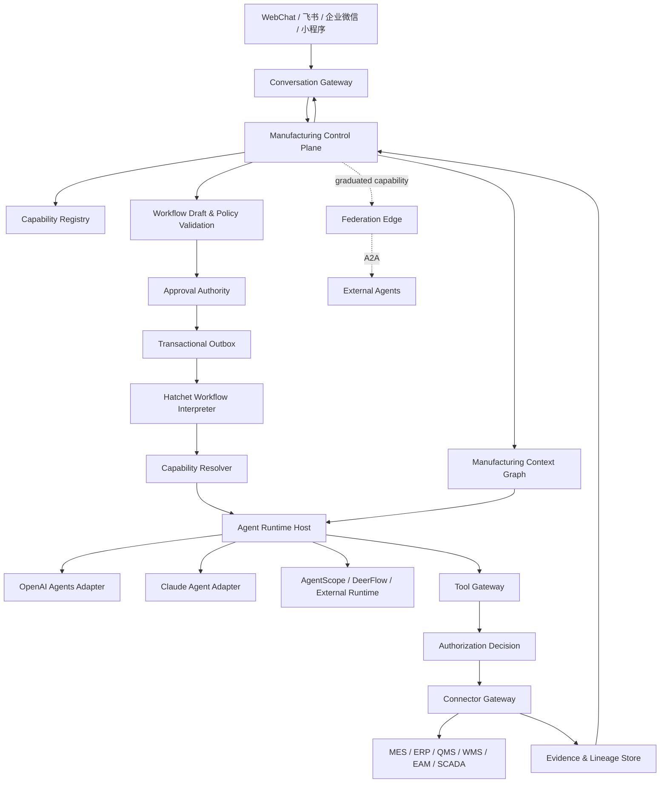

# 制造业数字员工平台：内部能力内核细节终审与兼容实施方案 v19

> 版本：v19.0
> 日期：2026-07-18
> 审查对象：v18《内部数字员工内核优先、外部 Agent 联邦兼容方案》
> 审查方法：从运行时语义、长任务可靠性、权限与数据安全、模型供应、制造业数据现实、渠道集成、开源依赖、未来 Agent 联邦八个角度逐项攻击。
> 最终判决：**v18 的主方向通过，不再推翻；但必须修正若干实现级阻断项，才能进入代码阶段。**

---

## 0. 终审结论

### 0.1 保留的主决策

```text
✅ 内部制造业数字员工优先，外部 Agent 联邦后置
✅ Manufacturing Control Plane 是业务权威核心
✅ 允许多个 Agent Runtime，不绑定单一模型或框架
✅ Dynamic Workflow 必须“生成草稿—校验—审批—执行”
✅ 所有工业系统访问经过 Connector Gateway
✅ Evidence、权限、审批和 Eval 是平台核心资产
✅ WebChat、飞书、企业微信、小程序只是渠道投影
✅ A2A 后期只作为联邦边缘协议，不替代内部 Workflow
✅ AgentTeams 只作为可选内部专家协作环境
```

### 0.2 必须修正的关键点

```text
1. 从 Agent-first 改为 Capability-first
2. 不在运行时生成 Hatchet 代码；改为通用 Workflow Interpreter
3. Control Plane 是唯一审批权威，SDK/Hatchet 只上报中断
4. Model Gateway 从“可选”升级为必选模型出口
5. OpenAI 默认 tracing 必须关闭或改写到自有 Evidence Store
6. Claude Agent SDK 必须运行在受限服务中，不能默认获得文件和 Shell 权限
7. AgentRuntimeAdapter 增加幂等、预算、恢复、事件游标和 Capability Token
8. 跨服务状态同步采用 transactional outbox/inbox，避免双写
9. Workflow DSL 必须限制能力、工具、循环、分支和副作用
10. Evidence 从文件引用升级为 Claim–Evidence–Lineage 模型
11. 恢复 Context Graph Lite 和 untrusted_text 污点传播
12. 渠道使用统一 Channel Contract；LangBot 只是可替换 Adapter
13. 授权服务必须先抽象 API，再决定 Casbin / OpenFGA / OPA
14. 外部联邦开放对象是“已毕业 Capability”，不是整个 Agent
```

### 0.3 新的一句话架构

> **以版本化制造业 Capability 为产品单元，以 Control Plane 管理任务、工作流、权限和证据，以通用 Workflow Interpreter 执行已批准流程，以可替换 Agent Runtime 实现 Capability，以 Connector Gateway 强制执行数据和动作策略；外部 A2A 只映射已毕业 Capability。**

---

# 1. 细节审查发现

## 1.1 v18 仍然是 Agent-first，不利于未来稳定互联

v18 主要定义：

```text
AgentDefinition
AgentVersion
AgentCapability
AgentRuntimeAdapter
```

问题是，外部用户和制造业业务真正依赖的是：

```text
“生产日报生成 v1”
“工单延期分析 v2”
“质量异常初判 v1”
```

而不是：

```text
“MES Analyst Agent 1.3.2”
```

同一个 Capability 未来可能由以下任一实现承担：

```text
OpenAI Agents SDK Agent
Claude Agent SDK Agent
AgentScope Agent
DeerFlow Worker
确定性分析程序
多个 Agent 组成的 Workflow
外部 A2A Agent
```

因此必须新增：

```text
CapabilityDefinition
CapabilityVersion
CapabilityImplementationBinding
CapabilityReleasePolicy
CapabilityEvalProfile
```

**Agent 是实现，Capability 才是稳定产品合同。**

---

## 1.2 “编译 WorkflowDraft 为 Hatchet Workflow”存在语义风险

v18 写的是：

```text
WorkflowDraft
→ 编译为 Hatchet Workflow / Durable Tasks
```

Hatchet 支持 Durable Tasks、DAG、事件等待、重试、子工作流和运行恢复，但平台不应在运行时把 LLM 输出转换为新代码并动态部署。

正确方式是：

```text
一个固定注册的 Hatchet Durable Task：
execute_workflow_version(workflowVersionId)

它读取版本化 WorkflowSpec
→ 按图解释执行
→ 调用固定注册的 step handlers
→ 写回 Control Plane
```

即：

```text
动态的是 Workflow 数据
稳定的是 Workflow Interpreter 代码
```

这样可以避免：

```text
运行时代码生成
Worker 重新部署
动态代码供应链风险
Hatchet 注册状态漂移
难以重放历史 Workflow
```

Hatchet 官方支持 Durable Task 在等待事件时持久化，并支持在 Durable Task 中生成子任务或子工作流，因此适合做解释器的可靠执行底座，而不是动态代码编译器。

---

## 1.3 审批目前有三套状态源

潜在审批点包括：

```text
Control Plane Approval
Hatchet durable event wait
OpenAI Agents SDK interruption / RunState
Claude Agent SDK permission request
```

如果每层各自保存审批结果，会出现：

```text
SDK 认为已批准，Control Plane 仍 pending
Hatchet 已恢复，业务审批已过期
渠道卡片重复点击导致多次推进
审批参数在等待期间被修改
```

必须确立：

> **Control Plane 的 ApprovalVersion 是唯一审批权威。**

其他组件只能：

```text
产生 approval_required 事件
等待 approval.resolved 事件
读取不可变 ApprovalVersion
```

审批必须绑定：

```text
精确 WorkflowVersion
精确 Step
精确工具
精确参数摘要与 hash
精确数据和动作上限
有效期
审批角色和责任范围
```

任何参数变化都生成新的 ApprovalVersion。

---

## 1.4 Model Gateway 不能继续是可选项

目标客户位于中国大陆，部署模式包括国内公有云和客户 VPC；同时需要支持：

```text
OpenAI
Claude
千问
豆包
DeepSeek
Kimi
客户私有化模型
```

因此 Model Gateway 必须从第一天成为唯一模型出口，至少提供：

```text
模型别名解析
Provider 路由
数据等级路由
租户策略
超时、限流、预算
请求和响应元数据审计
敏感字段脱敏
模型能力矩阵
失败回退
禁止直接出网
```

业务 Agent 只能声明：

```text
manufacturing.analysis.high
document.long_context
workflow.planner
verifier.strict
```

不能写死具体模型 ID。

---

## 1.5 OpenAI Agents SDK tracing 是明确的数据旁路

OpenAI Agents SDK JS/TS 在 Node.js 等服务端运行时默认启用 tracing，记录模型生成、工具调用、handoff 和 guardrail 等运行事件。

生产环境必须二选一：

```text
A. OPENAI_AGENTS_DISABLE_TRACING=1

B. 替换 Trace Processor：
   SDK event → Evidence Bridge → 自有 OpenTelemetry / Evidence Store
```

不得同时：

```text
把制造业数据路由到客户 VPC 模型
却把 trace 发送到外部 tracing 后端
```

此外，序列化 OpenAI `RunState` 时不能放入密钥或长期凭证；SDK 文档也提示持久化的运行上下文会随状态序列化。

---

## 1.6 Claude Agent SDK 不是普通无权限推理 SDK

Claude Agent SDK继承了 Claude Code 的工具、权限、Hooks、Subagents、Sessions 和 MCP 等能力。它可以读文件、运行命令，并通过 permission hooks 请求或拒绝工具调用。

因此在制造业平台中：

```text
Claude Agent SDK
≠ 默认可信的业务 Agent Runtime
```

使用规则：

```text
1. 单独 Agent Service 进程或容器
2. 默认 deny 文件写入、Shell 和公网
3. 只挂载明确的只读文档目录
4. 工业工具只能通过 Connector Gateway / MCP Gateway
5. PreToolUse hook 只做本地阻断，不替代平台授权
6. 所有工具调用仍必须携带任务级 Capability Token
```

对于纯结构化制造业分析，优先使用受控 function tools；Claude Agent SDK 更适合：

```text
长文档分析
实施方案
受控代码与脚本任务
需要 Session 和 Subagent 的复杂任务
```

---

## 1.7 AgentRuntimeAdapter 契约不够支持真正长任务

v18 的接口缺少：

```text
平台 Task ID
幂等键
预算
截止时间
权限委派
事件游标
断线重连
状态查询
暂停/恢复
Checkpoint 引用
Artifact
输出 schema
```

修订后的接口见第 8 章。

---

## 1.8 Control Plane 与 Hatchet 存在双写风险

例如：

```text
Hatchet Step 完成
→ 写 Hatchet 状态
→ 再写 Control Plane workflow_steps
```

若第二次写失败，会产生不一致。

修正：

```text
Control Plane 命令
→ transactional outbox
→ Workflow Dispatcher
→ Hatchet

Hatchet/Worker event
→ inbox 去重
→ 单事务更新 WorkflowStep + Evidence + outbox
```

每个事件必须有：

```text
eventId
aggregateId
aggregateVersion
idempotencyKey
occurredAt
producer
```

---

## 1.9 Workflow DSL 过于简化

v18 缺少：

```text
条件分支
Step timeout
整体 deadline
输出映射
失败路由
补偿步骤
数据等级传播
Agent 选择规则
用户输入等待
审批过期
有界循环
并发上限
```

但也不能一次支持通用编程语言。

正确选择是一个受限 DSL：

```text
DAG + 有界循环 + 条件表达式 + 事件等待
```

禁止：

```text
任意代码
任意 URL
任意工具名称
无限循环
运行时提高权限
运行时改变数据出域等级
```

---

## 1.10 Evidence 模型过薄

v18 的 `EvidenceRef` 只有：

```text
sourceSystem
sourceType
capturedAt
dataClass
contentHash
resourceScope
```

还不足以证明结论。

需要至少区分：

```text
Claim：最终输出中的一个事实、推断或建议
EvidenceItem：原始或派生证据
EvidenceLink：Claim 与 Evidence 的关系
Lineage：证据如何被查询、转换和聚合
```

证据必须记录：

```text
查询条件
数据时间范围
源系统记录 ID
Schema 版本
原始快照 URI 或受控摘要
转换程序版本
脱敏策略版本
来源时间与采集时间
访问权限和保留期
```

---

## 1.11 Context Graph 在 v18 中重新变成了名称，没有契约

必须恢复最小 Context Graph：

```text
domain_objects
domain_relations
external_object_mappings
object_aliases
```

用于解决：

```text
MES 设备编码与 EAM 设备编码不一致
ERP 物料与 MES 产品编码不一致
车间、产线、设备层级
工单、工序、批次关系
客户口语名称与系统名称映射
关系的生效和失效时间
```

没有这层，数字员工会长期依赖模糊字符串匹配。

---

## 1.12 v18 缺少间接提示注入和污点传播

以下内容全部视为不可信：

```text
MES 工单备注
质量异常描述
设备报警注释
供应商文件
用户上传文档
外部 Agent 输出
网页内容
```

Connector 返回必须按字段标注：

```text
structured_trusted
structured_unverified
untrusted_text
secret
```

污点规则：

```text
untrusted_text 可以用于摘要和分析
但不能单独决定 D1+ 动作的关键参数

D1+ 参数必须：
结构化来源支持
或 Verifier 复核
或人工明确确认
```

---

## 1.13 渠道策略仍然模糊

v18 写成：

```text
LangBot 或官方渠道 SDK
```

这会让实现团队没有明确边界。

修订决策：

```text
统一 Channel Contract 是平台资产。

飞书首选官方 SDK，便于精确控制身份、卡片和事件。
企业微信优先官方/官方维护 SDK。
当需要快速覆盖更多渠道时，再增加 LangBot Adapter。
```

LangBot 已支持飞书、企业微信、钉钉、微信和 Matrix，并具备插件、访问控制、限流和管理面板；但它必须只作为消息传输与投影服务，不能让其 Pipeline、Session 或 Agent 成为业务权威状态。

---

## 1.14 v18 的主路径组件数量仍然偏多

不能要求第一个可运行版本同时部署：

```text
Hatchet
Keycloak
Casbin
OpenFGA
OPA
Higress
LangBot
AgentTeams
AgentScope
DeerFlow
```

必须定义不同部署档位，见第 19 章。

---

# 2. 修订后的架构原则

```text
Capability-first
Control-Plane-first
Evidence-first
Policy-at-every-tool-call
Runtime-replaceable
Channel-projection-only
Federation-later
```

---

# 3. 修订后的总体架构



---

# 4. Capability-first 产品模型

## 4.1 CapabilityDefinition

```ts
type CapabilityDefinition = {
  id: string;
  displayName: string;
  description: string;
  domain: "document" | "production" | "quality" | "equipment" | "maintenance";

  inputSchemaRef: string;
  outputSchemaRef: string;

  maxDataClass: "C0" | "C1" | "C2" | "C3";
  maxActionLevel: "R0" | "R1" | "A1" | "D1" | "W1" | "W2" | "W3";

  evidencePolicyRef: string;
  authorizationPolicyRef: string;
  evalProfileRef: string;
};
```

## 4.2 CapabilityVersion

```ts
type CapabilityVersion = {
  capabilityId: string;
  version: string;
  status: "draft" | "shadow" | "internal" | "graduated" | "deprecated";

  inputSchemaDigest: string;
  outputSchemaDigest: string;

  implementationBindings: CapabilityImplementationBinding[];

  releaseNotes: string;
  createdAt: string;
};
```

## 4.3 CapabilityImplementationBinding

```ts
type CapabilityImplementationBinding = {
  id: string;
  capabilityId: string;
  capabilityVersion: string;

  implementationType:
    | "agent"
    | "workflow"
    | "deterministic"
    | "external";

  implementationRef: string;
  trafficWeight: number;

  deploymentModes: Array<"cn_cloud" | "customer_vpc" | "factory">;
  modelPolicyRef?: string;
};
```

### 核心原则

```text
用户请求 Capability
Control Plane 选择 CapabilityVersion
Capability Resolver 选择实现
Agent Runtime 只是其中一种实现
```

---

# 5. 权威状态模型

```text
Conversation
  └─ BusinessTask
       └─ WorkflowRun
            ├─ WorkflowStep
            │    └─ AgentTask
            └─ WorkflowStep
                 └─ ToolExecution
```

| 对象 | 权威存储 |
|---|---|
| Conversation / Message | Control Plane Postgres |
| BusinessTask | Control Plane Postgres |
| WorkflowDraft / Version | Control Plane Postgres |
| ApprovalVersion | Control Plane Postgres |
| WorkflowRun / Step 业务状态 | Control Plane Postgres |
| Hatchet Run ID / 执行游标 | Workflow binding |
| Agent Runtime Session | Runtime 自身，平台只保存引用 |
| Connector Action | Connector Gateway + Control Plane 映射 |
| Claim / Evidence / Lineage | Evidence Store |
| Artifact 文件 | S3-compatible Storage |
| Channel 卡片状态 | Channel projection/outbox |

---

# 6. Workflow 设计

## 6.1 两类 Workflow

### 预批准模板

用于稳定、低风险场景：

```text
生产日报
文档问答
只读工单查询
```

特点：

```text
WorkflowVersion 已审核
R0/R1 范围内可直接运行
不要求每次重新审批 Workflow
高风险 Step 仍独立审批
```

### Agent 生成 Workflow

用于复杂、非标准任务：

```text
Agent 生成 Draft
→ 静态校验
→ 权限和成本预览
→ 人工批准
→ 创建不可变 WorkflowVersion
→ 运行
```

这既满足“Agent 可生成 Workflow，但需要人工确认”，又避免所有简单查询都先审批计划。

---

## 6.2 受限 Workflow DSL

```ts
type WorkflowSpec = {
  schemaVersion: "1.0";
  id: string;
  version: number;
  goal: string;

  deadlineSeconds: number;
  maxParallelSteps: number;
  maxTotalCostCny?: number;

  inputs: Record<string, WorkflowValueRef>;

  steps: WorkflowStepSpec[];

  outputMapping: Record<string, WorkflowValueRef>;

  dataPolicy: {
    maxDataClass: "C0" | "C1" | "C2" | "C3";
    allowedEgressClasses: Array<"C0" | "C1" | "C2" | "C3">;
  };

  actionPolicy: {
    maxActionLevel: "R0" | "R1" | "A1" | "D1" | "W1" | "W2" | "W3";
  };
};
```

```ts
type WorkflowStepSpec = {
  id: string;

  kind:
    | "capability"
    | "deterministic"
    | "tool"
    | "approval"
    | "verification"
    | "wait";

  dependsOn: string[];
  condition?: SafeExpression;

  capabilityRef?: {
    id: string;
    versionRange: string;
  };

  handlerRef?: string;
  inputMapping: Record<string, WorkflowValueRef>;
  outputSchemaRef: string;

  timeoutSeconds: number;

  retryPolicy: {
    maxAttempts: number;
    backoff: "fixed" | "exponential";
    retryableErrorCodes: string[];
  };

  sideEffectClass: "read" | "analyze" | "draft" | "write";
  idempotencyPolicyRef: string;

  compensationStepId?: string;
};
```

限制：

```text
只允许登记过的 capability、handler 和 tool
循环必须有最大次数
表达式使用受限解释器
禁止任意 JavaScript/Python
禁止任意 URL
禁止运行时提高 data/action ceiling
```

---

## 6.3 Hatchet Workflow Interpreter

平台只注册固定任务：

```text
execute_workflow_version
execute_capability_step
execute_tool_step
wait_for_approval
verify_step_output
```

解释执行流程：

```text
读取 WorkflowVersion
→ 校验版本和批准状态
→ 构建可运行节点
→ 使用 durable child tasks 执行
→ 等待审批/输入事件时释放 Worker
→ 保存 StepResult
→ 根据图继续
```

Hatchet 只负责 durable execution，不负责业务授权和 Workflow 的最终合法性。

---

# 7. 审批模型

## 7.1 ApprovalVersion

```ts
type ApprovalVersion = {
  id: string;
  taskId: string;
  workflowRunId: string;
  workflowVersionId: string;
  stepId: string;

  requestType:
    | "workflow_approval"
    | "tool_approval"
    | "data_egress"
    | "budget_extension"
    | "write_action";

  payloadHash: string;
  payloadSnapshotRef: string;

  requestedBy: string;
  requiredRoles: string[];
  resourceScopes: string[];

  expiresAt: string;
  status: "pending" | "approved" | "rejected" | "expired" | "superseded";

  decisionBy?: string;
  decisionAt?: string;
};
```

## 7.2 SDK 中断映射

```text
OpenAI interruption
Claude permission request
Hatchet wait
渠道审批卡片
```

全部映射为同一个平台 `ApprovalVersion`。

只有：

```text
approval.status = approved
且 payloadHash 未变化
且未过期
```

Workflow 才能继续。

---

# 8. Agent Runtime Host 与接口

## 8.1 不先拆成大量独立微服务

首个部署可使用：

```text
agent-runtime-host
  ├─ OpenAIAgentsAdapter
  └─ ClaudeAgentAdapter
```

当安全隔离、资源或团队边界需要时，再拆成独立服务。

Claude 使用文件/Shell时必须单独容器化。

---

## 8.2 修订后的 Adapter

```ts
export type AgentTaskInput = {
  platformTaskId: string;
  workflowRunId: string;
  workflowStepId: string;

  idempotencyKey: string;
  tenantId: string;

  agentDefinitionId: string;
  agentVersion: string;

  capability: {
    id: string;
    version: string;
  };

  input: unknown;
  inputSchemaRef: string;
  outputSchemaRef: string;

  contextPacketRef: string;
  delegatedCapabilityToken: string;

  modelPolicyRef: string;
  toolsetRef: string;
  evidencePolicyRef: string;

  budget: {
    maxTurns: number;
    maxInputTokens?: number;
    maxOutputTokens?: number;
    maxCostCny?: number;
    deadlineAt: string;
  };
};
```

```ts
export interface AgentRuntimeAdapter {
  describe(agentRef: AgentRef): Promise<AgentDescriptor>;

  createTask(input: AgentTaskInput): Promise<RuntimeTaskRef>;

  getTask(ref: RuntimeTaskRef): Promise<AgentTaskSnapshot>;

  streamEvents(
    ref: RuntimeTaskRef,
    options?: { afterCursor?: string },
  ): AsyncIterable<AgentTaskEvent>;

  submitHumanInput(
    ref: RuntimeTaskRef,
    input: HumanInput,
    idempotencyKey: string,
  ): Promise<void>;

  resolveInterruption(
    ref: RuntimeTaskRef,
    input: RuntimeInterruptionResolution,
  ): Promise<void>;

  pauseTask(ref: RuntimeTaskRef): Promise<void>;
  resumeTask(ref: RuntimeTaskRef): Promise<void>;
  cancelTask(ref: RuntimeTaskRef): Promise<void>;

  getCheckpoint(ref: RuntimeTaskRef): Promise<RuntimeCheckpointRef | null>;
  getHealth(agentRef: AgentRef): Promise<AgentHealth>;
}
```

## 8.3 AgentTask 状态

```ts
type AgentTaskState =
  | "queued"
  | "working"
  | "input_required"
  | "approval_required"
  | "paused"
  | "blocked"
  | "completed"
  | "failed"
  | "timed_out"
  | "canceled"
  | "rejected";
```

## 8.4 Event Envelope

```ts
type AgentTaskEvent = {
  eventId: string;
  taskId: string;
  cursor: string;
  sequence: number;

  type:
    | "task.started"
    | "agent.message.delta"
    | "agent.message.completed"
    | "tool.requested"
    | "tool.completed"
    | "approval.required"
    | "input.required"
    | "artifact.created"
    | "checkpoint.created"
    | "task.completed"
    | "task.failed";

  payload: unknown;
  evidenceRefs: string[];
  occurredAt: string;
};
```

---

# 9. Model Gateway

## 9.1 必选能力

```text
模型别名
租户路由
国内 Provider
私有化 Provider
OpenAI/Anthropic 协议
数据等级路由
预算
限流
故障回退
审计
脱敏
出网控制
```

## 9.2 ModelCapability Matrix

```ts
type ModelCapability = {
  provider: string;
  model: string;

  supportsTools: boolean;
  supportsStructuredOutput: boolean;
  supportsParallelTools: boolean;
  supportsVision: boolean;
  supportsReasoning: boolean;
  supportsStreaming: boolean;

  maxContextTokens: number;

  deploymentClass:
    | "cn_public_cloud"
    | "customer_vpc"
    | "factory_private";

  allowedDataClasses: Array<"C0" | "C1" | "C2" | "C3">;
};
```

每次模型变更必须执行 Provider Conformance Test：

```text
tool call schema
structured output
streaming
timeout
retry
token accounting
中文制造业术语
敏感内容脱敏
```

---

# 10. Context Packet 与 Context Graph

## 10.1 ContextPacket

```ts
type ContextPacket = {
  id: string;
  tenantId: string;
  taskId: string;

  requester: {
    userId: string;
    roles: string[];
    resourceScopes: string[];
  };

  conversation: {
    conversationId: string;
    audienceType: "private" | "group";
    allowedDataClasses: string[];
  };

  businessContext: {
    objectRefs: string[];
    timeRange?: {
      start: string;
      end: string;
    };
  };

  inputRefs: string[];
  relevantMemoryRefs: string[];
  evidenceRefs: string[];

  dataClassification: "C0" | "C1" | "C2" | "C3";
  trustLabels: Record<string, TrustLabel>;

  capabilityTokenRef: string;
  expiresAt: string;
};
```

混合数据的包级等级取最高值；字段级标签仍保留。

## 10.2 Context Graph Lite

```text
domain_objects
- id
- tenant_id
- object_type
- canonical_code
- display_name
- attributes
- valid_from
- valid_to

domain_relations
- source_object_id
- relation_type
- target_object_id
- valid_from
- valid_to

external_object_mappings
- source_system
- external_type
- external_id
- domain_object_id
- confidence
- verified_by

object_aliases
- domain_object_id
- alias
- locale
- source
```

---

# 11. Tool 与 Connector Gateway

## 11.1 Delegated Capability Token

Agent 不持有员工或系统的长期令牌。

每次任务签发短期能力：

```ts
type DelegatedCapability = {
  tokenId: string;
  tenantId: string;

  requestedBy: string;
  actingAgent: string;

  platformTaskId: string;
  workflowRunId: string;

  allowedCapabilities: string[];
  allowedTools: string[];
  resourceScopes: string[];

  maxDataClass: "C0" | "C1" | "C2" | "C3";
  maxActionLevel: "R0" | "R1" | "A1" | "D1" | "W1" | "W2" | "W3";

  audienceScope: string[];
  expiresAt: string;
};
```

Connector Gateway 每次调用重新校验。

## 11.2 ConnectorAction 修订

```ts
type ConnectorAction = {
  id: string;
  version: string;

  inputSchemaRef: string;
  outputSchemaRef: string;

  inputDataClasses: string[];
  outputDataClass: "C0" | "C1" | "C2" | "C3";
  actionLevel: "R0" | "R1" | "A1" | "D1" | "W1" | "W2" | "W3";

  sideEffectClass: "read" | "analyze" | "draft" | "write";

  idempotency: {
    supported: boolean;
    keyScope?: "tenant" | "resource" | "global";
    retentionSeconds?: number;
  };

  compensationActionRef?: string;
  approvalPolicyRef: string;
  evidencePolicyRef: string;

  allowedResourceTypes: string[];
};
```

## 11.3 Typed Tool Result

```ts
type ToolResult<T> = {
  data: T;

  dataClass: "C0" | "C1" | "C2" | "C3";
  trustLabels: Record<string, TrustLabel>;

  evidenceRefs: string[];
  lineageRef: string;

  warnings: string[];
  missingFields: string[];
};
```

---

# 12. Claim、Evidence 与 Lineage

## 12.1 Claim

```ts
type Claim = {
  id: string;
  taskId: string;

  claimType: "fact" | "inference" | "recommendation" | "uncertainty";
  text: string;

  confidence?: number;
  evidenceLinkIds: string[];

  generatedBy: string;
  verifiedBy?: string;
};
```

## 12.2 EvidenceItem

```ts
type EvidenceItem = {
  id: string;
  tenantId: string;

  sourceSystem: string;
  sourceRecordIds: string[];

  sourceTimestamp?: string;
  capturedAt: string;

  querySnapshotRef: string;
  contentSnapshotRef?: string;

  schemaVersion: string;
  transformationVersion?: string;
  desensitizationPolicyVersion?: string;

  contentHash: string;

  dataClass: "C0" | "C1" | "C2" | "C3";
  resourceScopes: string[];

  retentionPolicyRef: string;
};
```

## 12.3 Lineage

```text
源记录
→ 查询参数
→ Connector 结果
→ Deterministic 转换
→ Agent 输入
→ Claim
→ 最终报告
```

证据存储必须遵守租户权限和保留期，不能默认永久保存 C2/C3 原始快照。

---

# 13. 安全基线

## 13.1 模型与 tracing

```text
所有模型调用只经 Model Gateway
OpenAI SDK tracing 默认关闭或替换
所有第三方 telemetry 显式关闭或登记
Agent Worker egress allowlist
```

## 13.2 提示注入

```text
自由文本统一标记 untrusted_text
平台策略不进入模型裁决
D1+ 参数必须有结构化 Evidence
外部 Agent 输出默认 untrusted
```

## 13.3 Sandbox

```text
Claude Code/Agent 工具运行于隔离容器
默认无宿主机写权限
默认无公网
只挂载任务 Workspace
生产凭证不进入 Agent 容器
```

## 13.4 供应链

```text
锁定依赖版本
生成 SBOM
容器镜像签名
密钥轮换预案
高风险依赖升级需安全审查
```

## 13.5 审计

```text
所有 Policy Decision
所有 Tool Request
所有 ApprovalVersion
所有 Connector Action
所有输出受众过滤
全部记录为不可变审计事件
```

---

# 14. 授权架构

平台对上只暴露统一接口：

```ts
interface AuthorizationService {
  decide(input: AuthorizationInput): Promise<AuthorizationDecision>;
}
```

MVP 可以使用：

```text
Postgres 资源范围 + Casbin domain RBAC
```

复杂制造业关系出现后切换：

```text
OpenFGA：用户、组织、工厂、车间、产线、设备关系
OPA：班次、渠道、数据等级、动作等级和环境条件
```

业务代码不直接依赖 Casbin/OpenFGA/OPA 的具体模型。

权限公式：

```text
员工授权
∩ Agent capability ceiling
∩ Workflow approved scope
∩ Conversation audience scope
∩ Connector policy
= 有效权限
```

---

# 15. Conversation 与 Channel

## 15.1 Canonical Message Model

```ts
type ChannelEnvelope = {
  channel: "web" | "feishu" | "wecom" | "dingtalk" | "miniapp";

  tenantExternalId: string;
  externalEventId: string;
  externalConversationId: string;
  externalMessageId: string;
  externalUserId: string;

  contentType: "text" | "file" | "image" | "card_action";
  content: unknown;

  receivedAt: string;
};
```

## 15.2 Channel Gateway 必须提供

```text
事件签名验证
身份映射
消息去重
Conversation 映射
附件落库
状态卡片投影
审批回调
Outbox 重试
```

## 15.3 采用顺序

```text
第一个正式渠道：
官方 SDK

渠道数量快速扩展时：
增加 LangBot Adapter
```

LangBot 不能直连 Runtime 或 Connector Gateway。

---

# 16. Agent 管理

## 16.1 AgentDefinition

```ts
type AgentDefinition = {
  id: string;
  displayName: string;
  role: string;

  supportedCapabilities: string[];

  capabilityCeiling: {
    maxDataClass: "C0" | "C1" | "C2" | "C3";
    maxActionLevel: "R0" | "R1" | "A1" | "D1" | "W1" | "W2" | "W3";
  };

  runtimeProfileRef: string;
  harnessProfileRef: string;
  evalProfileRef: string;
};
```

## 16.2 AgentVersion 不可变

```text
instructionsDigest
toolsetVersion
modelPolicyVersion
runtimeAdapterVersion
outputSchemaDigest
evalBaselineId
```

任何一项变化产生新 AgentVersion。

## 16.3 不先做完整 UI

```text
YAML + Git
API
CLI
极简状态页
```

---

# 17. Eval 与 Capability Graduation

## 17.1 三层 Eval

### 单元层

```text
Schema
Tool permissions
Connector mapping
Deterministic calculations
```

### Capability 层

```text
真实案例
Evidence coverage
事实正确率
拒答和数据缺失行为
成本和延迟
模型切换回归
```

### Workflow 层

```text
步骤完整性
审批行为
故障恢复
幂等
跨 Agent 一致性
```

## 17.2 Graduation 状态

```text
draft
→ shadow
→ internal
→ graduated
→ external-preview
→ external
```

## 17.3 Graduation 要求

```text
版本化回归集
专家评分和评分者一致性
关键错误记录
Evidence 完整率
权限攻击测试
提示注入测试
模型版本固定
成本上限
故障恢复测试
持续抽检和回炉机制
```

对外 A2A 只能暴露 `external-preview` 或 `external` 的 CapabilityVersion。

---

# 18. 首批业务闭环

## 18.1 Capability：solution.analysis.v1

输入：

```text
需求文档
会议纪要
产品资料
现状系统清单
```

Workflow：

```text
document_ingest
→ requirement_extract
→ contradiction_check
→ solution_design
→ evidence_verify
→ human_review
→ report_publish
```

验收：

```text
每个关键结论有引用
需求和假设分离
冲突明确列出
无法确认内容标注未知
输出符合结构化 schema
```

## 18.2 Capability：production.daily-report.v1

输入：

```text
MES 工单汇总
ERP 订单摘要
QMS 质量汇总
人工说明
```

Workflow：

```text
context_resolve
→ deterministic_summary
→ anomaly_analysis
→ report_draft
→ claim_evidence_check
→ verifier
→ human_signoff
→ publish
```

验收：

```text
确定性指标由程序计算
Agent 不重新计算关键数值
数据缺失显式显示
建议与事实分离
所有异常有 Evidence
```

---

# 19. 部署档位

## 19.1 开发档

```text
Postgres
本地或 S3-compatible Artifact
Control Plane
Agent Runtime Host
Connector Mock
WebChat
```

Hatchet可使用本地/自托管开发环境。

## 19.2 内部试点档

```text
Postgres
Hatchet
Object Storage
Control Plane
Model Gateway
Agent Runtime Host
Connector Gateway
WebChat
一个正式 IM 渠道
OIDC
```

## 19.3 客户 VPC 档

```text
外部数据库或高可用 Postgres
自托管 Hatchet
客户 OIDC / Keycloak
Model Gateway
Egress Proxy
Secrets/KMS
Object Storage
审计和备份
多 Runtime Worker
正式 Connector
```

AgentTeams、DeerFlow、AgentScope、LangBot均为按需组件，不是所有部署必须安装。

---

# 20. 能力门

## Gate 0：合同和模拟器

```text
Capability Schema
AgentRuntimeAdapter
Workflow DSL
Tool Contract
Evidence Contract
Channel Contract
Connector Mock
```

## Gate A：单 Capability 内部闭环

```text
一个 Runtime
一个 Capability
一个只读 Connector
结构化输出
Evidence
权限
```

## Gate B：固定多 Agent Workflow

```text
Planner / 专业 Agent / Verifier
Hatchet 恢复
AgentTask event replay
```

## Gate C：生成 Workflow + 审批

```text
WorkflowDraft
静态校验
风险预览
ApprovalVersion
Interpreter 执行
```

## Gate D：真实数据

```text
接通一个真实只读系统
Context mapping
数据质量报告
权限和审计验收
```

## Gate E：多渠道

```text
WebChat
飞书或企微
统一 Conversation
Channel Outbox
审批卡片
```

## Gate F：第二 Runtime

```text
OpenAI 与 Claude 两个 Adapter
同一 Capability 做对照 Eval
Runtime 可替换
```

## Gate G：Capability Graduation

```text
Shadow
Internal
Graduated
持续抽检
```

## Gate H：专家协作

```text
AgentTeams 可选接入
只做协作投影
```

## Gate I：外部联邦

```text
A2A mapping
External Agent trust
Inbound/outbound 只读试点
```

---

# 21. 核心数据表

```text
tenants
users
external_identities
roles
resource_scopes

conversations
conversation_members
messages
channel_installations
channel_events
channel_outbox

business_tasks

capability_definitions
capability_versions
capability_implementation_bindings
capability_release_policies

workflow_drafts
workflow_versions
workflow_runs
workflow_steps
workflow_run_bindings

approval_versions

agent_definitions
agent_versions
agent_deployments
agent_health

agent_tasks
agent_task_events
runtime_checkpoints

tool_definitions
tool_versions
tool_executions

connector_definitions
connector_actions
connector_executions
idempotency_records

domain_objects
domain_relations
external_object_mappings
object_aliases

claims
evidence_items
evidence_links
lineage_records
artifacts

policy_decisions
delegated_capabilities
audit_events

model_routes
model_capabilities
model_invocations

eval_cases
eval_runs
eval_scores

outbox_events
inbox_events

external_agents          # 后置
agent_trust_records      # 后置
federation_calls         # 后置
```

---

# 22. 推荐代码结构

```text
manufacturing-agent-platform/
├── apps/
│   ├── control-plane/
│   ├── conversation-gateway/
│   ├── web-chat/
│   ├── channel-gateway/
│   ├── workflow-interpreter/
│   ├── agent-runtime-host/
│   ├── tool-gateway/
│   ├── connector-gateway/
│   └── federation-edge/              # 后置
│
├── packages/
│   ├── capability-contracts/
│   ├── workflow-contracts/
│   ├── agent-runtime-contracts/
│   ├── tool-contracts/
│   ├── channel-contracts/
│   ├── authorization-contracts/
│   ├── context-graph/
│   ├── evidence-contracts/
│   ├── model-routing/
│   ├── outbox/
│   └── a2a-mapping/                  # 后置
│
├── runtime-adapters/
│   ├── openai-agents/
│   ├── claude-agent/
│   ├── agentscope/                   # 可选
│   ├── deerflow/                     # 可选
│   └── a2a/                          # 后置
│
├── channel-adapters/
│   ├── feishu/
│   ├── wecom/
│   └── langbot/                      # 可选
│
├── connectors/
│   ├── mes/
│   ├── erp/
│   ├── qms/
│   ├── wms/
│   ├── eam/
│   └── scada/
│
├── infra/
│   ├── postgres/
│   ├── hatchet/
│   ├── object-storage/
│   ├── model-gateway/
│   ├── oidc/
│   └── egress-proxy/
│
└── docs/
    ├── adr/
    ├── capabilities/
    ├── workflows/
    ├── policies/
    ├── connectors/
    └── evals/
```

---

# 23. 修订后的 ADR

## ADR-001：Capability 是产品合同，Agent 是实现

## ADR-002：Control Plane 是唯一业务权威

## ADR-003：动态 Workflow 是版本化数据，不是动态代码

## ADR-004：Hatchet 执行通用 Workflow Interpreter

## ADR-005：Control Plane ApprovalVersion 是唯一审批权威

## ADR-006：Model Gateway 是唯一模型出口

## ADR-007：OpenAI tracing 默认关闭或写入自有 Evidence Bridge

## ADR-008：Claude Agent SDK 必须运行在受限工具和 Sandbox 策略下

## ADR-009：工业访问只经 Connector Gateway

## ADR-010：Claim–Evidence–Lineage 是输出合同

## ADR-011：Context Graph Lite 是制造业对象解析基础

## ADR-012：自由文本和外部 Agent 输出默认不可信

## ADR-013：平台通过 AuthorizationService 抽象权限实现

## ADR-014：渠道只做 Conversation 投影

## ADR-015：内部契约兼容 A2A 语义，但 A2A 仅在联邦边缘启用

## ADR-016：只有已毕业 Capability 可对外开放

---

# 24. 非目标

当前不做：

```text
开放 Agent 市场
未知 Agent 自动注册
任意 Workflow 代码生成
动态 Workflow 无审批执行
外部 Agent 直连工业系统
W2/W3 控制动作
完整 Agent 运营大后台
Matrix 作为客户唯一入口
所有可选开源项目一次性部署
```

---

# 25. 最终终审判决

v18 的“内部数字员工内核优先”方向正确，不应再次推翻。

真正需要收敛的是实现单元：

```text
不是围绕 Agent 建平台
而是围绕制造业 Capability 建平台

不是让 LLM 生成 Hatchet 代码
而是让固定 Interpreter 执行批准后的 Workflow 数据

不是让 SDK、渠道和 Workflow Engine 分别管理审批
而是让 Control Plane 保持单一审批权威

不是只保存报告和 trace
而是保存 Claim–Evidence–Lineage

不是第一天建设外部 Agent 联邦
而是第一天让内部合同可以平滑映射到未来 A2A
```

最终原则：

> **先把每一个制造业 Capability 做成可版本化、可评测、可授权、可取证、可替换实现的内部产品；外部 Agent 互联只是这些成熟 Capability 的第二种访问方式。**

---

# 26. 资料引用

## OpenAI

- OpenAI Agents SDK JS/TS
  https://openai.github.io/openai-agents-js/

- Human-in-the-loop
  https://openai.github.io/openai-agents-js/guides/human-in-the-loop/

- Tracing
  https://openai.github.io/openai-agents-js/guides/tracing/

- Sessions
  https://openai.github.io/openai-agents-js/guides/sessions/

- Models / ModelProvider
  https://openai.github.io/openai-agents-js/guides/models/

## Anthropic

- Claude Agent SDK Overview
  https://docs.anthropic.com/en/docs/claude-code/sdk

- Claude Code Security
  https://docs.anthropic.com/en/docs/claude-code/security

- Claude Agent SDK TypeScript Reference
  https://docs.anthropic.com/en/docs/claude-code/sdk/sdk-typescript

## Workflow 与 UI

- Hatchet
  https://github.com/hatchet-dev/hatchet

- Hatchet Durable Event Waits
  https://docs.hatchet.run/v1/durable-event-waits

- Hatchet Durable Tasks vs DAGs
  https://docs.hatchet.run/cookbooks/durable-tasks-vs-dags

- AG-UI
  https://docs.ag-ui.com/introduction

- AG-UI Interrupts
  https://docs.ag-ui.com/concepts/interrupts

## 渠道与可选协作

- LangBot
  https://github.com/langbot-app/LangBot

- AgentScope 2.0
  https://github.com/agentscope-ai/agentscope

- AgentTeams
  https://github.com/agentscope-ai/AgentTeams

## 身份与授权

- Keycloak
  https://www.keycloak.org/docs/latest/server_admin/

- Casbin RBAC with Domains
  https://casbin.apache.org/docs/rbac-with-domains/

- OpenFGA
  https://openfga.dev/docs/authorization-concepts

- Open Policy Agent
  https://www.openpolicyagent.org/docs

## 后续联邦

- A2A Protocol
  https://a2a-protocol.org/latest/specification/

- Model Context Protocol
  https://modelcontextprotocol.io/
